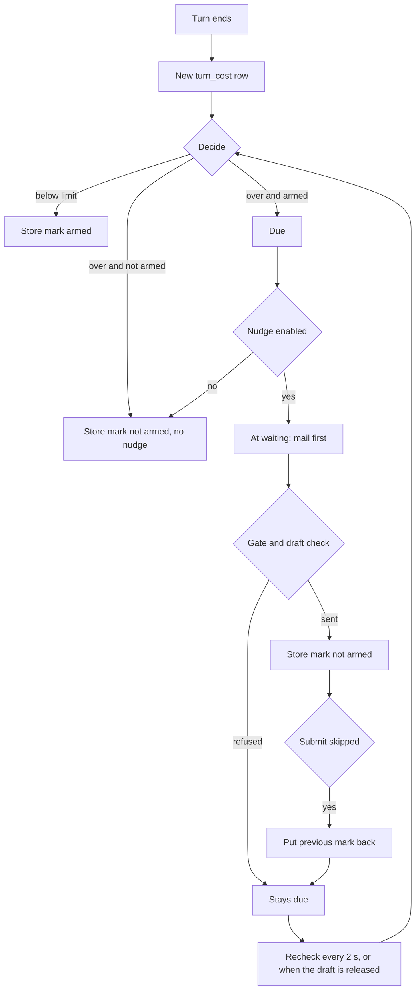

# Context-limit nudge (#689)

When a harness's context grows past a limit the user set, Skein pastes
one short message into that harness at its next stopping point. The
message tells the agent to tell the user that it is time to hand over or
start a fresh session. Skein does nothing else: no compaction, no
restart, no handover.

## Configuration

Both live in Settings, and both are saved in `settings.json`
(`SpawnSettings`, `crates/skein-daemon/src/spawn_settings.rs`).

- **The limit**: `contextThreshold`, in tokens, set in the Agents
  section. Unset means off, and then no harness is ever nudged. While it
  is unset the marks still follow the newest row, armed, so a limit set
  later judges only rows that land after it.
- **The nudge**: `contextNudge { enabled, body }`, set in the Nudges
  section (`app/src/ContextNudgeRow.tsx`). It is on by default. A blank
  `body` means the default text. `{tokens}` and `{limit}` in the body
  become plain integers.

The agent can also read the same two numbers itself with the
`context_status` verb, see [agent-api.md](agent-api.md#context_status).
That verb sends nothing.

## Rules

1. Each new `turn_cost` row is judged once. Its context size is compared
   with the limit. A size equal to the limit counts as over.
2. A row below the limit arms the harness. Only a row below the limit
   arms it.
3. A row at or over the limit while the harness is armed is due: one
   nudge, then the harness is disarmed.
4. A row over the limit while the harness is not armed sends nothing.
   So a harness that is already over the limit when first seen is not
   nudged until it drops below and crosses again.
5. A crossing while the nudge is switched off is recorded as sent. It
   never fires later when the nudge is switched on.
6. The mark (newest row id and armed flag) is stored per harness in the
   table `context_nudge_marks`. A restart of Skein does not re-nudge.
7. A spawn marks the newest row as seen, so a stale row (left by the
   previous session or written while the daemon was down) sends nothing.
   The mark is armed if that row is below the limit or there is no limit;
   otherwise it keeps its armed flag.
8. The mark is stored when the paste succeeds. A nudge that is refused
   (mail in flight, a user draft, the gate closed) stays due and is tried
   again. If the submit is then skipped (the user typed, or the harness
   left its stopping point), the previous mark is put back and the nudge
   is due again at the next stopping point.
9. Mail goes first. The check runs after the mail layer for the same
   transition.
10. Hermes reports no context size, so it never gets a nudge.

## Flow

Renders the sections above and `prompt_delivery/context_nudge.rs` and
`context_flow.rs`. Non-normative: the text is authoritative.

1. The harness ends a turn and the daemon records a `turn_cost` row.
2. `decide` compares the newest row with the stored mark and the limit.
3. Below the limit, the mark is stored as armed. Over the limit and
   armed, a nudge is due. Over the limit and not armed, the mark is
   stored and nothing is sent.
4. A due nudge is dropped (mark stored, nothing sent) when the nudge is
   switched off.
5. Otherwise the nudge waits for the harness to be `waiting`, after any
   mail.
6. The send gate and the draft check run. If the paste succeeds, the
   mark is stored as not armed.
7. If the send is refused, the nudge stays due and is rechecked.

## Rechecks and the opencode late row

opencode writes its `turn_cost` row in a separate SSE frame, so the row
can land after the transition to `waiting`. One check on the transition
would miss it. So after a check on a transition to `waiting`, the
harness is rechecked every 2 s (`RECHECK_INTERVAL_MS`):

- For 10 s when the check found nothing due (`QUIET_WINDOW_MS`).
- For 60 s while a due nudge keeps being refused (`REFUSED_WINDOW_MS`).

Rechecks stop when a check stores a mark or sends a nudge, when the
harness leaves `waiting`, on a new spawn, and when the harness is
forgotten (stopped, removed, room archived). A new spawn gives a harness
with no mark its first one, so a first turn that passes the limit is
nudged.

A refused nudge is rechecked for 60 s only, but a user draft can last
longer. So when the client reports that the draft was released or input
changed (`ClientFactsChanged`), a `waiting` harness is checked at once,
after the mail layer.

## Where the code is

All under `crates/skein-daemon/src/`:

- `prompt_delivery/context_nudge.rs`: `DEFAULT_BODY`, `render`, and the
  pure `decide`.
- `prompt_delivery/context_flow.rs`: `ContextFlow`, the layer in
  `DeliveryCore` that checks on transitions, sends through the `Sender`
  and runs the rechecks.
- `db/context_nudge.rs`: the `context_nudge_marks` table.
- `spawn_settings.rs`: `context_threshold` and `context_nudge`.
- `agent_api/verbs/context_status.rs`: the read-only verb.

The Settings row is `app/src/ContextNudgeRow.tsx`, mounted in
`app/src/NudgesPanel.tsx`.
