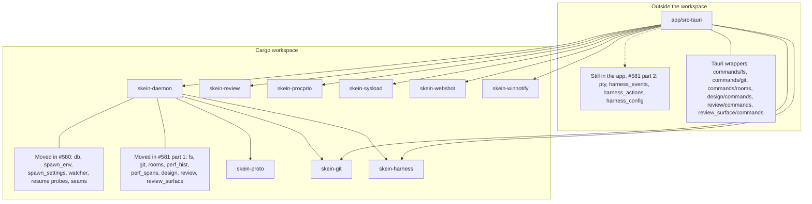

# Crates: the server side leaves the app (#580)

Phase 1d of the skeind extraction (epic #575, docs/skeind-recon.md, #580)
moved the Tauri-free leaf modules out of `app/src-tauri` into two new
workspace crates. Phase 1e part 1 (#581) moved the next layer: files, git,
the room load, perf, the design server and the review surface. Behaviour
is unchanged: the app re-exports every moved module at its old path, so no
importer changed. Part 2 of #581 (the PTY and harness engines) is still to
come.

Figure: crate layout after #581 part 1, arrows pointing from a crate to
what it depends on, with what each of the two sides holds. Renders the
`[dependencies]` path entries of each `Cargo.toml` and the module lists
below; non-normative, the manifests and the text are authoritative.

## The two crates and the rule

- `crates/skein-proto` is wire types: plain data that skeind and its
  clients both need to name. serde (and serde_json) only, no logic. It has
  `PROTO_VERSION: u32 = 1`, the `Room`/`Harness` family (`rooms`),
  `HarnessEvent`/`HarnessAction` (`harness_log`), `HarnessKind`
  (`harness_kind`), `PendingDto`/`TranscriptStatDto` (`resume`) and
  `DropReason` (`spawn_env`). There is no `hello` handshake (#584) and no
  wire framing; framing waits for the transport phase (#585/#582, open
  question 9 in skeind-recon.md).
- `crates/skein-daemon` is the Tauri-free server side. `cargo tree -p
  skein-daemon` lists no tauri. It depends on skein-proto, skein-harness
  and skein-git.

The rule: a type that crosses the wire and carries no behaviour goes in
skein-proto. Code that runs on the server and needs no Tauri goes in
skein-daemon. Anything that touches `tauri::*` stays in the app.

## What moved into skein-daemon

`db/` (the sqlite layer), `spawn_env` (+ `login_env`), `spawn_settings`
(+ `env_profile`, `priority`), `tool_groups` (was `agent_api/groups.rs`),
`watcher`, `ignore_filter`, `worktree_key` (`relative_key`, was in
`review.rs`), `room_paths`, `resume` (the session-probe logic) and
`harness_kind` (re-exported from skein-proto). With them go the three
seams from phases 1a to 1c: `event_sink`, `stream_sink` and `paths`.

### Added by #581 part 1

- `fs`, `git`: the `_impl` logic and DTOs. The Tauri wrappers stay in the
  app's `commands/fs.rs` and `commands/git.rs`.
- `rooms`: the `load_rooms` logic; the wrapper stays in `commands/rooms.rs`
  (`todos.rs` is unchanged).
- `perf_hist`, and `perf_spans` (`SpanAgg`, `SpanSnapshot`,
  `REVIEW_DISCOVERY_BATCH`). The app's `perf_spans.rs` keeps the other
  statics and the drain.
- `design/`: `serve`, `rewrite`, `device`, `change_filter`, `entries` (the
  logic split out of the old `design/commands.rs`) and the `.js` shims. The
  app keeps `design/mod.rs` (a glob re-export) and `design/commands.rs`
  (the Tauri wrappers).
- `review` and `review/discovery`: baselines and discovery.
  `REVIEW_CHANGED_EVENT` and `ReviewChanged` are defined in
  `skein_daemon::review`; `agent_api/state.rs` re-exports them. The app
  keeps `review.rs` and `review/commands.rs` (4 Tauri wrappers).
- `review_surface` (the root is `review_surface.rs`) and everything under
  it except `commands.rs`. The app keeps `review_surface.rs` (a glob
  re-export), `review_surface/commands.rs` (15 Tauri commands) and
  `element_agent_tests.rs`, a test that needs `agent_api`.

## What stayed in the app, and why

- The engines, for part 2 of #581: `pty/`, `harness_events_*`,
  `harness_actions_*` and `harness_config`.
- `agents.rs`: Tauri-free, but it needs `harness_config` (which needs
  `agent_api::state::HarnessIdentity` and `hermes_profile`) and
  `pty::harness_program_lookup`. It moves with the engines (#581/#582).
- `resume.rs`: the 6 `#[tauri::command]` wrappers and `profile_db` stay;
  they call the probe logic in skein-daemon.
- The Tauri impls of the seams: `tauri_event_sink.rs`,
  `tauri_stream_sink.rs`, `tauri_paths.rs`.
- `shared_state.rs`, which builds the state from a `Paths` and an event
  sink.

## Re-export pattern

`app/src-tauri/src/lib.rs` declares each moved module as
`pub(crate) use skein_daemon::db;` (and the same for the others), and
`agent_api` re-exports `tool_groups` as `agent_api::groups`. Importers keep
their old paths. The app stays excluded from the workspace, so it is still
checked and tested through its own `--manifest-path`.

## Lints and the `test-support` feature

skein-daemon has its own `[lints]` table rather than `workspace = true`.
The values match the workspace (`unsafe_code = "forbid"`, clippy
pedantic) plus `missing_errors_doc` and `missing_panics_doc` allowed,
because this is app code moved as-is. The `test-support` cargo feature
exposes `db::test_support`; the app enables it as a dev-dependency so its
tests can build databases.

## Next

- #581 part 2: the engines (`pty/`, `harness_events_*`,
  `harness_actions_*`, `harness_config`) move into skein-daemon.
- #582: the agent API and the in-process transport; `agents.rs` moves with
  this step or the one before it.
