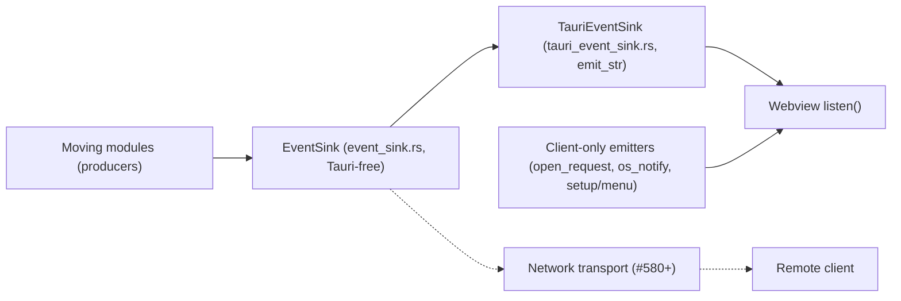
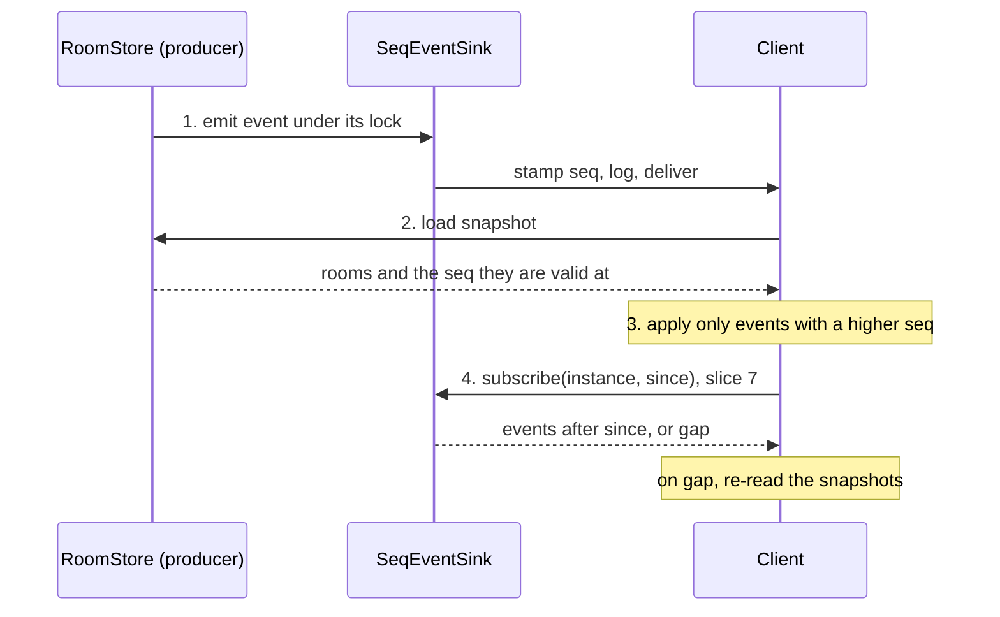

# Event sink: server to UI events (#577)

A daemon has no `AppHandle` (#575). Until #577, every module that
told the UI something took a Tauri handle and called `emit`. Now they
take an `EventSink` instead. The Tauri build plugs in `TauriEventSink`,
so the webview receives the same bytes as before. A network transport
(#580 onward) will implement the same trait later, with no change to
the producers. Streams opened by one call are covered by
[skeind-stream-sink.md](skeind-stream-sink.md) (#578).

Figure: how a server-side event reaches a client. Renders
`event_sink.rs` and `tauri_event_sink.rs` in `app/src-tauri/src`;
non-normative, the code is authoritative.

The trait is `EventSink::emit_json(event, String)`. The generic
`event_sink::emit(sink, name, &payload)` serializes with serde_json.
Client-only emitters stay on Tauri directly: they only make sense next
to a window.

## Event names per producer

- `harness_action_event.rs`: `harness-action`. Called from the Claude,
  opencode and Hermes adapters and from agent API mail.
- `review.rs`, `review_surface/commands.rs`: `skein://review-changed`.
- `agent_api/state.rs`: `skein://review-changed`,
  `skein://harness-permission`, `skein://harness-session-start`,
  `skein://harness-session-end`, `skein://mail-changed`,
  `skein://agent-request`.
- `agent_api/hermes_event.rs`: `skein://harness-hermes-hook`.
- `room_store/mod.rs`: `skein://rooms-changed` (#729), one per applied
  `rooms_apply` batch, carrying the sender's `origin` so it can skip its
  own echo.
- `harness_phase/stream.rs`: `skein://harness-phase`, one per changed
  harness (#732).
- `opencode_sidecar/start.rs`: `skein://opencode-sidecar-exit`.
- `prompt_delivery/daemon_env.rs`: `skein://delivery-seam` and
  `skein://mail-held` (#733).
- `agent_api/verbs/room_create/record.rs`: `skein://agent-room-created`.

The `agent_api/` files above are in `crates/skein-daemon` since #582.
`setup/embed.rs` builds one sink, passes it in the `InProcessTransport`
to `Daemon::build`, which hands it to the Claude, opencode and Hermes
managers and to `AgentApiState`, and the app `app.manage`s it for the
review commands.

`AgentApiState.app` is gone (#582): spawn settings come from a shared
`Arc<SpawnEnvState>`, and the two things that needed the webview are the
`ClientRequests` and `WebviewCapture` seams (see
[skeind-crates.md](skeind-crates.md)).

## Event seq and replay (#757, P2b slice 4)

Every event the daemon broadcasts now carries one `seq`, so a client
that missed events, or loaded a snapshot while events were in flight,
can tell which ones it already has. Design:
[skeind-p2b-design.md](skeind-p2b-design.md), "The event stream".

Figure: the seq on one event, a snapshot, and a replay request. Renders
`event_seq.rs`, `room_store/mod.rs` and `skein-proto/src/events.rs`;
non-normative, the text is authoritative. Steps 1 to 3 are live. Step 4
arrives with the link in slice 7 (#796); no client calls `subscribe`
yet.

### What the sink does

`SeqEventSink` (`event_seq.rs`) wraps the transport's `EventSink`.
`Daemon::build` wraps it once, hands the wrapper to every producer as
the `EventSink`, and keeps it as `Daemon.event_seq`; `setup/embed.rs`
manages that handle for the commands that need it.

1. The wrapper holds one counter per daemon. Each event takes the next
   seq. The seq is written as a top-level `seq` key of the payload's
   JSON object. A payload that is not an object passes through
   unchanged: it uses a seq but is not logged.
2. The stamped event goes into a bounded in-memory log, then to the
   inner sink. The log keeps at most `LOG_MAX_EVENTS` (4096) events and
   `LOG_MAX_BYTES` (8 MiB) of payload; the oldest go first.
   `harness-action` is stamped but not logged, because it is re-read
   from sqlite.
3. Each daemon start has a fresh instance id.
4. `subscribe(instance, since)` returns `Replay::Events` (every logged
   event after `since`, plus the current seq), or `Replay::Gap` with the
   current seq when the instance id differs, `since` is older than the
   log, or `since` is ahead of the daemon. The wire types
   (`Sequenced<T>`, `LoggedEvent`, `Replay`) are in
   `crates/skein-proto/src/events.rs`; `RoomsChanged.seq` is in
   `room_mutations.rs`.

The trait has three default methods for this: `current_seq` (0 for a
sink that stamps nothing), `stamp_json` and `deliver_json`. A producer
that must pick the seq under its own lock calls `stamp_json` there and
`deliver_json` later (the phase stream does). `Stamped` carries the seq
and the stamped payload between the two steps.

Seq order is the log's order. Live delivery order is per producer: a
producer that stamps under a lock and delivers later can be delivered
after a higher seq of another kind. A client orders by `seq`, not by
arrival.

### The snapshot rule

A snapshot reports the seq it is valid at. A client applies only events
with a higher seq. Each snapshot holds this in its own way:

- Rooms. `RoomStore` emits `rooms-changed` under the store lock, and
  `RoomStore::snapshot()` reads the rooms and `current_seq()` under one
  acquisition of the same lock. `LoadOutcome.seq` is taken the same way
  when a load installs its rooms, and `boot_resume.rs` returns it with
  the rooms. `db_load_rooms` passes it to the webview;
  `roomsSync.ts` keeps it as a watermark and drops queued or late
  events at or below it (`useRoomsHydrate.ts` and `useRoomsSync.ts`
  pass the seq in).
- Phase. `harness_phase/stream.rs` stamps each `PhaseUpdate` under the
  service lock (`stamp_json`) and the `skein-phase-out` thread delivers
  it later (`deliver_json`). The phase snapshot's seq is `current_seq()`
  read under the same lock, so every update stamped so far is in the
  snapshot and none stamped later is. `phaseMirror.ts` applies by seq.
- Mail held. `mail_held_snapshot` (`commands/delivery.rs`) returns
  `{seq, harnessIds}`. It reads the seq before the set. The daemon
  updates the held set before it emits `mail-held`, so every event at or
  below that seq is already in the set. `mailHeldMirror.ts` filters its
  buffer by it.

### Not in this slice

No client calls `subscribe` yet; that arrives with the link in slice 7
(#796). Until then a webview reload takes fresh snapshots and applies
the tail by seq.
