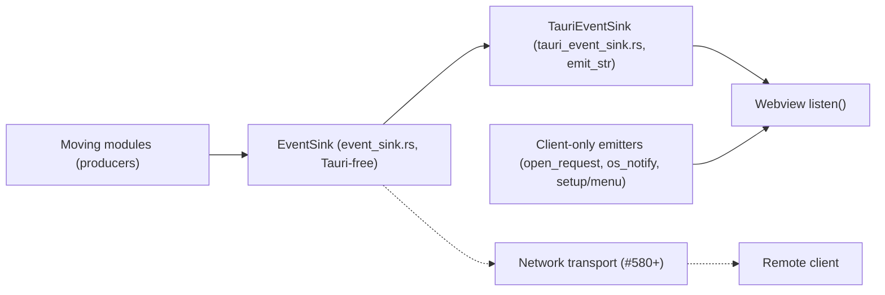

# Event sink: server to UI events (#577)

A daemon has no `AppHandle` (#575). Until #577, every module that
told the UI something took a Tauri handle and called `emit`. Now they
take an `EventSink` instead. The Tauri build plugs in `TauriEventSink`,
so the webview receives the same bytes as before. A network transport
(#580 onward) will implement the same trait later, with no change to
the producers.

Figure: how a server-side event reaches a client. Renders
`event_sink.rs` and `tauri_event_sink.rs` in `app/src-tauri/src`;
non-normative, the code is authoritative.

The trait is `EventSink::emit_json(event, String)`. The generic
`event_sink::emit(sink, name, &payload)` serializes with serde_json.
Client-only emitters stay on Tauri directly: they only make sense next
to a window.

## Event names per producer

- `harness_action_event.rs`: `harness-action`. Called from the Claude,
  opencode and Hermes adapters and from agent API mail.
- `review.rs`, `review_surface/commands.rs`: `skein://review-changed`.
- `agent_api/state.rs`: `skein://review-changed`,
  `skein://harness-permission`, `skein://harness-session-start`,
  `skein://harness-session-end`, `skein://mail-changed`,
  `skein://agent-request`.
- `agent_api/hermes_event.rs`: `skein://harness-hermes-hook`.

`setup/state.rs` builds one sink, hands it to the Claude, opencode and
Hermes managers, and `app.manage`s it for the review commands.
`AgentApiState` builds its own from the `AppHandle`.

Deliberate leftover: `AgentApiState.app` stays, for `spawn_settings()`
and design screenshots only.
