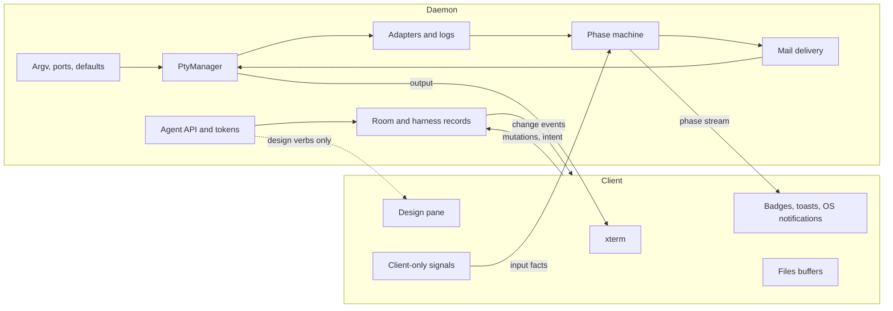
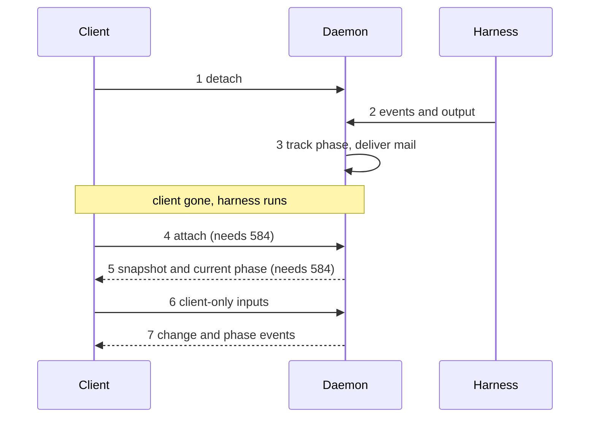
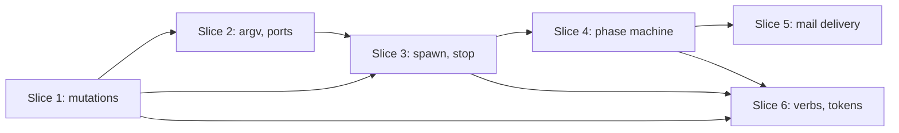

# skeind P2a: the daemon owns the harness lifecycle (#583)

Status: design, decided 2026-11-12. Not yet implemented.
Epic: #575. Design: docs/skeind-design.md. Recon:
docs/skeind-recon.md (section 2 rows 6, 14-18, 28-30, 37, 45, 46, and
section 8).

#583 is a prerequisite of #584 (socket, reattach, snapshots) and #585
(transport). Today a daemon with no client cannot work: argv, ports,
event logging, the phase machine and mail delivery all live in the
TypeScript frontend, rooms are saved wholesale by the client, and every
agent token is revoked at boot. #583 moves what unattended operation
needs into skein-daemon.

The daemon is still embedded in the app after #583. Nothing survives a
UI restart yet. #583 only makes the daemon able to run a harness with
no client attached. Surviving the restart is #584.

## Today

| Concern | Owner today | Where |
| --- | --- | --- |
| Argv per kind, resume argv | Frontend | `harnessCmd.ts`, `remoteCmd.ts`, `agents.ts` |
| Spawn defaults (shell, cwd, agent) | Frontend and host | `prefs.ts` `defaultAgents` (localStorage), `default_shell`, `default_cwd` |
| opencode port, sidecar | Frontend | `pick_free_port` from several call sites, `opencodeV2Spawn.ts` |
| Spawn and kill of the PTY | Frontend | `useTerminalSpawn.ts`: spawn in a mount effect, `pty_kill` on unmount |
| PTY output | Per-spawn channel | No ring buffer in the daemon; a dead channel drops output |
| Room and harness records | Frontend, saved wholesale | `useRoomsStore`, `roomsSaveScheduler.ts`, `db_save_rooms` (wipe and re-insert) |
| Boot resume | Frontend | `useRoomsHydrate.ts`: probes, stale sessionIds, `withResumeCmds`, identity gate |
| Adapters (Claude JSONL, opencode SSE, Hermes) | Engines in daemon, attached from the webview | `terminalSpawnAdapters.ts` |
| Transition log (`harness_events`), action rows (`harness_actions`) | Webview calls the daemon; transitions follow the phase machine | `useTransitionLog.ts`, `useHarnessActions.ts` |
| Phase machine | Frontend | `harnessActivity*.ts`, `deferral.ts`, `subagents.ts`, `backgroundTasks.ts`, `harnessEvents*.ts` |
| Mail and nudge delivery | Frontend | `useMailDelivery.ts`, `harnessInput*.ts`, xterm `term.paste()` |
| Agent API verbs | Daemon, some ask the webview | `request_frontend`, 3 to 60 s timeouts |
| Agent tokens | Daemon | `agent_tokens` table; all revoked at `Daemon::build` |

Four facts matter most.

- The phase machine is about 3,800 lines of TypeScript. Its tests are
  pure node vitest, no DOM. Nearly all its inputs are already produced
  by daemon code: L2c Claude and opencode events, the permission hook,
  PTY bytes, PTY exit and timers. The subagent and background-task
  state machines already live in `crates/skein-harness`.
- Three inputs exist only in a client: the decisive keystroke that
  clears `permission` (xterm `onKey`, plus the empty-composer read of
  the xterm buffer), focus-induced output muting, and the Hermes
  screen-phase reader (`screenPhase.ts`).
- Rust has no phase. `list_rooms`, `get_room` and `list_harnesses` ask
  the webview (request kind `harness_phases`, 3 s). No answer means
  every phase reads "unknown".
- The agent API URL, with its ephemeral port, is baked into each
  harness env beside the token (`SKEIN_REVIEW_URL`,
  `SKEIN_REVIEW_TOKEN`, `SKEIN_ROOM_ID`, `SKEIN_HARNESS_ID`). A daemon
  restart orphans live harnesses by port as well as by token. The
  epic already says harnesses do not survive a daemon restart.

## Target

After #583 the daemon owns the records and the lifecycle. A client
renders state and sends intent.

Daemon: room and harness records, argv and ports, spawn defaults,
PtyManager and the stop decision, the adapters, the event and action
logs, the phase machine, mail and nudge delivery, the agent API, and
tokens.

Client: xterm, badges, toasts and OS notifications, the design pane,
Files buffers, and the three client-only signals.

Figure 1: who owns what after #583. Renders section "Target"; the
text is authoritative (non-normative).

## Decisions

All four were made on 2026-11-12.

### D1. Token lifetime

**Decision.** A token lives as long as the daemon process. A room's
token is also revoked when the room is archived or closed. The revoke
at daemon start stays: PTYs die with the daemon, and a UI restart no
longer reaches it. The per-room revoke uses the existing
`revoke_agent_tokens(Some(room))`, which has no caller today. A
reopened room mints a fresh token at its next spawn.

**Reason.** It is the smallest change that keeps a surviving
harness's tools working and still bounds a leaked token.

**Rejected.**
- Daemon-life only: archived rooms' tokens would linger.
- Per-harness tokens: a schema change, and it breaks "the token is the
  room scope".
- Persisting tokens and port across a daemon restart: contradicts the
  epic's non-goal that durability comes from resume.

**Consequences.** For #584: the daemon restart path must re-spawn with
resume, which mints fresh env anyway. Archive and close must call the
per-room revoke (slice 6).

### D2. Phase machine

**Decision.** Port the whole machine to Rust in skein-daemon. The
daemon owns the phase store, deferral, the subagent and background
registries, watchdogs and ceilings, the supervisor invariants, the
transition log, and mail and nudge delivery. Clients subscribe to a
phase stream and render badges, toasts and OS notifications.

The three client-only signals become client-to-daemon inputs:
- Decisive input. The daemon sees stdin writes itself; the client adds
  the fact "the composer was empty".
- Focus mute.
- The Hermes screen phase. It stays client-reported until #584's
  headless emulator exists. With no client attached, a screen-phase
  harness reads `unknown`. This is a known limit.

The `harness_phases` round trip is deleted.

Mitigation: port the vitest tables to Rust tests first, as the spec.
Then run the Rust machine in shadow beside the TypeScript one, logging
every divergence. Only then flip the client to the daemon's phase and
delete the TypeScript machine.

**Reason.** One source of truth. Nearly all inputs are already on the
daemon side. #587 needs it there.

**Rejected.**
- Split authority: two machines must agree.
- A headless TypeScript host: a JS runtime on every daemon host.
- Deferring: fails #583's acceptance and blocks #587.

**Consequences.** The largest port in the phase, and the one that
needs the shadow run. It lands late (slice 4).

### D3. Slice order

**Decision.** State first. Six child issues, in the order listed under
"Slices".

**Reason.** Every later move needs a record the daemon writes. Each
slice ships alone with no visible change in attached mode. The riskiest
port lands late, on a stable base.

**Rejected.**
- Phase machine first: its inputs would be re-plumbed twice.
- One harness kind at a time: two lifecycles side by side, and
  persistence cannot be split per kind.

**Consequences.** The first two slices touch the most frontend code
and the least new behaviour.

### D4. Verbs with no client

**Decision.** The daemon executes `create_room`, `open_harness`,
`close_harness` and `close_room` itself, over the slice 1 mutations and
the slice 3 spawn, and reads phases from its own machine. Attached
clients learn through events. `(kind, agent)` resolution uses the
daemon-side defaults from slice 2.

Only the design-pane verbs and the native screenshot need a client.
With none attached they refuse with a named code, `no_client`, distinct
from today's generic unavailable.

`close_harness` and unsaved Files buffers: unsaved text exists only in
a client. The daemon asks each attached client and refuses if any
reports dirty buffers. With no client attached there is nothing
unsaved, and it proceeds.

`activate: false` semantics stay: a verb never takes over a screen.

**Reason.** An unattended director must be able to open and close
rooms.

**Rejected.**
- Queueing until a client attaches: stalls the director.
- Refusing everything: defeats detached mode.

**Consequences.** Today's `request_frontend` kinds for these four verbs
(`create_room.resolve`, `create_room`, `open_harness.resolve`,
`open_harness`, `close_harness`, `close_room`) are retired. The design
kinds stay.

## Lifecycle across a UI restart

The daemon is embedded today, so steps 1 to 3 and 6 to 7 describe what
#583 makes possible; steps 4 and 5 need #584 to be real.

Figure 2: a harness across a UI restart. Renders section "Lifecycle
across a UI restart"; the text is authoritative (non-normative).

1. The client detaches. Unmounting a terminal no longer kills the PTY;
   only an explicit `stop_harness` does (slice 3).
2. The harness keeps running. The daemon's adapters keep tailing its
   transcript or event stream and write `harness_actions` rows
   (slice 3).
3. The daemon's phase machine keeps tracking the phase, including
   deferral and watchdogs, and writes the `harness_events` transition
   log (slice 4). Mail and nudges go out through the daemon's
   PTY writer. Agent verbs keep working under D4. The token stays
   valid (D1).
4. A client attaches. This needs the socket and the event stream with
   a sequence number from #584.
5. The client gets current state: records, phase, and a terminal
   snapshot. The snapshot and ring buffer are #584.
6. The client sends its own facts: decisive input with the
   empty-composer flag, focus mute, and the Hermes screen phase.
7. The client applies daemon change events and phase events from then
   on. It renders; it decides nothing about the lifecycle.

What #583 delivers in attached mode: the same screen, with the daemon
as the author of every record, argv, port, log row and phase. What
#584 adds: a process boundary, reattach, and terminal snapshots.

## Slices

Six child issues, in this order.

1. **Per-room mutations.** The daemon owns Room and Harness records.
   Replace `db_save_rooms` / `save_all` with per-room and per-harness
   mutation commands. The client becomes a subscriber that applies
   daemon change events. Keep the #167 safety properties (quarantine,
   snapshots) and the #594 structural-versus-debounced distinction as
   a daemon concern. `save_all` remains only for migration.
2. **Argv, ports and spawn defaults.** Port `cmdForKind`, `resumeCmd`,
   `withResumeCmds`, `unarchiveRoomTransform`, `remoteArgv` and
   `validateAgent` to Rust over the Harness record. Move
   `defaultAgents` and default shell and cwd into daemon settings
   (`settings.json`), with a one-time import from the client's
   localStorage. Allocate the opencode port and own the sidecar at
   spawn. The daemon-host probes (login-shell probe, program
   resolution, agent enumeration, CLI version probe, the #565 login
   env with loopback kept in `NO_PROXY`) already live in skein-daemon.
   They are preserved, not moved: the Rust argv builder uses the
   daemon's own program resolution and agent enumeration.
3. **Daemon-initiated spawn and stop.** `ensure_running(harness)` and
   explicit `stop_harness`. The daemon attaches the L2c adapters and
   writes the `harness_actions` rows (action extraction). Boot resume
   moves to daemon start. Define the sink contract: detach does not
   kill.
4. **Phase machine in Rust.** Shadow, then flip (D2). The transition
   log (`harness_events`, written today by `useTransitionLog.ts`)
   moves with it, since it records phase transitions.
5. **Mail and nudge delivery.** The #238 / #381 gate and the
   bracketed-paste write go through the daemon's PTY writer.
6. **Client-less agent verbs and the token policy.** D4 and D1.

| Slice | Depends on |
| --- | --- |
| 1 | #582 (done) |
| 2 | 1 |
| 3 | 1, 2 |
| 4 | 3 |
| 5 | 4 |
| 6 | 1, 3, 4 |

Figure 3: slice dependencies. Renders section "Slices"; the text is
authoritative (non-normative).

## What #583 assumes of #584 and #585

Not designed here. #583 assumes:

- An event stream with a sequence number, so a client can resume from
  the last event it saw. Slice 1's change events and slice 4's phase
  events ride on it.
- PTY attach with a snapshot and a ring buffer. #583 only defines
  "detach does not kill".
- Daemon-host paths: state, logs and settings live on the daemon's
  host (the paths seam).
- N clients. Slice 1's mutations must be safe for two writers; the
  client-only inputs of D2 must name the client they came from.

## Risks

- **Frontend regressions with thin coverage.** Nearly every shipped
  regression has lived in the frontend. Mitigation: state first, each
  slice ships alone, no visible change in attached mode.
- **Phase-machine port drift.** Two implementations can disagree.
  Mitigation: ported vitest tables as the spec, then a shadow run that
  logs every divergence before the flip.
- **ConPTY cursor-query with no terminal.** Spawn today depends on an
  xterm answering the cursor query (#484, `bufferPtyInput`). A
  daemon-side answer when no terminal is attached is unproven.
- **Hermes screen phase.** Without a client it reads `unknown` until
  #584's headless emulator exists. A known limit.
- **localStorage defaults migration.** `defaultAgents` moves to
  daemon settings. A one-time import must not overwrite a value the
  daemon already has, and must not lose one the user set.
- **Two writers during the slice 1 transition.** Until `save_all` is
  retired, the client and the daemon can both write rooms. Mitigation:
  the client stops calling `db_save_rooms` in the same slice that adds
  the mutations.
- **Post-exit shell unattended.** The post-exit shell and
  `opencodeShellFollow.ts` are keystroke-driven in xterm. What a
  daemon-run harness does on exit with no terminal is a policy to set
  in slice 3.
- **File-size limits.** New Rust files aim for 600 lines or fewer
  (CLAUDE.md). The phase machine port must be split by concern across
  several files and a sibling `tests.rs`.

## Acceptance mapping

| #583 acceptance item | Satisfied by |
| --- | --- |
| Attached mode: the app no longer builds argv or allocates ports | Slice 2 |
| Attached mode: the app no longer writes `harness_events` rows (the daemon does; `harness_actions` rows move in slice 3) | Slice 4 (with slice 3 for actions) |
| A no-client test creates a room, spawns a harness through the daemon API, and the phase and `harness_events` rows update | Slices 3 and 4 together (slice 3: `harness_actions` rows; slice 4: phase and transition log; room creation: slice 1; verbs: slice 6) |
| Two simulated clients write different rooms without erasing each other | Slice 1 |
| `cargo test --workspace`, `cargo test --manifest-path app/src-tauri/Cargo.toml`, `cd app && npm test` pass | Every slice |
| No change in what the user sees in attached mode | Every slice; slice 4's shadow run guards the flip |

The scope items map as follows: room persistence to slice 1; argv and
port to slice 2; action logging to slice 3; the transition log and
phase logic to slice 4; mail delivery to slice 5; agent API verbs and
token lifetime to slice 6. The scope item "daemon-host probes stay on
the daemon" needs no move: they already live in skein-daemon, and
slice 2 preserves them (its argv builder uses them).

## Child issue drafts

These are drafts. They are NOT filed. Sibling slices are referred to
as "slice N".

### Draft 1: skeind P2a-1: per-room mutations, daemon owns records

Part of #583. Depends on: #582.

**Why.** `db_save_rooms` wipes and re-inserts every room, so a second
client erases the first's rooms. A daemon with N clients needs
per-room writes.

**Scope.**
- Per-room and per-harness mutation commands in the daemon.
- Change events the client applies; `useRoomsStore` becomes a
  subscriber.
- Keep quarantine, snapshots and the structural-versus-debounced
  distinction as daemon behaviour.
- `save_all` kept only for migration.

**Out of scope.** Argv and spawn (slice 2, slice 3). The socket (#584).

**Acceptance.**
- Two simulated clients write different rooms without erasing each
  other.
- The #167 safety properties still have tests.
- No change in what the user sees.
- `cargo test --workspace`, `cargo test --manifest-path
  app/src-tauri/Cargo.toml` and `cd app && npm test` pass.

### Draft 2: skeind P2a-2: argv, ports and spawn defaults in the daemon

Part of #583. Depends on: slice 1.

**Why.** Argv, the opencode port and the defaults feeding them are
built in the frontend with the client's notion of platform. The daemon
must build them for its own host.

**Scope.**
- Port `cmdForKind`, `resumeCmd`, `withResumeCmds`,
  `unarchiveRoomTransform`, `remoteArgv` and `validateAgent` to Rust.
- Move `defaultAgents`, default shell and default cwd into daemon
  settings, with a one-time import from localStorage.
- Allocate the opencode port and own the sidecar at spawn.
- Stays as is: the daemon-host probes (login-shell probe, program
  resolution, agent enumeration, CLI version probe, the #565 login
  env, loopback in `NO_PROXY`) already live in skein-daemon. The new
  argv builder uses them.

**Out of scope.** Spawn and stop ownership (slice 3).

**Acceptance.**
- The app no longer builds argv or calls `pick_free_port`.
- The Rust argv tests cover every kind, resume and `--agent`.
- The localStorage import runs once and does not overwrite.
- The three test commands pass.

### Draft 3: skeind P2a-3: daemon-initiated spawn and stop

Part of #583. Depends on: slice 1, slice 2.

**Why.** Spawn happens in a React mount effect and unmount kills the
PTY, so no harness can outlive a terminal view.

**Scope.**
- `ensure_running(harness)` and explicit `stop_harness`.
- Unmounting a terminal detaches; it does not kill.
- The daemon attaches the L2c adapters and writes the
  `harness_actions` rows. The transition log (`harness_events`) stays
  with the phase machine and moves in slice 4.
- Boot resume (probes, stale-session drop, repo-identity gate) moves
  to daemon start.
- Sink contract: detach does not kill. Buffering and snapshots stay
  with #584.
- A daemon-side answer to the ConPTY cursor query (unproven).
- Post-exit shell policy.

**Out of scope.** Ring buffer and snapshots (#584).

**Acceptance.**
- A test starts the daemon with no client, creates a room, spawns a
  harness through the daemon API, and `harness_actions` rows appear.
- Closing a terminal view leaves the PTY running.
- The app no longer calls `db_record_harness_action`.
- The three test commands pass.

### Draft 4: skeind P2a-4: phase machine in Rust

Part of #583. Depends on: slice 3.

**Why.** The phase machine is the largest piece of lifecycle logic
still in the webview, and #587 needs it in the daemon.

**Scope.**
- Port the vitest tables to Rust tests first.
- Port the machine, deferral, registries, watchdogs, ceilings and
  supervisor invariants.
- Client-to-daemon inputs: decisive input with the empty-composer
  flag, focus mute, Hermes screen phase.
- Move the transition log (`harness_events`, today
  `useTransitionLog.ts`) into the daemon, written on each transition.
- Phase stream to clients; delete the `harness_phases` round trip.
- Shadow run with divergence logging, then flip, then delete the
  TypeScript machine.

**Out of scope.** Mail delivery (slice 5). A headless emulator (#584).

**Acceptance.**
- Ported tables pass in Rust.
- The shadow run logs no unexplained divergence before the flip.
- A no-client test shows the phase updating and `harness_events`
  rows written by the daemon.
- The app no longer writes `harness_events` rows.
- The three test commands pass.

### Draft 5: skeind P2a-5: mail and nudge delivery in the daemon

Part of #583. Depends on: slice 4.

**Why.** Delivery pastes through xterm `term.paste()`, so mail to a
waiting harness stops when no client is open.

**Scope.**
- Move the #238 / #381 gate and held-mail logic to the daemon.
- Bracketed-paste write through the daemon's PTY writer.

**Out of scope.** Approval queue and push (#587).

**Acceptance.**
- A no-client test delivers mail to a waiting harness.
- Held mail goes out on the transition to waiting.
- The three test commands pass.

### Draft 6: skeind P2a-6: client-less agent verbs and token policy

Part of #583. Depends on: slice 1, slice 3, slice 4.

**Why.** `create_room`, `open_harness`, `close_harness` and
`close_room` ask the webview, so an unattended director gets
"unavailable". Tokens are revoked only at daemon start.

**Scope.**
- Execute the four verbs in the daemon over slice 1 and slice 3.
- Read phases from the daemon's machine.
- `no_client` refusal for design verbs and the native screenshot.
- `close_harness` asks each attached client about dirty Files
  buffers; no client means proceed.
- Per-room token revoke on archive and close (D1).

**Out of scope.** Changing which verbs are refused by name.

**Acceptance.**
- With no client, the four verbs work and design verbs return
  `no_client`.
- Archiving a room invalidates its token; reopening mints a new one.
- The three test commands pass.
