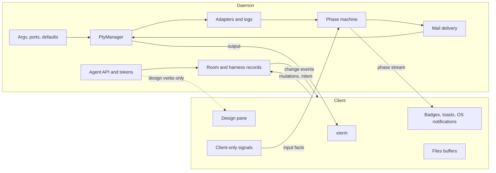
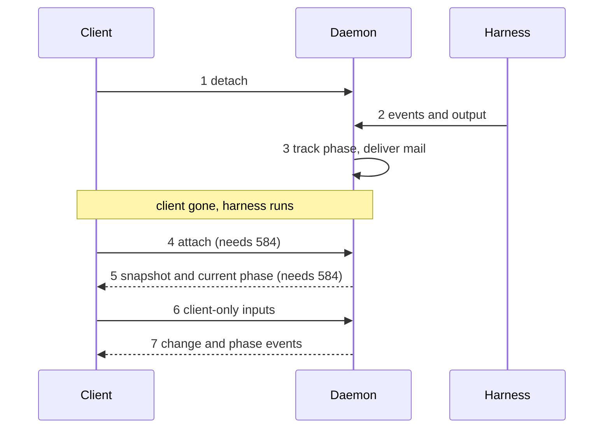
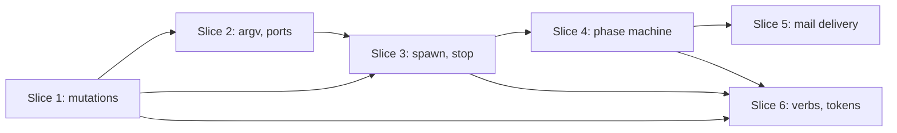
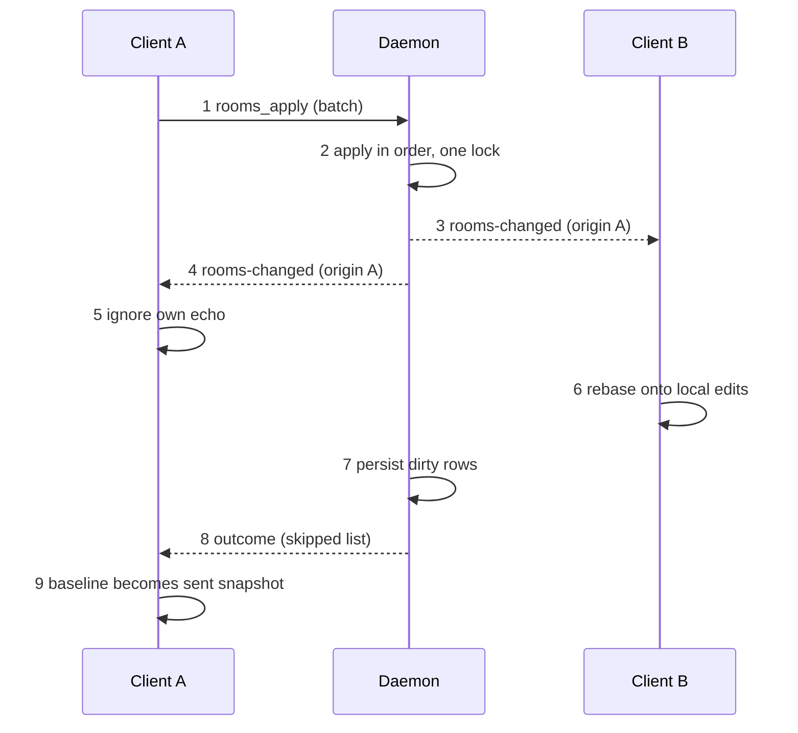
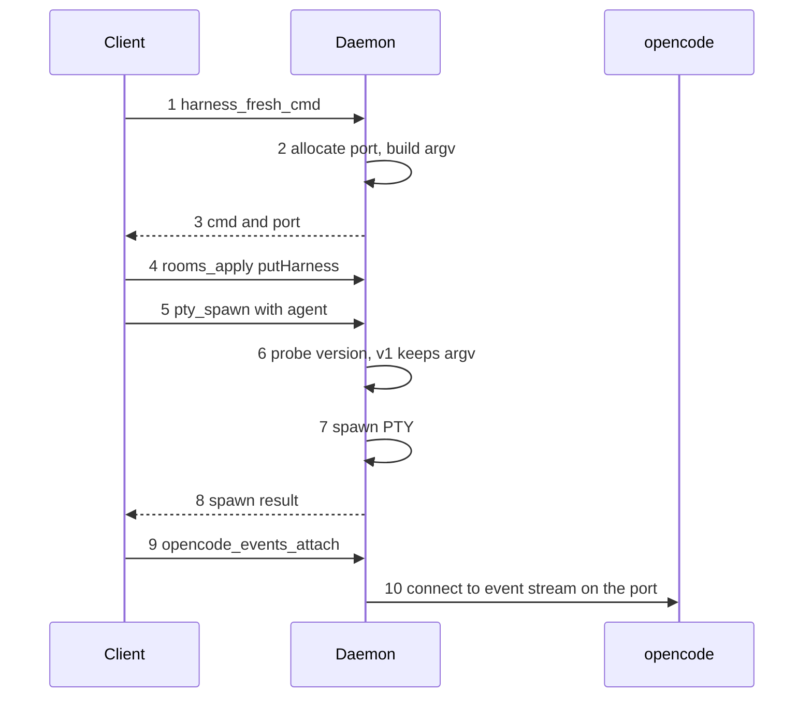
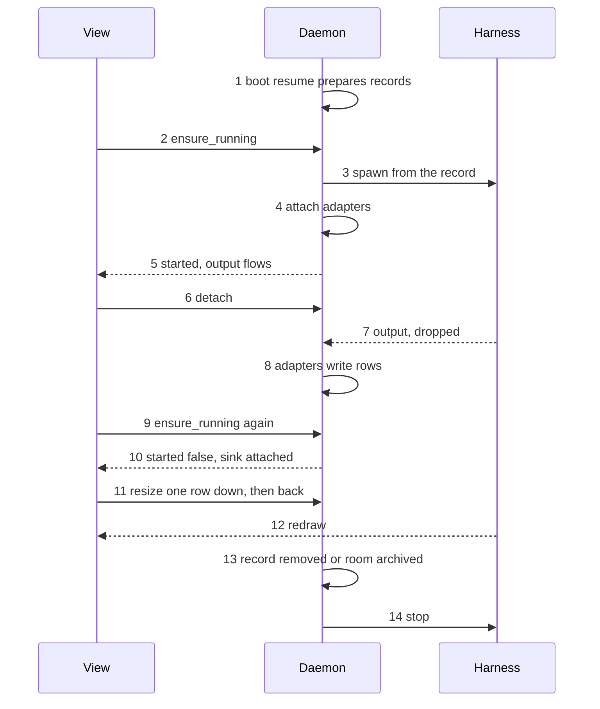
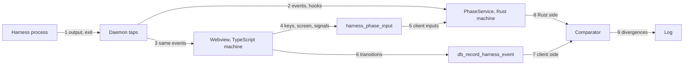

# skeind P2a: the daemon owns the harness lifecycle (#583)

Status: design decided 2026-11-12. Slices 1 to 3 implemented (#729,
#730, #731); slices 4 to 6 not yet.
Epic: #575. Design: docs/skeind-design.md. Recon:
docs/skeind-recon.md (section 2 rows 6, 14-18, 28-30, 37, 45, 46, and
section 8).

#583 is a prerequisite of #584 (socket, reattach, snapshots) and #585
(transport). Today a daemon with no client cannot work: argv, ports,
event logging, the phase machine and mail delivery all live in the
TypeScript frontend, rooms are saved wholesale by the client, and every
agent token is revoked at boot. #583 moves what unattended operation
needs into skein-daemon.

The daemon is still embedded in the app after #583. Nothing survives a
UI restart yet. #583 only makes the daemon able to run a harness with
no client attached. Surviving the restart is #584.

## Today

| Concern | Owner today | Where |
| --- | --- | --- |
| Argv per kind, resume argv | Daemon since slice 2 (#730); before it, the frontend | `harness_argv/`; the app calls `harness_fresh_cmd`, `harness_resume_cmd`, `rooms_resume_cmds`. `harnessCmd.ts` keeps only `isOpencodeV2` and the Hermes profile constant |
| Spawn defaults (shell, cwd, agent) | Daemon since slice 2 (#730); before it, the frontend held the agent | `default_agents` in the daemon's `settings.json`; `default_shell_impl`, `default_cwd_impl`. `prefs.ts` `defaultAgents` survives only as the legacy import source |
| opencode port, sidecar | Daemon since slice 2 (#730); before it, the frontend | The port is allocated inside the argv commands; the spawn (`ensure_running` since slice 3, `pty_spawn` before) probes the version and starts the sidecar. `opencodeV2Spawn.ts` is gone |
| Spawn and kill of the PTY | Daemon since slice 3 (#731); before it, the frontend | `harness_runner/`: spawns from the stored record on first request, stops when the record goes. `useTerminalSpawn.ts` asks, attaches and detaches |
| PTY output | Replaceable sink per PTY | `pty/sink_slot.rs`. No ring buffer in the daemon (#584); with no sink attached output is dropped |
| Room and harness records | Daemon since slice 1 (#729); before it, the frontend saved wholesale | `RoomStore` (`room_store/`); clients send mutations through `rooms_apply`. `db_save_rooms` and `roomsSaveScheduler.ts` are gone |
| Boot resume | Daemon since slice 3 (#731); before it, the frontend | `boot_resume.rs`: probes, stale session ids, resume cmds, saved under origin `daemon-boot`. `useRoomsHydrate.ts` keeps the folder and identity gates |
| Adapters (Claude JSONL, opencode SSE, Hermes) | Daemon attaches them after a spawn (slice 3); the client also attaches its own event channels for the phase machine | `harness_runner/adapters.rs`, `terminalSpawnAdapters.ts` |
| Transition log (`harness_events`), action rows (`harness_actions`) | Action rows: written by the daemon's adapters since slice 3. Transition log: the client, which calls the daemon, until slice 4 | `useTransitionLog.ts`, `useHarnessActions.ts` |
| Phase machine | Frontend | `harnessActivity*.ts`, `deferral.ts`, `subagents.ts`, `backgroundTasks.ts`, `harnessEvents*.ts` |
| Mail and nudge delivery | Frontend | `useMailDelivery.ts`, `harnessInput*.ts`, xterm `term.paste()` |
| Agent API verbs | Daemon, some ask the webview | `request_frontend`, 3 to 60 s timeouts |
| Agent tokens | Daemon | `agent_tokens` table; all revoked at `Daemon::build` |

Four facts matter most.

- The phase machine is about 3,800 lines of TypeScript. Its tests are
  pure node vitest, no DOM. Nearly all its inputs are already produced
  by daemon code: L2c Claude and opencode events, the permission hook,
  PTY bytes, PTY exit and timers. The subagent and background-task
  state machines already live in `crates/skein-harness`.
- Three inputs exist only in a client: the decisive keystroke that
  clears `permission` (xterm `onKey`, plus the empty-composer read of
  the xterm buffer), focus-induced output muting, and the Hermes
  screen-phase reader (`screenPhase.ts`).
- Rust has no phase. `list_rooms`, `get_room` and `list_harnesses` ask
  the webview (request kind `harness_phases`, 3 s). No answer means
  every phase reads "unknown".
- The agent API URL, with its ephemeral port, is baked into each
  harness env beside the token (`SKEIN_REVIEW_URL`,
  `SKEIN_REVIEW_TOKEN`, `SKEIN_ROOM_ID`, `SKEIN_HARNESS_ID`). A daemon
  restart orphans live harnesses by port as well as by token. The
  epic already says harnesses do not survive a daemon restart.

## Target

After #583 the daemon owns the records and the lifecycle. A client
renders state and sends intent.

Daemon: room and harness records, argv and ports, spawn defaults,
PtyManager and the stop decision, the adapters, the event and action
logs, the phase machine, mail and nudge delivery, the agent API, and
tokens.

Client: xterm, badges, toasts and OS notifications, the design pane,
Files buffers, and the three client-only signals.

Figure 1: who owns what after #583. Renders section "Target"; the
text is authoritative (non-normative).

## Decisions

All four were made on 2026-11-12.

### D1. Token lifetime

**Decision.** A token lives as long as the daemon process. A room's
token is also revoked when the room is archived or closed. The revoke
at daemon start stays: PTYs die with the daemon, and a UI restart no
longer reaches it. The per-room revoke uses the existing
`revoke_agent_tokens(Some(room))`, which has no caller today. A
reopened room mints a fresh token at its next spawn.

**Reason.** It is the smallest change that keeps a surviving
harness's tools working and still bounds a leaked token.

**Rejected.**
- Daemon-life only: archived rooms' tokens would linger.
- Per-harness tokens: a schema change, and it breaks "the token is the
  room scope".
- Persisting tokens and port across a daemon restart: contradicts the
  epic's non-goal that durability comes from resume.

**Consequences.** For #584: the daemon restart path must re-spawn with
resume, which mints fresh env anyway. Archive and close must call the
per-room revoke (slice 6).

### D2. Phase machine

**Decision.** Port the whole machine to Rust in skein-daemon. The
daemon owns the phase store, deferral, the subagent and background
registries, watchdogs and ceilings, the supervisor invariants, the
transition log, and mail and nudge delivery. Clients subscribe to a
phase stream and render badges, toasts and OS notifications.

The three client-only signals become client-to-daemon inputs:
- Decisive input. The daemon sees stdin writes itself; the client adds
  the fact "the composer was empty".
- Focus mute.
- The Hermes screen phase. It stays client-reported until #584's
  headless emulator exists. With no client attached, a screen-phase
  harness reads `unknown`. This is a known limit.

The `harness_phases` round trip is deleted.

Mitigation: port the vitest tables to Rust tests first, as the spec.
Then run the Rust machine in shadow beside the TypeScript one, logging
every divergence. Only then flip the client to the daemon's phase and
delete the TypeScript machine.

**Reason.** One source of truth. Nearly all inputs are already on the
daemon side. #587 needs it there.

**Rejected.**
- Split authority: two machines must agree.
- A headless TypeScript host: a JS runtime on every daemon host.
- Deferring: fails #583's acceptance and blocks #587.

**Consequences.** The largest port in the phase, and the one that
needs the shadow run. It lands late (slice 4).

### D3. Slice order

**Decision.** State first. Six child issues, in the order listed under
"Slices".

**Reason.** Every later move needs a record the daemon writes. Each
slice ships alone with no visible change in attached mode. The riskiest
port lands late, on a stable base.

**Rejected.**
- Phase machine first: its inputs would be re-plumbed twice.
- One harness kind at a time: two lifecycles side by side, and
  persistence cannot be split per kind.

**Consequences.** The first two slices touch the most frontend code
and the least new behaviour.

### D4. Verbs with no client

**Decision.** The daemon executes `create_room`, `open_harness`,
`close_harness` and `close_room` itself, over the slice 1 mutations and
the slice 3 spawn, and reads phases from its own machine. Attached
clients learn through events. `(kind, agent)` resolution uses the
daemon-side defaults from slice 2.

Only the design-pane verbs and the native screenshot need a client.
With none attached they refuse with a named code, `no_client`, distinct
from today's generic unavailable.

`close_harness` and unsaved Files buffers: unsaved text exists only in
a client. The daemon asks each attached client and refuses if any
reports dirty buffers. With no client attached there is nothing
unsaved, and it proceeds.

`activate: false` semantics stay: a verb never takes over a screen.

**Reason.** An unattended director must be able to open and close
rooms.

**Rejected.**
- Queueing until a client attaches: stalls the director.
- Refusing everything: defeats detached mode.

**Consequences.** Today's `request_frontend` kinds for these four verbs
(`create_room.resolve`, `create_room`, `open_harness.resolve`,
`open_harness`, `close_harness`, `close_room`) are retired. The design
kinds stay.

## Lifecycle across a UI restart

The daemon is embedded today, so steps 1 to 3 and 6 to 7 describe what
#583 makes possible; steps 4 and 5 need #584 to be real.

Figure 2: a harness across a UI restart. Renders section "Lifecycle
across a UI restart"; the text is authoritative (non-normative).

1. The client detaches. Unmounting a terminal no longer kills the PTY;
   only an explicit `stop_harness` does (slice 3).
2. The harness keeps running. The daemon's adapters keep tailing its
   transcript or event stream and write `harness_actions` rows
   (slice 3).
3. The daemon's phase machine keeps tracking the phase, including
   deferral and watchdogs, and writes the `harness_events` transition
   log (slice 4). Mail and nudges go out through the daemon's
   PTY writer. Agent verbs keep working under D4. The token stays
   valid (D1).
4. A client attaches. This needs the socket and the event stream with
   a sequence number from #584.
5. The client gets current state: records, phase, and a terminal
   snapshot. The snapshot and ring buffer are #584.
6. The client sends its own facts: decisive input with the
   empty-composer flag, focus mute, and the Hermes screen phase.
7. The client applies daemon change events and phase events from then
   on. It renders; it decides nothing about the lifecycle.

What #583 delivers in attached mode: the same screen, with the daemon
as the author of every record, argv, port, log row and phase. What
#584 adds: a process boundary, reattach, and terminal snapshots.

## Slices

Six child issues, in this order.

1. **Per-room mutations.** The daemon owns Room and Harness records.
   Replace `db_save_rooms` / `save_all` with per-room and per-harness
   mutation commands. The client becomes a subscriber that applies
   daemon change events. Keep the #167 safety properties (quarantine,
   snapshots) and the #594 structural-versus-debounced distinction as
   a daemon concern. `save_all` remains only for migration.
2. **Argv, ports and spawn defaults.** Port `cmdForKind`, `resumeCmd`,
   `withResumeCmds`, `unarchiveRoomTransform`, `remoteArgv` and
   `validateAgent` to Rust over the Harness record. Move
   `defaultAgents` and default shell and cwd into daemon settings
   (`settings.json`), with a one-time import from the client's
   localStorage. Allocate the opencode port and own the sidecar at
   spawn. The daemon-host probes (login-shell probe, program
   resolution, agent enumeration, CLI version probe, the #565 login
   env with loopback kept in `NO_PROXY`) already live in skein-daemon.
   They are preserved, not moved: the Rust argv builder uses the
   daemon's own program resolution and agent enumeration.
3. **Daemon-initiated spawn and stop.** `ensure_running(harness)` and
   explicit `stop_harness`. The daemon attaches the L2c adapters and
   writes the `harness_actions` rows (action extraction). Boot resume
   moves to daemon start. Define the sink contract: detach does not
   kill.
4. **Phase machine in Rust.** Shadow, then flip (D2). The transition
   log (`harness_events`, written today by `useTransitionLog.ts`)
   moves with it, since it records phase transitions.
5. **Mail and nudge delivery.** The #238 / #381 gate and the
   bracketed-paste write go through the daemon's PTY writer.
6. **Client-less agent verbs and the token policy.** D4 and D1.

| Slice | Depends on |
| --- | --- |
| 1 | #582 (done) |
| 2 | 1 |
| 3 | 1, 2 |
| 4 | 3 |
| 5 | 4 |
| 6 | 1, 3, 4 |

Figure 3: slice dependencies. Renders section "Slices"; the text is
authoritative (non-normative).

## Slice 1 as built (#729)

The daemon now holds the room and harness records in memory, in
`RoomStore` (`crates/skein-daemon/src/room_store/`). That copy is the
authority. A client diffs what it has against what the daemon is known
to hold, sends the difference as mutations, and applies the change
events the daemon broadcasts as `skein://rooms-changed`. The daemon
writes sqlite one row at a time.

The 37 `setRooms` call sites in the frontend were left alone on
purpose. Nearly every shipped regression has lived in the frontend, and
rewriting 37 call sites would be the riskiest way to move the records.
The seam is the save path instead: it used to send the whole array to
`db_save_rooms`, and now it diffs (`diffRooms` in `roomMutations.ts`)
and sends mutations. The React state is unchanged.

Wire types are in `crates/skein-proto/src/room_mutations.rs`.

| Mutation | Effect |
| --- | --- |
| `createRoom` | Adds a whole room, harnesses included, at the end. Skipped as `exists` if the id is taken |
| `updateRoom` | Replaces the room-level fields. The payload's `harnesses` is ignored; the stored ones are kept |
| `removeRoom` | Removes a room. Skipped as `absent` if it is not there |
| `reorderRooms` | Listed ids take the listed order; unlisted rooms follow in their old order |
| `putHarness` | Replaces a harness by id, or appends it if new |
| `removeHarness` | Removes a harness. Skipped as `absent` if it is not there |
| `reorderHarnesses` | Same rule as `reorderRooms`, within one room |

| Change | Meaning |
| --- | --- |
| `roomPut` | The full room after the batch (create, update or any harness change). Idempotent |
| `roomRemoved` | The room is gone |
| `roomsOrder` | The full order of all rooms after the batch |

A room-scoped mutation (`updateRoom`, `putHarness`, `removeHarness`,
`reorderHarnesses`) for a room the store does not hold is skipped as
`unknown_room`. The outcome lists skipped mutations by index. A batch
where everything was skipped emits no event.

Figure 4: a room mutation with two clients. Renders section "Slice 1
as built" and crates/skein-daemon/src/room_store/; the text is
authoritative (non-normative).

1. Client A diffs its baseline against its current rooms and sends the
   mutations in one `rooms_apply` call with its `clientId`.
2. The store applies them in order under its lock. It refuses the whole
   call if no rooms load has succeeded yet.
3. The store emits one `rooms-changed` event carrying `origin` and the
   changes. Client B receives it.
4. Client A receives the same event.
5. Client A sees `origin` equals its own `clientId` and ignores it.
6. Client B merges the changes into its React state and its baseline
   (see "The conflict rule").
7. The store persists the dirty rows. A structural batch is written
   before the call returns. Anything else is written by the debounce.
8. The call returns the outcome, listing skipped mutations.
9. Client A moves its baseline to the snapshot it sent, with any remote
   changes that arrived during the call applied on top. On failure the
   baseline stays put and the send is retried after 2 s.

Steps 3 to 7 are not strictly ordered in time. The code emits the event
before it persists; the figure follows the code.

### Where the #167 safety properties live

- **Quarantine.** `load_all` is unchanged: an unparseable row goes to
  `sessions_quarantine`, never dropped.
- **Snapshots.** The `.bak` and `.bak.1` rotation is unchanged.
- **No write before a successful load.** The store enforces it for
  every mutation, not only an empty save. `RoomStore::apply` returns an
  error until `load_rooms` has filled the store. A reload goes through
  `RoomStore::load_with`: under the store lock it persists anything
  dirty, then reads sqlite and installs the result, so a reload cannot
  overwrite a mutation that landed in between. If that persist fails, the
  reload returns before it reads.
- **Writes cannot wipe.** `Database::write_room_rows` upserts the
  touched rows, deletes the removed ids and writes the order into
  `created_at`, all in one transaction. A row nobody named is not
  touched, so a client cannot erase another client's room.

### Structural versus debounced

The client no longer has a timer or a scheduler. It sends every change
at once, and the daemon decides when to write.

Structural batches are written before `rooms_apply` returns:
`createRoom`, `removeRoom`, `reorderRooms`, `removeHarness`,
`reorderHarnesses`, a `putHarness` that adds a harness, and an
`updateRoom` or `putHarness` that changes a key field. The room key is
id, name, archived, retired, cwd, repoRoot, branch, createdBy and
closedBy. The harness key is id, kind, name, agent, cwd, remote,
sessionId and createdBy. This is the #594 list, now in `structural.rs`.

Everything else is coalesced: a 500 ms debounce, with a 2 s maximum wait
from the first unwritten change. `rooms_flush` writes at once. The
client calls it on window close, Cmd+Q, updater install and page hide,
after draining its own send.

### The conflict rule

A remote `roomPut` replaces the local room in the baseline
(`roomChanges.ts`): a field the remote room lacks is cleared, and an
equal room keeps its object identity. The React state is then merged
three-way, in `roomsRebase.ts`: per key over the union of keys, for the
room-level fields and, per harness id, for the harness fields. A local
value that differs from the baseline is an edit not yet synced. It wins,
and the next diff sends it. So a remote change to one field and an
unsynced local edit to another field of the same room or harness both
survive.

`spawnGen` is the one Harness field the daemon does not store
(`LOCAL_ONLY_HARNESS_KEYS` in `roomMutations.ts`). It is never sent on
its own, and a remote change never overwrites it.

- A room removed locally and not yet synced is not brought back by a
  remote `roomPut`.
- A room created locally and not yet synced is kept whole.
- A remote `roomsOrder` is ignored while a local reorder is pending.
- On the daemon, the skip rules never resurrect a room: a mutation for
  a removed room is skipped as `unknown_room`.

### Known limits

- No sequence number and no reattach yet. A client that misses an event
  has no way to catch up. That is #584.
- The agent API verbs (`create_room`, `open_harness`, `close_harness`,
  `close_room`) still go through the frontend until slice 6.
- `Database::save_all` survives for migration and tests only.
- The event goes out before a structural write. If that write fails,
  `rooms_apply` returns an error, the rows stay dirty and the writer
  re-arms itself (`persist_or_rearm`). A client retry of the same
  mutations is answered with an error while the write still fails, and
  with Ok only once the row is on disk.
- The client has no debounce. Each change is one small `rooms_apply`
  call. Calls never overlap, and changes made during a call collapse
  into the next one.
- A batch the daemon always rejects is retried every 2 s, with no
  backoff, as the old scheduler did.
- The client subscribes to `skein://rooms-changed` at mount, not after
  load. Events from other clients that arrive during the load are
  buffered and replayed when the loaded rooms are installed
  (`beginHydrate` / `finishHydrate` in `roomsSync.ts`), so none is
  merged against an empty list. An event emitted before the listener
  has registered is not seen; the load that follows reflects it.

## Slice 2 as built (#730)

The daemon now builds every harness argv and allocates the opencode
port. The app asks for the argv, records the result and spawns what it
was given. The builders are a pure Rust port of the old frontend ones,
in `crates/skein-daemon/src/harness_argv/`:

- `mod.rs`: `cmd_for_kind`, `resolve_hermes_profile`.
- `resume.rs`: `resume_harness`, `with_resume_cmds`,
  `unarchive_room_transform`.
- `remote.rs`: `remote_argv`, `validate_remote_host`.
- `agent_check.rs`: `validate_agent`, `with_verdict`.
- `opencode_v2.rs`: `opencode_v2_argv`, `opencode_spawn_plan`,
  `is_opencode_v2`.
- `plan.rs`: `fresh_cmd`, `resume_one`, `resume_rooms`. These wrap the
  builders with port allocation and session id minting.

| Command | The app calls it | The daemon |
| --- | --- | --- |
| `harness_fresh_cmd` | A new harness, and repoint | Builds the first argv for the kind, allocates the opencode port, mints a Claude session id, takes the shell for a byoh harness from its own default |
| `harness_resume_cmd` | Restart of one harness | Rebuilds the argv from the record in resume form, with a fresh opencode port |
| `rooms_resume_cmds` | Boot, and unarchive | Does the same for every harness of the given rooms; unarchive also clears `archived`, `retired` and `closedBy` |

`pty_spawn` changed too. It takes `agent` and `sessionId` from the
record. For an opencode harness on a v2 CLI it probes the version,
starts the sidecar, swaps in `opencode --server <url> --session <id>`
and binds the sidecar to the PTY. The result carries
`sidecarGeneration`, `opencodeVersion` and `sessionId`. The old
`opencodeV2Spawn.ts` is gone, and so are the `pick_free_port` and
`opencode_sidecar_start` and `opencode_sidecar_stop` commands.

The agent verdict moved as well. `list_harness_agents` takes an optional
`check` name and returns `verdict` (`ok`, `unknown` or `unverified`)
from the same enumeration. The TS `validateAgent` is gone. The spawn
gate, `create_room` resolution and the harness picker read the daemon's
verdict.

Figure 5: a fresh opencode harness on a v1 CLI, from asking for argv to
a running PTY with SSE attached. The v2 differences are in step 6 to 10
below. Renders section "Slice 2 as built" and
crates/skein-daemon/src/harness_argv/; the text is authoritative
(non-normative).

1. The client sends `harness_fresh_cmd` the kind, an optional session
   id, the agent, the remote spec and the Hermes profile (no room),
   plus `newHarness`. It is true for a brand-new harness, where the
   daemon mints a Claude session id when none is given and defaults the
   Hermes profile; it is false for a repoint, where both pass through
   as given.
2. The daemon binds a free port on `127.0.0.1` and builds the argv with
   `cmd_for_kind`.
3. It returns the argv and the port. The client keeps the port to attach
   the SSE adapter later (v1 only).
4. The client records the harness through `rooms_apply`, as in slice 1.
5. The client calls `pty_spawn` with the argv, the `agent` and the
   `sessionId` of the record.
6. The daemon probes the opencode version. On an older (v1) CLI the argv
   from step 3 is used as is.
7. It spawns the PTY.
8. The result carries `sidecarGeneration`, `opencodeVersion` and
   `sessionId`. The client writes the session id back to the record
   only when one is set and differs from the stored one (the v2 path).
9. The client asks the daemon to attach the SSE adapter
   (`opencode_events_attach`).
10. The daemon connects to opencode's event stream on the port from
    step 3.

Steps 4 and 5 may happen in either order in the code; the figure shows
the usual one.

On a v2 CLI, step 6 also starts a sidecar for the agent and session
inside `pty_spawn`, swaps in `opencode --server <url> --session <id>`
and binds the sidecar to the PTY. The result's `sidecarGeneration` is
set, and steps 9 and 10 attach by sidecar generation with no port
(`ptySpawnOutcome.ts`); the port from step 2 goes unused. The live check
exercised the v1 path.

### The merge rule

The results of `harness_resume_cmd` and `rooms_resume_cmds` are merged
into the client's rooms by id (`harnessArgvApply.ts`). Only `cmd`,
`sessionId` and `shellClaim` are taken. On unarchive `archived`,
`retired` and `closedBy` are dropped as well. The reason is that the
Rust `Room` and `Harness` structs have no catch-all, so they do not
carry frontend-only fields. Replacing the room wholesale with the
daemon's copy would lose those fields. Merging by id also keeps a room
the user edited while the call was in flight.

### Defaults and the one-time import

`defaultAgents` lives in the daemon's `settings.json`
(`SpawnSettings.default_agents`; logic in
`spawn_env/default_agents.rs`). `None` means the daemon has never owned
a value.

- `default_agents_import` stores the client's legacy localStorage map
  only if the daemon has never owned one. The check and the write happen
  under the settings lock. Later calls change nothing and return what is
  stored. Blank names and keys that are not a harness kind are dropped.
- `default_agent_set` edits one kind. A blank name removes it.
- A whole-settings save never changes `defaultAgents`; only
  `default_agents_import` and `default_agent_set` write it.
- While `settings.json` is unreadable (the daemon runs on defaults in
  its degraded state), the import and the setter refuse and write
  nothing, so a corrupt file is never replaced by the automatic boot
  import.
- The client calls the import on every boot and never deletes the legacy
  key (`defaultAgentsStore.ts`, `useAppSettings.ts`).

The default shell and the default cwd were already computed by the
daemon for its own host (`default_shell_impl`, `default_cwd_impl` in
`spawn_env/lookups.rs`; `SpawnSettings.shell` is the user override). The
byoh argv now takes the shell from there, inside the daemon, instead of
receiving it from the client. Nothing for shell or cwd was ever in
localStorage, so nothing is imported for them.

### What stays with the client until slice 3

Slice 3 (#731) moved these (see "Slice 3 as built"):

- Deciding when to spawn and when to stop.
- The stale-session probes that run before the client asks for resume
  argv.
- Passing the argv it was given back into `pty_spawn`.

`buildRemoteSpec` is not in that list: the client still builds the
remote spec when it creates a `remote` harness.

A failed daemon argv call at boot shows the same retry card as a failed
rooms load. In creation, reopen and repoint it shows a message and
changes nothing.

### Known limits

- New Room creates the worktree before it asks for the argv. If
  `harness_fresh_cmd` then fails, no room is created but the worktree
  and its branch stay behind, and have to be removed by hand before the
  same branch name can be used again. Skein performs no git mutations
  beyond adding the worktree, so it does not clean this up.
- The import marker is the presence of the key. A daemon whose
  `settings.json` was written by hand with an empty map counts as
  having imported.
- Other clients are not told when a default agent changes. They see the
  new value at their next boot or settings read.
- The argv round trip ended in slice 3: `pty_spawn` is gone and the
  daemon spawns from the stored record. The client's copy of the argv is
  now only an expectation (`expectCmd`).

## Slice 3 as built (#731)

The daemon now starts and stops harnesses itself. A view no longer
spawns or kills anything. It asks the daemon to make sure a harness is
running, attaches its terminal, and detaches when it goes away. The code
is `crates/skein-daemon/src/harness_runner/`:

- `mod.rs`: `HarnessRunner` with `ensure_running`, `stop_harness`,
  `detach_view`, `detach_view_if`, `release_events` and `reconcile`.
- `gates.rs`: the refusals and `SpawnPlan::from_record`.
- `adapters.rs`: attaches the Claude, opencode and Hermes adapters.
- `record.rs`: writes the spawn result back to the record.

Three more pieces: `boot_resume.rs` (boot resume), `pty/sink_slot.rs`
(the replaceable output sink) and, in the app,
`commands/harness_runner.rs` (the three Tauri commands).

### Decisions made on 2026-11-12

- **Exit policy.** A harness that exits stays exited. The daemon starts
  nothing in its place. The post-exit shell starts only when a client
  asks: Enter changes the record's `cmd` to the shell, and the view then
  asks again with `restart`. Rejected: the daemon starts the shell, and
  the daemon restarts the harness.
- **Re-attach with no ring buffer.** The terminal starts blank, and the
  view forces a repaint by resizing the PTY one row down and back
  (`app/src/terminalRepaint.ts`). A plain shell stays blank until its
  next output. Rejected: an interim raw tail buffer in the daemon, and
  staying blank until new output arrives.
- **Spawn on first request.** The daemon prepares at start and spawns a
  harness when a view or a verb first asks for it. A daemon with no
  client resumes nothing by itself. Rejected: spawn everything at daemon
  start. Startup output would be lost until #584 and the size would be a
  guessed 80x24.

### The commands

| Command | Effect |
| --- | --- |
| `harness_ensure_running` | Spawns the harness from its record, or reuses its process, and attaches this view's channel as the output sink. Returns the spawn result, `started`, `exited`, `exitCode` and an `attachId` |
| `harness_detach` | Clears the output sink. With an `attachId` only if that attachment is still current. Never kills |
| `harness_stop` | Kills the process and its sidecar, detaches the adapters and forgets the harness. Idempotent. No client calls it yet |

`pty_spawn`, `pty_kill` and the never-called `db_record_harness_action`
are removed.

`ensure_running` takes `{roomId, harnessId, rows, cols, envProfile,
restart, expectCmd}`. Argv, folder, kind, agent and session id come from
the stored record, never from the caller. It refuses with one of these
codes:

| Code | When |
| --- | --- |
| `unknown_harness` | No such harness in that room |
| `room_archived` | The room is archived |
| `no_pty` | The kind has no terminal (`files`, `design`) or is unknown |
| `no_cmd` | The record has no argv |
| `folder_missing` | The harness's folder, else the room's, is not a directory |
| `repo_mismatch` | The #418 identity check (`check_identity`) says the folder holds another repository. An unknown identity passes |
| `stale_record` | `expectCmd` is set and differs from the record's `cmd`. Checked before anything is touched |
| `spawn_failed` | The spawn itself failed |

An existing process is reused (`started: false`) unless `restart` is
true. A reused process that already exited delivers its `exit` event to
the new sink through the attach.

Figure 6: the harness lifecycle across a spawn, a detach, a re-attach and
a stop. Renders section "Slice 3 as built" and
crates/skein-daemon/src/harness_runner/; the text is authoritative
(non-normative).

1. At the first successful rooms load of the daemon process, boot resume
   probes the stored sessions, clears stale ids and rewrites every `cmd`
   to resume form. It spawns nothing.
2. A view asks for the harness with `harness_ensure_running`. Before it
   does, the client drains its pending room mutations so the record is
   at the daemon.
3. The daemon checks the gates and spawns the process from the record.
4. It attaches the adapters itself (Claude JSONL tail, opencode SSE,
   Hermes actions tail).
5. The call returns with `started: true`. Output flows to the view's
   sink.
6. The view goes away and calls `harness_detach`. The process keeps
   running.
7. With no sink, output is dropped. The daemon answers a ConPTY cursor
   query itself.
8. The adapters keep writing `harness_actions` rows.
9. A new view calls `harness_ensure_running` with `restart` false.
10. The daemon finds the process and attaches the sink. The result has
    `started: false`.
11. The view resizes the PTY one row down, then back after 80 ms.
12. The tool redraws and the new view fills.
13. A record change removes the harness or archives its room. The room
    store tells the runner after each applied batch.
14. `reconcile` stops it without taking the spawn gate: it kills the
    process and its sidecar and detaches the adapters. An explicit
    `harness_stop` does the same, after waiting for the gate.

### Boot resume

`BootResume::load_rooms` (`boot_resume.rs`) wraps the rooms load. At the
first successful load with at least one room in this daemon process it:

- probes each stored session id (Claude, opencode, Hermes) and clears the
  stale ones. A probe error keeps the id. An opencode v2 id is trusted
  and not probed;
- rewrites each `cmd` to resume form with a fresh opencode port, using
  the slice 2 builders;
- saves the changed harnesses through `RoomStore::apply` under origin
  `daemon-boot`, then flushes. A failed flush is logged, and the
  prepared rooms are still what the client receives.

The preparation writes one info log line with the counts (rooms, `cmd`s
changed, stale sessions dropped).

A later load in the same process (a retry or a webview reload) returns
the store untouched. A failed preparation is logged, the unprepared rooms
are returned and it is not retried. The frontend no longer probes at boot
and no longer calls `rooms_resume_cmds` at boot. It takes the opencode
ports from the stored `cmd` (`opencodePort.ts`). `rooms_resume_cmds`
remains for unarchive.

### The output sink

`PtyManager::spawn_with_sink` takes an optional sink. `attach`,
`detach`, `is_alive` and `exit_code` work on a running PTY. The reader
and waiter threads write through a `SinkSlot` (`pty/sink_slot.rs`)
and never hold a sink themselves.

- Detach never kills.
- With no sink, output is dropped. The ring buffer and snapshots are
  #584.
- An exit with no sink is recorded. The next attach receives it at once.
- Each attach gets an id. `detach_if(attach_id)` clears the sink only if
  that attachment is still current, so a late detach from an old view
  cannot blank a newer one.

ConPTY withholds all child output until the host answers its `ESC[6n`
cursor query (#484). While a view is attached its xterm answers, and
`ptyInputBuffer.ts` is unchanged. While none is attached the slot
answers `ESC[1;1R` itself, and never while a live sink is attached, or
the child would see a second report as input. A sink whose channel is
dead (a view that vanished without detaching) stays attached, but it
cannot answer, so the slot answers and ConPTY output is not withheld. A
query split across two chunks is handled. `pty/sink_pty_tests.rs` spawns a real child with no
sink on Windows and shows that its output arrives once a view attaches.
The same test timed out after 20 s with no output when the answer was
disabled; that check was run by hand and is not an automated assertion.

### Adapters and rows

After a spawn the daemon attaches the adapters itself. They write the
`harness_actions` rows, and since slice 4 their events feed the daemon's
shadow phase machine. opencode
attaches by the `--port` in the stored `cmd`, or by sidecar generation on
v2. The client still attaches its own event channels for its phase
machine, which stays in TypeScript until slice 4. Its attach replaces the
daemon's. When the client detaches (`claude_events_detach` and the
opencode one), the app calls `release_events`: the runner puts its own
adapter back if it still has the harness and the process is alive, and
detaches otherwise (also when the process has exited). The
transition log `harness_events` is still written by the client.

### Stops

Stops follow the records. `RoomStore::observe` calls
`HarnessRunner::reconcile` after every applied batch, with the store lock
released. A harness whose record is gone, or whose room is archived, is
stopped. `harness_stop` is the explicit way. An unmount stops nothing.

`ensure_running`, the public `stop_harness` and `release_events` take one
gate per harness, so calls for the same harness run one at a time. A stop
that arrives while the harness is still starting waits, then stops what
was started. `reconcile` takes no gate, because a spawn's own record
write-back re-enters the observer on the thread that holds it, and the
observer must not wait for a spawn. It reads the current records
(`store.rooms()`), not the batch it was handed, so observers that run out
of order reach the same answer. After a spawn, `ensure_running` looks the
record up again and stops the process if the harness was removed or
archived meanwhile, which covers what `reconcile` could not see yet.

### Client side

- `harnessEnsure.ts` drains the pending room mutations, calls
  `harness_ensure_running` with `expectCmd`, and retries a bounded number
  of times (4 attempts) on `stale_record` and `unknown_harness`.
- `harnessMounts.ts` sets `restart` only when the mount key changed in
  this webview: Restart harness, Enter for shell and repoint. The key is
  read with `restartFor` and recorded with `commitMount` only when the
  ensure call is actually dispatched (`harnessEnsure.ts`), so a React
  StrictMode double mount cannot swallow a restart.
- `useTerminalSpawn.ts` detaches on unmount. For a re-attached harness
  with no authoritative adapter it calls `harnessActivity.reattached`,
  which moves `spawning` to `idle` with a non-notifying source
  (`harnessActivityLifecycle.ts`).
- `terminalRepaint.ts`: a cancelled repaint sends the restoring resize at
  once, so the PTY is never left one row short.
- `useRoomsHydrate.ts` mounts the rows as the daemon returns them.

### Known limits

- The agent verdict check before a spawn is still client-side
  (`terminalSpawnAgent.ts`, calling `list_harness_agents`).
- The phase machine that decides and `harness_events` are client-side
  until the flip (slice 4, part 2). Events emitted while no client is
  attached reach only the daemon's shadow copy (see "Slice 4 as built").
- Output written while no view is attached is lost until #584.
- An unbound Hermes session capture and `hermes_work` stay client-side.
  The daemon tails Hermes only when the session id is already bound and
  the status hooks work.
- No agent API verb reaches `ensure_running` yet (slice 6).
- `release_events` re-attaches an opencode v1 adapter with the port of
  the spawn-time argv. After an opencode restarted from the post-exit
  shell (#517) was re-pointed by the client, a client letting go leaves
  the daemon's adapter on the old port until the next attach.
- A pending permission state is not carried across a re-attach. It moves
  with the phase machine (#732).

### What stays with the client

- `buildRemoteSpec`, when a `remote` harness is created.
- The agent verdict check before a spawn.
- The phase machine and `harness_events` (#732).
- The Hermes work poller and unbound Hermes session capture.

### Live verification

On 2026-11-12 an isolated dev instance on Windows was driven over CDP.
These passed:

- spawn of claude (with and without `--agent`), opencode, shell and
  files harnesses;
- tab and room switches with unchanged child PIDs;
- a webview reload re-attaching to the same PIDs (a plain shell also
  showed its earlier screen, because ConPTY redraws on the resize);
- closing a tab;
- Restart harness with `claude --resume`;
- the post-exit shell: nothing started for more than 10 s, Enter started
  a shell;
- archive and reopen;
- app restart with resume of the same session ids.

Not covered: macOS and Linux, Hermes, opencode v2, remote harnesses.

Observed, not a result of this slice: the Activity card read "0 events"
after a restart while `harness_actions` held rows (#740).

## Slice 4 as built (#732)

Slice 4 lands as two pull requests. This section describes part 1, the
shadow run. The Rust phase machine exists, is fed, and is compared with
the TypeScript one. The TypeScript machine still decides everything on
screen: badges, toasts, notifications, the send gate and the
`harness_events` log. Part 2, the flip, will rewrite this section.

The code is `crates/skein-daemon/src/harness_phase/`:

| File | The question it answers |
| --- | --- |
| `machine.rs` | What is the phase of each harness, and what does a tick change? (`PhaseMachine`) |
| `lifecycle.rs` | What do spawn, exit, attach, detach, a session switch and a re-attach do? |
| `io.rs` | What do PTY output, a keystroke and a submitted prompt do? |
| `permission.rs` | When does a permission dialog open, and what clears it? |
| `deferral.rs`, `work.rs` | Is an end of turn deferred while subagents or background tasks still run, and until when? |
| `screen.rs` | What does the rendered Hermes screen say (`waiting`, `running`, `unknown`)? |
| `supervisor.rs`, `supervisor_state.rs`, `invariants.rs` | Is the machine's state consistent with the facts, and what repairs a stale one? |
| `subagents.rs`, `background_tasks.rs` | Which delegated work is outstanding per harness? |
| `patterns.rs` | Does the screen tail end in a waiting prompt? |
| `constants.rs`, `types.rs` | The thresholds and the vocabulary (phase, source, transition) |
| `translate/` | What does one Claude, opencode or Hermes event mean for the machine? |
| `service.rs` | Who owns the clock, the lock and the tick thread? (`PhaseService`) |
| `shadow.rs` | Did both machines make the same transition? (`ShadowComparator`) |
| `sinks.rs` | How do adapter events reach the service beside a client's own sink? (phase sinks, `Tee`) |
| `client_input.rs` | What does the webview still have to tell the daemon? (`ClientPhaseInput`) |

Four small pieces sit outside it: `pty/observer.rs` (`PtyObserver`),
`harness_runner/phase_tap.rs` (the runner's observer) and
`harness_runner/events.rs` (the phase sinks the app tees), and
`agent_api/phase_tap.rs` (the hook routes). In the app,
`commands/harness_phase.rs` has the one new command.

### The port

The machine is pure. Time is injected as `now_ms`, and it has no
globals, threads or I/O. The TypeScript listeners became outboxes:
`drain_transitions`, `drain_changed` and `drain_delegation_armed`. The
transition source strings are the same as the TypeScript ones, because
the comparator pairs on them.

The vitest tables were ported as the spec before the machine was
written to pass them. There are about 350 `#[test]` functions under
`harness_phase/`. The cases that test code staying in the webview are
marked `// NOT PORTED` with the reason: status labels and room
aggregation (display), the `canSendPrompt` gate (send), and the mocked
`invoke` and `Channel` plumbing assertions.

The workspace has no regex dependency. The eight waiting-prompt regexes
of `harnessPatterns.ts` are a hand-written matcher (`patterns.rs`) that
reproduces the JavaScript semantics they use: ASCII case folding, `$`
at line terminators, JavaScript `\s` and ASCII `\b`. It is checked
against the real JavaScript regexes case by case.

`PhaseService` is the driver. It holds the machine, the translators and
the comparator behind one `std::sync::Mutex`. The clock is read and the
facts are gathered before the lock is taken, and nothing is logged to a
database from inside it. A poisoned lock is taken over. One std thread,
`skein-phase-tick`, calls `tick_once` every 1 s. It holds only a `Weak`
and ends when the service is dropped, and a panic in one pass is logged
and the next one runs.

### The inputs

| Group | Input | How it reaches the machine |
| --- | --- | --- |
| Daemon | Spawn, restart, stop | `HarnessRunner` calls `spawned` through the observer, and `forget` on a stop or a failed restart. A restart's `spawned` clears the old record itself. A retired observer drops the old process's late output and exit |
| Daemon | Every PTY output chunk and the exit | `PtyObserver` on the `SinkSlot`, whether or not a view is attached |
| Daemon | Claude and opencode adapter events | The adapters the runner attaches deliver into the phase sinks |
| Daemon | Claude `PermissionRequest` hook | `/api/harness/permission` calls `phase_permission`. It is dropped in post-exit-shell mode unless the stored shell claim accepts it. Both are read from the record |
| Daemon | Hermes status hooks | `phase_hermes_hook` into the Hermes translator |
| Client, teed | Claude and opencode event channels, the Hermes work poller | The app attaches its own channel with `Tee::new(client sink, phase sink)`. The new attach replaces the daemon's adapter, so the phase sink goes with it. The translator is told `attached` first |
| Client | Keystroke | `input`: the key bytes and the empty-composer flag |
| Client | Prompt submitted | `promptSubmitted`: a prompt sent through the #238 seam |
| Client | Focus mute | `muteInducedOutput`: the client is about to cause a redraw |
| Client | Screen reading | `screenReading`: `waiting`, `running`, `unknown`, or null to clear (#623) |
| Client | Hermes launch poll | `hermesLaunchPoll`: one 500 ms poll, with whether the screen read `waiting` (#625) |
| Client | Launch signal | `launchSignal`: the Claude CLI reported its own launch (`SessionStart`) |
| Client | Session switched | `sessionSwitched`: `clear`, `resume`, `fork` or `startup` (#116, #539) |
| Client | Recover unheard silence | `recoverUnheardSilence`: a mail nudge's lost first paste (#404) |
| Client | Reattached | `reattached`: a view attached to a process that was already running (#731) |
| Client | View reset | `viewReset`: the webview rebuilt its own record for a harness that keeps running. It touches no machine state and makes the comparator resync |

The client inputs go through `harness_phase_input` (`{harnessId,
input}`), one tagged enum, `ClientPhaseInput`. It is fire-and-forget:
`phaseInput.ts` swallows any failure and the TypeScript machine never
waits on the answer. The command is `async` so a keystroke does not run
on the main thread.

### Deviation from D2

D2 says the daemon sees stdin writes itself and the client only adds the
empty-composer fact. As built, the client reports each keystroke as an
input (the data and the flag), and the daemon does not tap stdin. The
TypeScript machine counts only keystrokes (xterm `onKey`), while the
PTY's stdin also carries pastes, mail nudges, focus reports and terminal
replies. Tapping all writes would change the decisive-input rule.

Likewise the Claude `SessionStart` hook's launch signal and session
switch are forwarded by the client, and the hook route does not feed
them. The decision depends on shell-claim and session-follow state that
stays client-side in this slice.

### The shadow comparator

Every transition the TypeScript machine logs already goes through
`db_record_harness_event`. That command now also hands it to the
comparator (`shadow_client_transition`), after the database write and
whatever its result. The Rust side hands over each transition the
machine makes, in `Inner::after`, for harnesses the service knows.

- **Pairing.** Two transitions are the same when `to` and `source`
  match and their timestamps are within `SHADOW_PAIR_WINDOW_MS` (5 s).
  The closest twin wins. A differing `from` is counted as
  `from_mismatch` and logged at debug, not warned: it is the echo of an
  earlier divergence.
- **Expiry.** An entry with no twin after 5 s, measured from when it
  reached the comparator, is a divergence, reported once. Each side keeps
  at most `SHADOW_PENDING_CAP` (256) pending entries per harness.
- **Skipped.** Client rows with source `user-restart` or
  `version-auto-restart` (the frontend writes these straight to the log),
  and rows for a harness the service does not know.
- **View reset.** After `viewReset` the comparator drops what is pending
  for the harness and skips client rows whose `from` is `spawning`, until
  the first one that is not, or for `SHADOW_RESYNC_MS` (15 s). A reloaded
  webview replays `spawning -> ...` rows that the steady Rust machine
  never makes.
  A real spawn ends a resync (`PhaseService::spawned`), because a
  restart is not a rebuild of a running harness; a `viewReset` within
  `SHADOW_RESET_AFTER_SPAWN_MS` (2 s) after a spawn is ignored, for the
  other arrival order.
- **Log.** Target `skein::phase_shadow`. WARN with `side` `rust_only` or
  `client_only`, the age, and the other side's three nearest pending
  transitions. At most `SHADOW_WARN_PER_MIN` (20) WARN lines per harness
  per rolling minute; the rest are counted as `suppressed`. Pairs are
  logged at debug, and the supervisor's violations too. Every
  `SHADOW_SUMMARY_EVERY_MS` (5 minutes) one info line gives the counters,
  if anything was compared.

Figure 7: the inputs into the Rust machine, and where the two
transition streams meet. Renders section "Slice 4 as built" and
crates/skein-daemon/src/harness_phase/; the text is authoritative
(non-normative).

1. The harness process writes output and eventually exits. The PTY
   observer hears both, whether or not a view is attached. The adapters
   tail the tool's own transcript or event stream.
2. The taps feed the Rust machine: PTY output and exit, the adapter
   events through the phase sinks, the Claude permission hook (gated on
   shell mode and the stored shell claim) and the Hermes hooks.
3. The webview's own channels carry the same adapter events. They are
   teed, so each event also reaches the Rust machine through step 2's
   sinks.
4. The webview observes what the daemon cannot: keystrokes, the rendered
   Hermes screen, a submitted prompt, the focus mute and the Claude
   launch and session decisions.
5. It forwards those through `harness_phase_input`, and the service
   applies them.
6. The TypeScript machine decides, and logs each transition.
7. `db_record_harness_event` writes the row and also hands the transition
   to the comparator.
8. The Rust machine's transitions go to the comparator from the service.
9. A transition with no twin within 5 s is logged as a divergence under
   `skein::phase_shadow`.

### What part 1 does not do

- The daemon writes no `harness_events` rows. The client still does.
- It emits no phase stream.
- `harness_phases` is still a client round trip.
- The double attach stays: the client attaches its own event channels,
  replacing the daemon's, and `release_events` hands the adapter back.
- Mail delivery and nudges are untouched (#733).
- The changed and delegation-armed outboxes are drained and dropped, so
  they cannot grow. The flip reads them (`FLIP(#732)` markers in
  `service.rs`).

### Known limits

- With no client attached, the Hermes screen phase reads `unknown`
  (#584). The machine treats "no client reporting" as an `unknown`
  reading.
- The supervisor's `mail_held` and `tail_silent_file_growing` get no
  facts yet. The tick supplies only whether an adapter is attached, so
  those two cannot fire. The mail facts move with #733 and the
  transcript sampler comes with the flip.
- During the attach swap, two sources can briefly feed one translator:
  the daemon's adapter until the client's attach replaces it, and the
  client's channel after.
- The shell claim reaches the daemon through debounced room saves
  (`shellClaim` and `cmd` are not in the structural key). A permission
  ping within that window can be gated differently than in the webview.
- The screen reading is forwarded only while the webview samples it,
  and only when it changes (`screenPhaseTick.ts`).
- A webview reload makes the TypeScript machine rebuild its record from
  the transcripts; an armed end-of-turn deferral is lost there
  (attach-seeded work never counts) while the Rust machine keeps it, so
  the two disagree until the next end of turn. The flip removes the
  TypeScript side of this.
- A webview reload also gives the TypeScript side a fresh Hermes
  binding, while the daemon keeps its Hermes translator and the state
  in it (open approvals, the open main turn).
- In a dev build, React StrictMode's second mount can send its view
  reset more than 2 s after the spawn when the adapter attach replays a
  long transcript. The comparator then opens a resync it should not, and
  skips that harness's `spawning` rows for up to 15 s.

### Live verification

On 2026-11-12 an isolated dev instance on Windows was driven over CDP
twice, with the shadow comparator logging at debug.

Run 1 (before the review fixes): a Claude turn, a main-session
permission dialog answered by a keystroke, a short subagent, `/context`,
an opencode busy/idle cycle, a shell's idle heuristic, a webview reload,
`/exit`, and an app restart. 42 transitions paired, 14 did not. All 14
had one of two causes:

- The webview's rebuild rows after the reload (3).
- The order of adapter attach and first PTY output (11): the daemon
  attaches its adapter at spawn, so the Rust machine is authoritative
  before the first output and goes `spawning` to `waiting` on the launch
  signal or the replayed end of turn, where the TypeScript machine in a
  dev build sees output first and goes `spawning` to `running` via
  `pty-output`.

One launch also took the 15 s launch-silent fallback on the Rust side,
because a folder-trust dialog delayed Claude's SessionStart hook. The
end states agreed in every case.

Run 2 (after the fixes: pairing on `to` and `source`, view reset, clean
restart): a fresh Claude launch, a turn, a background subagent and a
background task that both outlived the turn (status "delegating · 1
agent, 1 task" and "background · 1 task"), a reload while the task was
outstanding, Restart harness, a shell, and an opencode busy/idle cycle.
21 paired, 4 did not, 3 rebuild rows skipped, no `from` mismatch. The 4:

- Two were the attach-order difference above, in a room opened on the
  wrong folder.
- One was the reload losing the TypeScript side's deferral (see Known
  limits).
- One was the comparator skipping a real restart's row, fixed afterwards
  by ending a resync on a real spawn (covered by unit tests, not re-run
  live).

Not covered live: a subagent's own permission dialog, a background task
reaching its ceiling, a real opencode reply (the local model was
unreachable), Hermes, opencode v2, remote harnesses, macOS and Linux.

Observed, not a result of this slice: after an app kill and relaunch a
Claude harness was spawned with `--session-id` for a transcript that
already existed and exited with "Session ID ... is already in use", with
no earlier claude process alive; after `/exit` and Enter for shell, the
harness came back as a shell on relaunch and Restart harness also
started the shell; New Room on a linked worktree's path resolved to the
main checkout with a trailing slash and tailed the wrong transcript
directory.

## What #583 assumes of #584 and #585

Not designed here. #583 assumes:

- An event stream with a sequence number, so a client can resume from
  the last event it saw. Slice 1's change events and slice 4's phase
  events ride on it.
- PTY attach with a snapshot and a ring buffer. #583 only defines
  "detach does not kill".
- Daemon-host paths: state, logs and settings live on the daemon's
  host (the paths seam).
- N clients. Slice 1's mutations must be safe for two writers; the
  client-only inputs of D2 must name the client they came from.

## Risks

- **Frontend regressions with thin coverage.** Nearly every shipped
  regression has lived in the frontend. Mitigation: state first, each
  slice ships alone, no visible change in attached mode.
- **Phase-machine port drift.** Two implementations can disagree.
  Mitigation: ported vitest tables as the spec, then a shadow run that
  logs every divergence before the flip.
- **ConPTY cursor-query with no terminal.** Resolved in slice 3. While
  no view is attached the daemon answers `ESC[6n` with `ESC[1;1R`
  itself (`pty/sink_slot.rs`); a test with a real child on Windows
  (`pty/sink_pty_tests.rs`) shows output arriving once a view attaches.
  See "Slice 3 as built".
- **Hermes screen phase.** Without a client it reads `unknown` until
  #584's headless emulator exists. A known limit.
- **localStorage defaults migration.** `defaultAgents` moves to
  daemon settings. A one-time import must not overwrite a value the
  daemon already has, and must not lose one the user set.
- **Two writers during the slice 1 transition.** Resolved in slice 1.
  `db_save_rooms` is removed, so the client cannot write rows. Every
  write goes through the daemon's `RoomStore`, which writes per row.
  `Database::save_all` is left for migration and tests only.
- **Post-exit shell unattended.** Resolved in slice 3 by policy (D5a
  below): a harness that exits stays exited and the daemon starts
  nothing. The post-exit shell starts only when a view asks, so
  `opencodeShellFollow.ts` stays a client concern.
- **File-size limits.** New Rust files aim for 600 lines or fewer
  (CLAUDE.md). The phase machine port must be split by concern across
  several files and a sibling `tests.rs`.

## Acceptance mapping

| #583 acceptance item | Satisfied by |
| --- | --- |
| Attached mode: the app no longer builds argv or allocates ports | Slice 2 |
| Attached mode: the app no longer writes `harness_events` rows (the daemon does; `harness_actions` rows move in slice 3) | Slice 4 (with slice 3 for actions) |
| A no-client test creates a room, spawns a harness through the daemon API, and the phase and `harness_events` rows update | Slices 3 and 4 together (slice 3: `harness_actions` rows, tested by `harness_runner/tests/acceptance.rs`; slice 4: phase and transition log; room creation: slice 1; verbs: slice 6) |
| Two simulated clients write different rooms without erasing each other | Slice 1 |
| `cargo test --workspace`, `cargo test --manifest-path app/src-tauri/Cargo.toml`, `cd app && npm test` pass | Every slice |
| No change in what the user sees in attached mode | Every slice; slice 4's shadow run guards the flip |

The scope items map as follows: room persistence to slice 1; argv and
port to slice 2; action logging to slice 3; the transition log and
phase logic to slice 4; mail delivery to slice 5; agent API verbs and
token lifetime to slice 6. The scope item "daemon-host probes stay on
the daemon" needs no move: they already live in skein-daemon, and
slice 2 preserves them (its argv builder uses them).

## Child issue drafts

These are drafts. They are NOT filed. Sibling slices are referred to
as "slice N".

### Draft 1: skeind P2a-1: per-room mutations, daemon owns records

Part of #583. Depends on: #582.

**Why.** `db_save_rooms` wipes and re-inserts every room, so a second
client erases the first's rooms. A daemon with N clients needs
per-room writes.

**Scope.**
- Per-room and per-harness mutation commands in the daemon.
- Change events the client applies; `useRoomsStore` becomes a
  subscriber.
- Keep quarantine, snapshots and the structural-versus-debounced
  distinction as daemon behaviour.
- `save_all` kept only for migration.

**Out of scope.** Argv and spawn (slice 2, slice 3). The socket (#584).

**Acceptance.**
- Two simulated clients write different rooms without erasing each
  other.
- The #167 safety properties still have tests.
- No change in what the user sees.
- `cargo test --workspace`, `cargo test --manifest-path
  app/src-tauri/Cargo.toml` and `cd app && npm test` pass.

### Draft 2: skeind P2a-2: argv, ports and spawn defaults in the daemon

Part of #583. Depends on: slice 1.

**Why.** Argv, the opencode port and the defaults feeding them are
built in the frontend with the client's notion of platform. The daemon
must build them for its own host.

**Scope.**
- Port `cmdForKind`, `resumeCmd`, `withResumeCmds`,
  `unarchiveRoomTransform`, `remoteArgv` and `validateAgent` to Rust.
- Move `defaultAgents`, default shell and default cwd into daemon
  settings, with a one-time import from localStorage.
- Allocate the opencode port and own the sidecar at spawn.
- Stays as is: the daemon-host probes (login-shell probe, program
  resolution, agent enumeration, CLI version probe, the #565 login
  env, loopback in `NO_PROXY`) already live in skein-daemon. The new
  argv builder uses them.

**Out of scope.** Spawn and stop ownership (slice 3).

**Acceptance.**
- The app no longer builds argv or calls `pick_free_port`.
- The Rust argv tests cover every kind, resume and `--agent`.
- The localStorage import runs once and does not overwrite.
- The three test commands pass.

### Draft 3: skeind P2a-3: daemon-initiated spawn and stop

Part of #583. Depends on: slice 1, slice 2.

**Why.** Spawn happens in a React mount effect and unmount kills the
PTY, so no harness can outlive a terminal view.

**Scope.**
- `ensure_running(harness)` and explicit `stop_harness`.
- Unmounting a terminal detaches; it does not kill.
- The daemon attaches the L2c adapters and writes the
  `harness_actions` rows. The transition log (`harness_events`) stays
  with the phase machine and moves in slice 4.
- Boot resume (probes, stale-session drop, repo-identity gate) moves
  to daemon start.
- Sink contract: detach does not kill. Buffering and snapshots stay
  with #584.
- A daemon-side answer to the ConPTY cursor query (unproven).
- Post-exit shell policy.

**Out of scope.** Ring buffer and snapshots (#584).

**Acceptance.**
- A test starts the daemon with no client, creates a room, spawns a
  harness through the daemon API, and `harness_actions` rows appear.
- Closing a terminal view leaves the PTY running.
- The app no longer calls `db_record_harness_action`.
- The three test commands pass.

### Draft 4: skeind P2a-4: phase machine in Rust

Part of #583. Depends on: slice 3.

**Why.** The phase machine is the largest piece of lifecycle logic
still in the webview, and #587 needs it in the daemon.

**Scope.**
- Port the vitest tables to Rust tests first.
- Port the machine, deferral, registries, watchdogs, ceilings and
  supervisor invariants.
- Client-to-daemon inputs: decisive input with the empty-composer
  flag, focus mute, Hermes screen phase.
- Move the transition log (`harness_events`, today
  `useTransitionLog.ts`) into the daemon, written on each transition.
- Phase stream to clients; delete the `harness_phases` round trip.
- Shadow run with divergence logging, then flip, then delete the
  TypeScript machine.

**Out of scope.** Mail delivery (slice 5). A headless emulator (#584).

**Acceptance.**
- Ported tables pass in Rust.
- The shadow run logs no unexplained divergence before the flip.
- A no-client test shows the phase updating and `harness_events`
  rows written by the daemon.
- The app no longer writes `harness_events` rows.
- The three test commands pass.

### Draft 5: skeind P2a-5: mail and nudge delivery in the daemon

Part of #583. Depends on: slice 4.

**Why.** Delivery pastes through xterm `term.paste()`, so mail to a
waiting harness stops when no client is open.

**Scope.**
- Move the #238 / #381 gate and held-mail logic to the daemon.
- Bracketed-paste write through the daemon's PTY writer.

**Out of scope.** Approval queue and push (#587).

**Acceptance.**
- A no-client test delivers mail to a waiting harness.
- Held mail goes out on the transition to waiting.
- The three test commands pass.

### Draft 6: skeind P2a-6: client-less agent verbs and token policy

Part of #583. Depends on: slice 1, slice 3, slice 4.

**Why.** `create_room`, `open_harness`, `close_harness` and
`close_room` ask the webview, so an unattended director gets
"unavailable". Tokens are revoked only at daemon start.

**Scope.**
- Execute the four verbs in the daemon over slice 1 and slice 3.
- Read phases from the daemon's machine.
- `no_client` refusal for design verbs and the native screenshot.
- `close_harness` asks each attached client about dirty Files
  buffers; no client means proceed.
- Per-room token revoke on archive and close (D1).

**Out of scope.** Changing which verbs are refused by name.

**Acceptance.**
- With no client, the four verbs work and design verbs return
  `no_client`.
- Archiving a room invalidates its token; reopening mints a new one.
- The three test commands pass.
