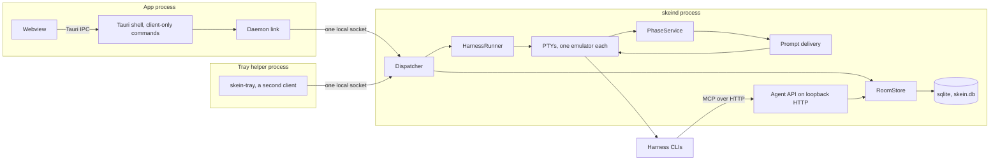
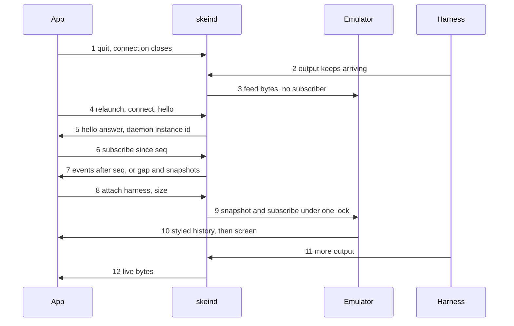
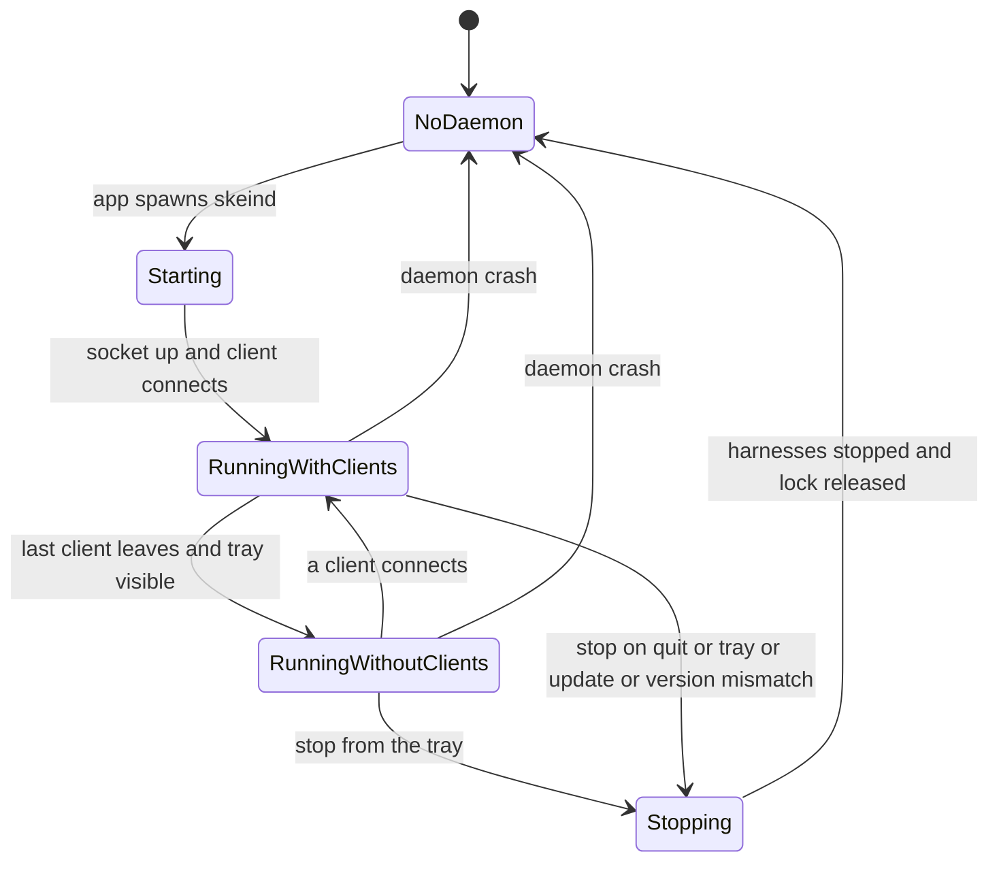
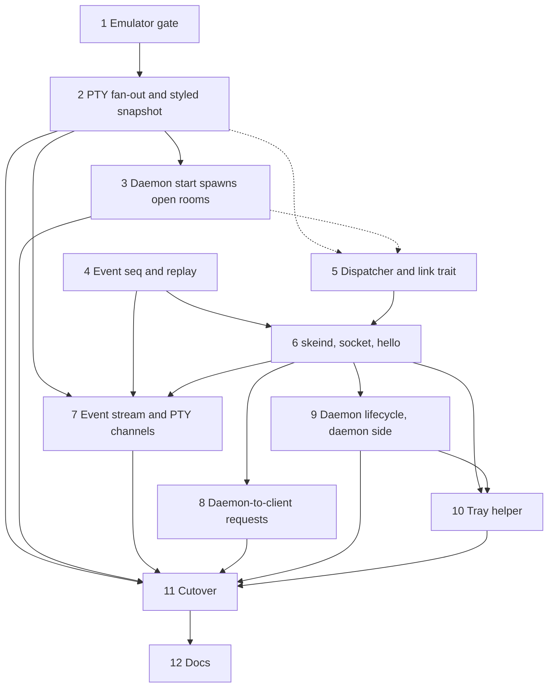

# skeind P2b: detached local mode (#584)

Status: design proposed 2026-11-18. All seven questions were decided by
Stefan on 2026-11-18 (D1 to D7 below); a few details stay open (see
"Still open"). Nothing is implemented, and no child issue is filed.
Epic: #575. Design: docs/skeind-design.md. Recon:
docs/skeind-recon.md (section 3 for the protocol surface, section 5 for
the emulator). P2a: docs/skeind-p2-design.md (#583).

P2b is the first phase that gives a user something new. The Skein
desktop app and its daemon become two processes. The daemon, `skeind`,
outlives the app. Quit the app and the harnesses keep working. Relaunch
and every terminal shows its screen again.

It depends on #583 (P2a). P2a made the daemon able to run a harness
with no client. P2b makes the daemon survive the client. #583 stays
open until a dogfood pass of v0.5.9 is done, so the later slices below
wait for it.

It absorbs three thin-client issues of epic #751 that say "with #584":

- #757: a seq on `RoomsChanged` and a rooms snapshot on connect. Folded
  into slice 4.
- #759: a two-way reconcile, and by D5 the daemon starting every open
  room's harnesses at its own start. Slice 3.
- #760: `SinkSlot` becomes N subscribers fed the emulator snapshot and
  then live bytes, with one size owner. Folded into slice 2.

It leaves two things alone. The network transport and device tokens
are #585. The client becoming a pure projection of daemon state is
#758, which depends on #757 and is not part of this work. #785 removes
boot preparation after #758.

## Goals and Non-goals

Goals:

- Quit the app and the harnesses keep working.
- Relaunch and every terminal shows its screen, then goes live.
- Several local clients can use one daemon at once. The daemon is the
  only writer of room and harness records (decided 2026-11-13).
- A versioned handshake from day one.
- The daemon does what the app does today, including starting every
  open room's harnesses at its own start (D5). The app holds no logic
  that the UI or the link does not need.

Non-goals:

- An embedded mode kept beside the detached one (D1).
- A network transport and device tokens (#585).
- Harnesses surviving a daemon crash. Durability comes from session
  resume, not from PTY survival (epic #575).
- The client becoming a projection of daemon state (#758).
- Approvals while unattended (#587).
- Any git mutation. Skein performs none (D9 on #52).

## Decisions

Each was asked of the user and decided on 2026-11-18. The rest of this
doc follows from them.

### D1. Detached is the only mode

Decided by Stefan, 2026-11-18.

**Decision.** `skeind` as a separate process is the default from the
release that ships it, with no way back and no embedded mode kept. In
his words: if we need to go back we revert code, we do not keep two
paths of code.

**Reason.** Two product paths double what must be tested, and the
embedded one would rot.

**Rejected.**
- An opt-in switch first, with the default flipped later (the doc's
  earlier recommendation).
- A permanent opt-in.

**Consequences.**
- No Settings switch between embedded and detached exists at any point.
- The preparatory slices still land on main in embedded form, so main
  stays shippable. One cutover slice switches the app to the socket and
  deletes the embedded path (`app/src-tauri/src/setup/embed.rs` and the
  in-process link as a product path). An in-process link may survive
  only as a test fixture.
- The dev profile (`tauri dev`) also runs two processes.
- Rollback is a revert of the cutover.

### D2. A re-attaching view gets full styled scrollback

Decided by Stefan, 2026-11-18.

**Decision.** On attach the client receives the styled scrollback
history, then the visible screen, then live bytes.

**Reason.** A reconnected terminal should look as if it never
disconnected.

**Rejected.**
- The visible screen only (the earlier recommendation).
- Plain-text history.

**Consequences.** From research on 2026-11-18. Verified means checked
against the crate's docs or source; not verified means part of the gate.

- Verified: no Rust crate has a built-in dump of styled scrollback plus
  screen plus modes.
- Proposed engine: `vt100` 0.18.x (0.18.1, 2026-10-19, MIT) behind the
  `TerminalEmulator` trait. The snapshot pages through history with
  `set_scrollback` and `rows_formatted`, then emits the visible screen
  with `state_formatted`. Version 0.18.0 also added
  `Callbacks::on_scroll`, which hands over each row scrolled off the
  top. That is an alternative way to keep history.
- Verified precedent: shpool restores sessions from a `vt100` fork with
  `last_n_rows_contents_formatted`.
- Not verified, and therefore part of the gate: synchronized output
  (mode 2026) support; whether alternate-screen state survives the
  paging; wide characters and hyperlinks in formatted output; and that a
  width change does not reflow. History written at one width will
  differ from what xterm.js would have reflowed.
- The gate's baseline becomes `@xterm/headless` with
  `@xterm/addon-serialize`, the client's own engine. The same recorded
  Claude Code byte stream goes through both, and the results are
  compared at cut points.
- Fallbacks if the gate fails, in order: `alacritty_terminal` 0.26.0
  with a serialiser we write over its grid (it has real history and
  reflow, and no serialise API); then a Node sidecar running
  `@xterm/headless` (the only option that does everything today, at the
  cost of a Node runtime beside the daemon).
- The history is bounded. The bound should equal the client terminal's
  scrollback setting. The exact number is open.

### D3. Daemon lifecycle

Decided by Stefan, 2026-11-18.

**Decision.** The app starts the daemon at its first start, if none is
already running on the machine for that profile. The daemon then runs
until it is stopped. It does not exit by itself when idle. An option in
the app, off by default, makes the app stop the daemon when the app
quits, for users who want today's behaviour where harnesses end with the
app. The daemon is visible to the user while the app is closed, through
a tray icon with options (D4).

**Reason.** Harnesses that outlive the app are the point of P2b, and an
idle exit would end them without anyone asking.

**Rejected.**
- Exit when idle (the earlier recommendation).
- An OS login service.

**Consequences.** An explicit stop path from the app option, from the
tray and from the update flow. A stop names the running harnesses
first.

### D4. The tray icon is a separate helper process

Decided by Stefan, 2026-11-18.

**Decision.** `skeind` stays fully headless. A small helper, working
name `skein-tray`, connects to the daemon like any client (`client_kind:
tray`) and shows the icon and its menu: open Skein, how many harnesses
are running, stop the daemon and its harnesses.

**Reason.** The daemon binary stays free of GUI code, for the headless
remote host of #585.

**Rejected.**
- The `skeind` binary drawing its own icon (the earlier
  recommendation).
- The app staying alive in the tray.

**Consequences.**
- A third executable to bundle, start, update and stop.
- The icon can die while the daemon lives. So the app restarts the
  helper on launch when the daemon is up and the helper is not, and the
  helper exits when its socket closes.
- Proposed, not confirmed: the app starts both `skeind` and the helper.
- Proposed, to be confirmed in its slice: the helper is a small
  windowless Tauri binary, because Tauri's tray support is already a
  dependency of the app.
- Risk: Linux tray support depends on the desktop environment.

### D5. The daemon starts what the app starts today

Decided by Stefan, 2026-11-18. Corrected the same day, after an earlier
draft of this decision misread "exactly as today".

**Decision.** "Exactly as today" is about functionality, not about who
triggers it. The app becomes a thin UI: no logic lives in it unless the
UI or the link to the daemon needs it. Whatever the app does today, the
daemon does. So when the daemon starts, it starts every harness of
every open room itself, with resume, without waiting for a client. It
already holds the knowledge: the room and harness records, and the argv
derived from the record at spawn (#752).

**Reason.** The user wants the daemon to be the product and the app a
view of it. A daemon that waits for a view to ask keeps launch logic in
the client.

**Rejected.**
- The daemon spawning nothing until a view or an agent verb asks (an
  earlier draft of this decision, a misreading of "exactly as today").
- Starting only the harnesses marked as running at the last exit.

**Consequences.**
- #759 (two-way reconcile; today `reconcile` only stops) IS part of
  #584 again, in its simplest form: at start the daemon ensures every
  PTY harness of every open (not archived) room runs. A richer
  per-harness desired state and restart generation stay as #759
  describes them. The slice implements #759 and closes it, or leaves
  the remainder there.
- The checks the app runs today before any harness mounts must be in
  the daemon, or it would start harnesses the app would have blocked.
  Verified paths: the repo identity check is
  `app/src/repoIdentity.ts` `compareIdentity`, run at hydrate
  (`useRoomsHydrate.ts`, `roomsStoreProbe.ts`), unarchive and repoint
  (`useRoomsRepoIdentity.ts`); a mismatched room shows
  `RepoMismatchCard` and mounts nothing. The missing-folder check
  (#164) is `app/src/missingFolder.ts` with `MissingFolderCard`, fed
  from `missingFolders` in `useRoomsStore.ts`. The daemon already has
  the spawn-time half: `harness_runner/gates.rs` `SpawnPlan::from_record`
  refuses `FolderMissing` and `RepoMismatch`, using `check_identity` in
  `crates/skein-daemon/src/git.rs` (an unknown identity passes). What
  is not in the daemon is the hydrate-time work: backfilling a stored
  identity for rooms that lack one, and the flags the UI shows. The
  slice moves that, with the app's vitest tables as the spec.
- A harness started with no view needs a terminal size. Proposed: the
  last known size, stored on the harness record as a daemon-owned field
  (`#[serde(default)]`), with a fixed default when none is stored. The
  first attaching client becomes the size owner and resizes. The exact
  default is open.
- Each start-time resume is marked in the event stream, as #584's
  acceptance asks.
- If the daemon itself dies while no app is running, nothing restarts
  the daemon. The next app launch starts it and everything comes back.
  That is the limit of durability here.
- This matches the #584 issue text and epic #575's durability wording.
  It supersedes the P2a wording "a harness starts on its first
  request" for daemon start. The docs slice updates
  `docs/skeind-p2-design.md` and CLAUDE.md's "spawns nothing; a harness
  starts on its first request" sentence.

### D6. An app update stops the daemon

Decided by Stefan, 2026-11-18.

**Decision.** Installing an update warns which harnesses are running,
stops the tray helper and the daemon, installs, and the new app starts
the new daemon. Harnesses resume. A `hello` version mismatch never
half-works: the app offers the same restart.

**Reason.** It is today's behaviour, with one version on both sides.
The Windows installer cannot replace a running executable (stated in
CLAUDE.md for #293; not re-tested here).

**Rejected.** The old daemon keeps running across an update.

**Consequences.** The update flow in `app/src/exitGuard.ts` gains a
stop step for both processes. The risks list carries the installer
hazard.

### D7. Local transport

Decided by Stefan, 2026-11-18.

**Decision.** A named pipe on Windows and a unix domain socket on macOS
and Linux. Auth is by filesystem permissions.

**Reason.** It is the epic's standing decision, and it needs no secret
on disk and no port.

**Rejected.** Loopback TCP with a token file.

**Consequences.** Two listener types (tokio has both). The pipe ACL and
the socket mode are tested per OS.

## Still open

- The emulator choice, pending the gate (slice 1). Unverified: mode
  2026 support, alternate-screen state across the paging, wide
  characters and hyperlinks in formatted output, and no reflow on a
  width change.
- The scrollback bound, as an exact number. It should equal the client
  terminal's setting.
- The tray helper's toolkit, and its behaviour on Linux desktops.
- Where the stop-on-quit option is stored (see "Settings and state").
- How phase inputs from several clients combine. Proposed: a keystroke
  from any client counts; focus mute holds while any client reports
  that harness focused; Hermes screen reading moves to the daemon's
  emulator, so no client reports it.
- Whether #583 closes before the dispatcher slice starts.
- The default terminal size of a harness the daemon starts with no
  stored size.
- Whether a harness the user had exited (post-exit state) is started
  again at daemon start. Proposed: yes, as an app launch does today.

## Today

The daemon is a library, not a program. `crates/skein-daemon` has no
`[[bin]]`. The app builds it in `app/src-tauri/src/setup/embed.rs` with
`Daemon::build(paths, spawn_env, identifier, InProcessTransport)`
(`crates/skein-daemon/src/daemon.rs`). It `app.manage`s each piece and
spawns the two server futures that `build` returns.

`InProcessTransport` (`crates/skein-daemon/src/transport.rs`) holds
three things: an `EventSink`, a `ClientRequests` and a `WebviewCapture`.
There is no transport trait yet.

The seams the daemon already has:

| Seam | Shape | Tauri impl |
| --- | --- | --- |
| `EventSink` | `emit_json(event, payload)`, a broadcast | `app/src-tauri/src/tauri_event_sink.rs` |
| `StreamSink<T>` | `send(item)`, one stream a call opens | `app/src-tauri/src/tauri_stream_sink.rs` |
| `ClientRequests` | `is_attached`, `send` (daemon asks the client) | `app/src-tauri/src/tauri_client.rs` |
| `WebviewCapture` | `capture` (native PNG of a rectangle) | `app/src-tauri/src/tauri_client.rs` |
| `Paths` | a struct: `data_dir`, `resource_dir` | `app/src-tauri/src/tauri_paths.rs` |

Commands. `app/src-tauri/src/lib.rs` registers 117 Tauri commands in 26
groups. About 12 are client-only: `updater_proxy` (4), `cli_shim` (3),
`os_notify` (2), `open_request_take`, `window_raise_main` and
`app_restart`. The other 105 or so call into daemon state. The largest
groups are review_surface (15), spawn_env (12), git (12), harness_log
(6) and resume (6).

PTY output. `crates/skein-daemon/src/pty/sink_slot.rs` has `SinkSlot`,
which holds at most one `Box<dyn StreamSink<PtyEvent>>`. The last attach
wins. With no sink, output is dropped and the daemon answers the cursor
query `ESC[6n` with a fixed `ESC[1;1R`. `HarnessRunner` has
`ensure_running(..., sink)`, `detach_view` and `stop_harness`
(`harness_runner/mod.rs`). A view that attaches again starts blank and
forces a repaint with a one-row resize
(`app/src/terminalRepaint.ts`).

Events. `EventSink` carries `skein://rooms-changed`, `harness-phase`,
`mail-changed`, `mail-held`, `review-changed`, `delivery-seam`,
`agent-room-created`, `agent-request`, `harness-permission`,
`harness-session-start`, `harness-session-end`, `harness-hermes-hook`
and `opencode-sidecar-exit`, plus the unprefixed `harness-action`. Only
`skein://harness-phase` has a seq. It is process-wide and sits on
`PhaseUpdate` (`harness_phase/stream.rs`). `rooms-changed` has none.
`Room.revision` is per room.

Wire version. `PROTO_VERSION: u32 = 1` exists in
`crates/skein-proto/src/lib.rs`. Nothing uses it.

Agent API. An axum server on `127.0.0.1:0` inside the daemon. Tokens
are revoked wholesale at daemon build and per room on archive
(`agent_api/token_lifecycle.rs`). By D1 of the P2a doc a token lives as
long as the daemon.

App exit. `app/src/exitGuard.ts` `prepareExit` flushes rooms before
quit and before an updater install. `RunEvent::Exit` stops only the
opencode sidecars. PTYs die with the process. The single-instance plugin
is registered first in `lib.rs`.

Paths. `data_dir` is the per-profile app data dir. There are three build
profiles with their own identifiers (see CLAUDE.md, "Running it").
`skein.db` and `settings.json` live there. Logs are set up client-side
(`setup/logging.rs`), not through `Paths`.

Windows. The NSIS installer refuses to install while any process with
its own exe name runs (#293). The local-release profile renames its exe
for that reason.

## Target

Two long-lived processes, plus the small tray helper (D4). The app
keeps the window, the webview and the client-only commands. It holds
one connection to `skeind`. `skeind`
holds everything P2a moved into the daemon. The agent CLIs stay
children of `skeind`, so they keep running when the app goes.



Figure 1: the app and the tray helper as clients of `skeind` over the
local socket. Renders sections "Target" and "The protocol"; the text is
authoritative (non-normative).

1. The webview talks Tauri IPC to its own shell, as today. It never
   opens the socket.
2. The shell forwards daemon-bound commands over the link. It keeps the
   client-only commands to itself.
3. One local socket carries requests, the event stream and PTY
   channels. Any number of clients can connect. The tray helper is the
   second one (D4); it uses requests and events only, no PTY channels.
4. The dispatcher in `skeind` is the only entry into the daemon. The
   agent API keeps its own loopback HTTP listener for the harness CLIs.
5. Harness CLIs are children of `skeind` and reach the agent API with
   MCP over HTTP, as they do today.

## The protocol

One connection per client carries three things:

- Requests. Client to daemon, and also daemon to client for the design
  verbs, `files.dirty` and the webview capture.
- The event stream (next section).
- PTY channels (the section after).

Framing. Length-prefixed frames. Requests and events are JSON. PTY
bytes and file bytes are binary frames, with no base64. Each frame
carries a small header: a kind, a channel id and a length.

Handshake. The client sends `hello { proto_version, client_kind,
capabilities }`. The daemon answers with its own `proto_version`, its
build, and a daemon instance id. The instance id is new on every daemon
start. A client uses it to tell "same daemon, resume with `since=seq`"
from "new daemon, take a fresh snapshot". `PROTO_VERSION` finally gets a
user. A `proto_version` mismatch never half-works: the daemon refuses
the connection and names both versions.

Client inputs. Each `harness_phase_input` (keystroke, screen reading,
focus mute and the rest) is stamped by the daemon with the connection's
client id, as the P2a doc assumed. How inputs from several clients
combine is open (see "Still open").

Capabilities say which daemon-to-client requests this client can
answer. The set is the design pane, the webview capture, and Files
buffers. With several clients, the daemon asks the ones that declared
the capability and takes the first answer. With none, it refuses
`no_client`, as it does today.

Request dispatch. One dispatcher in the daemon, `dispatch(Request) ->
Response`. The in-process link is the only caller until slice 6. From
slice 6 to the cutover (slice 11) both exist on main, and only the
in-process one ships. After the cutover only the socket is a product
path (an in-process link may remain as a test fixture). The roughly 105 daemon-bound Tauri commands become
thin forwarders in the shell and keep their names, so the webview does
not change. Request and response types live in `skein-proto`. The
in-process link keeps working with the same dispatcher, which is what
lets every earlier slice ship in embedded form.

Auth. The local socket is protected by filesystem permissions (epic
#575). The transport is D7: a named pipe on Windows, a unix domain
socket elsewhere.

## The event stream

Today most events have no seq, and a client that was away has no way to
ask what it missed. P2b gives every broadcast event one per-daemon seq.

- A wrapper around the `EventSink` stamps each event with the next
  number from one counter. The existing phase seq becomes this seq.
- A bounded in-memory log keeps the most recent events.
- `subscribe(since)` returns the events after `since`, or `gap` when
  `since` is older than the log or the daemon instance id differs.
- On `gap` the client re-reads its snapshots (rooms, the phase
  snapshot, mail, review counts) and continues from the current seq.

This is #757 folded in: the seq on `RoomsChanged` and the rooms
snapshot on connect are the same mechanism.

The Live Context feed needs no replay log. It is backed by sqlite
(`harness_actions` rows) and already re-reads from there. Only live
state that has no row needs the seq log.

The per-room `Room.revision` stays. It guards `PatchRoom` and
`PatchHarness` against stale writes. The seq orders events; the
revision orders edits. They answer different questions.

## The PTY channel and the snapshot

Do not replay a raw byte ring into a fresh xterm.js (epic #575). The
daemon keeps a headless emulator per PTY and sends its styled
scrollback and its screen (D2).

The emulator sits behind a trait:

```text
trait TerminalEmulator {
    feed(bytes)
    resize(rows, cols)
    snapshot() -> bytes   // styled history, then screen and modes
}
```

`vt100` 0.18.x is the proposed first implementation (D2), subject to
the gate. The snapshot pages through history with `set_scrollback` and
`rows_formatted`, then emits the visible screen with `state_formatted`.
The history is bounded, to the client terminal's scrollback setting
(exact number open). Every call into the parser is wrapped in
`catch_unwind`, because the recon found open panics on odd resizes. A
caught panic drops that PTY's emulator state and rebuilds it empty. It
does not kill the daemon.

Fan-out. Each PTY's output goes to its emulator and to a set of
subscribers. The set replaces the single `SinkSlot`. This is #760
folded in.

- Attach takes the snapshot and adds the subscriber under one lock. It
  sends the snapshot, then live bytes. No byte falls between the two.
- With no subscriber, the emulator still keeps the screen. It also
  answers the cursor query from its real cursor position, not the fixed
  `1;1`.
- One size owner: the last active client sets the PTY size. The size is
  re-asserted when that client becomes active again. Smallest-wins is
  rejected (epic #575).
- The one-row repaint hack goes away. The snapshot is the repaint.
- The Hermes screen phase can read the emulator screen with no client.
  P2a left it as `unknown` without one.



Figure 2: quit, keep running, relaunch, reattach. Renders sections "The
event stream" and "The PTY channel and the snapshot"; the text is
authoritative (non-normative).

The emulator gate. The recon has a proposed test and the issue makes it
a gate. Record a real Claude Code PTY byte stream, with resizes and the
alternate screen. Replay it into the emulator, and into `@xterm/headless`
with `@xterm/addon-serialize`, which is the baseline because it is the
client's own engine. Compare the daemon's snapshot, history included,
with the baseline at cut points: after a resize, in the alternate
screen, mid-redraw. The gate also checks the unverified items of D2:
mode 2026, alternate-screen state across the paging, wide characters
and hyperlinks, and the lack of reflow. This runs first (slice 1). If it
fails, the fallbacks are, in order, `alacritty_terminal` 0.26.0 with a
serialiser we write, then a Node sidecar running `@xterm/headless`. The
trait keeps that a local change.

## Lifecycle

Starting. At its first start the app looks for the daemon's socket for
its own profile. If it is there, the app connects. If not, it spawns
`skeind` detached and waits for the socket (D3). Detached means its own
process group, no console window on Windows, and outside the app's job
object, so it does not die with the app. The dev profile does the same,
so `tauri dev` also runs two processes.

Single instance. Two daemons on one `skein.db` erase each other's rooms
(the same hazard the app's single-instance plugin guards). Two rules:

- The socket name is derived from the profile identifier, so the three
  profiles never meet.
- The daemon takes an exclusive lock file in the data dir before it
  opens sqlite. A second daemon that cannot take the lock exits.

The app's own single-instance plugin stays, registered first.

Running. The daemon runs until it is stopped. It never exits by itself
when idle, with or without clients (D3). While no client is attached the
tray icon is the user's view of it (D4).

Stopping. Four things ask the daemon to shut down, and each names the
running harnesses first:

- the app's option "stop the daemon when I quit", off by default, on
  quit;
- the tray menu;
- the update flow (D6);
- a `hello` version mismatch, where the app offers the restart.

A plain quit with the option off leaves the daemon running. A stop
ends the tray helper too.

Tray helper. The app starts `skein-tray` after the daemon. On launch,
if the daemon is up and the helper is not, the app restarts the helper.
The helper exits when its socket closes (D4).

Daemon crash. The app sees the socket close. It shows a reconnect
state, starts a new daemon and reconnects. The new daemon has a new
instance id, so the client takes fresh snapshots. The new daemon
starts every open room's harnesses itself, with resume (D5), and the
app's views attach to them. If no app is running when the daemon dies,
nothing restarts the daemon: the next app launch starts it and
everything comes back.

Process trees. This is #190, landed on main on 2026-11-18 (PR #790).
Its code is `crates/skein-procprio/src/tree.rs` and
`crates/skein-daemon/src/pty/tree.rs`. Every harness PTY child is put in a Windows job object
with KILL_ON_JOB_CLOSE, and the job handle is held by the process that
spawned the child, so the whole tree dies when that process exits. On
Unix a kill sends SIGHUP and then SIGKILL to the child's process group.
Consequences:

- In detached mode the job handle must be owned by the `skeind` process,
  never by the app. That holds automatically as long as only `skeind`
  spawns PTYs.
- The app must start `skeind` outside any job object of its own (see
  "Starting" above).
- On Windows a daemon exit or crash takes every harness tree with it.
  That is intended: durability is resume.
- On Unix there is no kill-on-close equivalent. After a daemon crash
  (not a clean stop) children are ended only by the PTY closing, and a
  leftover process group is possible. See Risks.

Logging. The daemon writes its own daily log in the profile's log dir.
The app keeps its own. The two are separate files, so neither process
holds a file the other rotates.

Environment. The daemon inherits the environment of the app that
started it. The spawn-env probe (login shell PATH merge, host-terminal
identity stripping) keeps running in the daemon. A daemon started from
an old app session keeps that session's environment until it restarts.



Figure 3: daemon states. There is no idle exit. Renders section
"Lifecycle"; the text is authoritative (non-normative).

## Durability

The daemon starts what the app starts today (D5). This is #759 in its
simplest form (slice 3).

- At its start the daemon ensures every PTY harness of every open (not
  archived) room runs, through `ensure_running`, with resume. It does
  not wait for a client. `reconcile` on `RoomStore::observe`, which
  today only stops harnesses, now also starts them.
- Before it starts a room's harnesses the daemon runs the checks the
  app runs today: the missing-folder check and the repo identity check
  (see D5 for the verified paths). A gated room mounts nothing.
- A harness started with no view needs a size. The daemon uses the last
  known size, a daemon-owned field on the harness record
  (`#[serde(default)]`), or a fixed default when none is stored. The
  first attaching client becomes the size owner and resizes.
- Each start-time resume is marked in the event stream, so a client
  that was away sees "harness X was resumed" and does not guess.
- An app that connects mounts the same harnesses and attaches to the
  running ones. The new daemon instance id in `hello` tells it to take
  fresh snapshots.
- Quitting the app no longer stops harnesses. They keep running in the
  daemon, and the reattach shows their styled screen.
- A richer per-harness desired run state and a restart generation stay
  as #759 describes them. The slice implements #759 and closes it, or
  leaves that remainder there.

The spawn already derives its argv from the record and probes that the
session exists (`harness_argv/spawn.rs`, #752). A resume therefore
needs no new argv logic, only the start-time trigger.

D1 of the P2a doc still holds: a token lives as long as the daemon, so
a resumed harness gets a fresh token and fresh environment at spawn.

## Settings and state

Daemon-owned, unchanged: `skein.db` and `settings.json` in the profile
data dir. That covers spawn settings, tool groups and default agents.

Client-owned, unchanged: webview localStorage UI prefs, the updater,
the CLI shim, OS notifications and open requests.

New: one option, "stop the daemon when I quit", off by default (D3). It
is a client setting, because the app reads it at quit and the daemon
does not need it. Proposed, not confirmed: store it in a small client
file beside the app's own config. There is no embedded or detached
setting (D1). Nothing else is new.

## Migration from the embedded daemon

The same `Daemon` code runs before and after the cutover. Only the link
differs: an in-process link, then a socket link. There is no second
implementation of any feature, and (D1) no embedded path survives the
cutover.

Order the work so main stays shippable at every step:

1. The emulator and the fan-out land in embedded form. A webview reload
   already shows the styled screen instead of a blank terminal.
2. The daemon starts every open room's harnesses at its own start
   (slice 3). In embedded mode that is before the views mount, and the
   views attach to the running harnesses.
3. The event seq lands in embedded form. A webview reload already
   catches up.
4. The dispatcher lands, with the in-process link as its only caller.
5. The binary, the socket, the stream channels, the client crate and
   the daemon-side lifecycle land (slices 6 to 9). Nothing starts them
   yet.
6. The tray helper lands (slice 10). Nothing starts it yet.
7. One cutover slice (slice 11) switches the app to the socket, starts
   `skeind` and the tray helper itself, and deletes the embedded path
   (`app/src-tauri/src/setup/embed.rs` and the in-process link as a
   product path). An in-process link may stay as a test fixture.

There is no switch at any point. Rollback is a revert of the cutover.
Dogfood on the local-release profile before a release.

The dev profile (`tauri dev`) also runs two processes after the cutover.

Bundling. Three executables ship in the app bundle: the app, `skeind`
and `skein-tray`. `skeind` is a Tauri external binary. Each of the
three gets a per-profile exe name for the same reason as #293: the
Windows installer refuses to run while a process of its own exe name is
alive, and a detached daemon and a tray helper are exactly that. The
update flow stops both before the install (D6). See Risks.

## Proposed decisions not put to the user

Each is Proposed. They follow from the epic's standing decisions or
from the shape of the code, and can be reopened.

- Proposed: one dispatcher shared by both links. The in-process link
  and the socket call the same `dispatch` until the cutover, so the two
  cannot drift.
- Proposed: the shell proxies and the webview never opens the socket.
  The webview keeps its Tauri IPC, the webview needs no socket
  permission and the 105 command names stay.
- Proposed: one seq for all events, with #757 folded in. One counter is
  simpler than one per event kind, and the phase seq already is one.
- Proposed: N subscribers per PTY with #760 folded in. Several clients
  on one daemon need it, and it removes the repaint hack.
- Proposed: a lock file in the data dir plus a profile-derived socket
  name give single instance. The lock guards sqlite; the name keeps
  profiles apart.
- Proposed: the app starts both `skeind` and the tray helper, and the
  helper is a small windowless Tauri binary (D4; the toolkit is
  confirmed in its slice).

## Slices

Each slice ships alone and keeps main shippable. Slices 1 to 10 change
the product only in ways a user can only improve, or not at all. Slice
11 is the cutover.

1. **Emulator gate.** New `crates/skein-daemon/src/pty/emulator/`: the
   trait, a `vt100` 0.18.x implementation that pages styled history and
   then the screen, tests, and a recorded-session fixture. A vitest in
   `app/src` runs the same stream through `@xterm/headless` with
   `@xterm/addon-serialize` as the baseline and compares at cut points.
   Builds on #190, which has landed in `pty/`. No behaviour change.
2. **PTY fan-out and styled snapshot on attach (#760).**
   `crates/skein-daemon/src/pty/sink_slot.rs`, `pty/observer`,
   `harness_runner/` (attach, detach, size owner);
   `app/src/useTerminalSpawn.ts`, `terminalRepaint.ts` (removed),
   `harnessEnsure.ts`. Depends on 1. Ships in embedded form: a webview
   reload shows the screen and its history.
3. **Daemon start spawns open rooms' harnesses (#759).** The two-way
   reconcile at start, the repo identity and missing-folder gates in the
   daemon, the last known size on the record, and the resume marker
   events. Files: `crates/skein-proto/src/rooms.rs`,
   `crates/skein-daemon/src/room_store/`, `harness_runner/` (reconcile),
   `boot_resume.rs`, and a new repo identity module in the daemon. The
   daemon already has `git.rs` `check_identity` and `RepoIdentityDto`,
   and `harness_runner/gates.rs`, which refuses `FolderMissing` and
   `RepoMismatch` at spawn; `skein-git` `repo.rs` supplies the root
   commits. On the app side `app/src/repoIdentity.ts` and the hydrate
   path (`useRoomsStore.ts`, `useRoomsHydrate.ts`) keep only the display
   side. Follows 2, because both change `harness_runner/`. Ships in
   embedded form: the daemon starts harnesses before the views mount,
   and the views attach to them. Implements #759 and closes it, or
   leaves the richer desired-state remainder there.
4. **Event seq and replay (#757).**
   `crates/skein-daemon/src/event_sink.rs` plus a new seq log module,
   `harness_phase/stream.rs`; `crates/skein-proto` (the event
   envelope); `app/src/phaseMirror.ts`, `roomsSync.ts`,
   `useRoomsSync.ts`, `mailHeldMirror.ts`. Independent of 1 to 3. It
   landed in embedded form; see
   [skeind-event-sink.md](skeind-event-sink.md).
5. **Request dispatcher and link trait.** New request and response
   types in `crates/skein-proto/src`, new
   `crates/skein-daemon/src/dispatch/`, and `transport.rs` (the link
   trait and the in-process impl). The Tauri commands become
   forwarders: `app/src-tauri/src/commands/*`,
   `review_surface/commands.rs`, `review/commands.rs`,
   `agent_api/commands.rs`, `resume.rs` and
   `harness_actions_hermes.rs`. Large and mechanical. Split by command
   group into several pull requests: rooms; harness runner and pty;
   phase and delivery; review and review surface; git and fs; spawn env
   and settings; the rest. No behaviour change. An old and a new path
   never coexist for one command. Depends on #583 closing (open: see
   "Still open"). Its pty and harness-runner command group also follows
   slices 2 and 3, because they change the attach signature and the
   runner that those forwarders wrap. Slices 3, 4 and this one all add
   files to `crates/skein-proto`, different ones; coordinate the
   `lib.rs` re-exports.
6. **`skeind` binary, local socket, hello.** A new `crates/skeind` with
   a thin `main`. Proposed over a `[[bin]]` in `skein-daemon`, because
   a separate crate keeps the library free of a `main` and of CLI
   parsing, and keeps `cargo tree -p skein-daemon` as it is. Add
   `crates/skein-daemon/src/transport/` (framing, the pipe and socket
   listeners, hello); the existing `transport.rs` becomes
   `transport/mod.rs`. Add a new `crates/skein-client`, the connecting
   side, reusable by the tray helper, a later CLI or a mobile bridge,
   and used by `app/src-tauri`. Depends on 4 and 5.
7. **Event stream and PTY channels over the socket.** `subscribe(since)`
   and `gap` over the link, binary PTY frames, the socket
   implementations of `EventSink` and `StreamSink<PtyEvent>` on the
   daemon side and their counterparts in `crates/skein-client`, and
   attach, detach, resize and input over the link. Files:
   `crates/skein-daemon/src/transport/`, `event_sink.rs`,
   `stream_sink.rs`, `crates/skein-client` (new),
   `app/src-tauri/src/tauri_event_sink.rs` and `tauri_stream_sink.rs`.
   Depends on 2, 4 and 6.
8. **Daemon-to-client requests routed by capability.**
   `crates/skein-daemon/src/agent_api/client.rs` (`ClientRequests` and
   `WebviewCapture` routed by capability),
   `app/src-tauri/src/tauri_client.rs`. Depends on 6.
9. **Daemon lifecycle, daemon side.** The lock file, a stop request that
   names the running harnesses, the daemon's own logging, and running
   with no client attached (`crates/skein-daemon`, `crates/skeind`).
   Depends on 6.
10. **Tray helper.** A new crate, working name `crates/skein-tray`, a
    `client_kind: tray` client with the icon and its menu (open Skein,
    running-harness count, stop). It owns only that crate and its menu.
    Bundling and starting it belong to the cutover. Depends on 6 and 9
    (it needs the stop request and the running-harness count). It lands
    before the cutover; D3 wants it in the same release.
11. **Cutover.** It alone owns `app/src-tauri/tauri.conf.json`,
    `.github/workflows/release.yml` and `app/src-tauri/src/setup/` for
    all three executables. The app finds, starts and connects to
    `skeind`, starts the tray helper, and restarts the helper on launch
    when the daemon is up and the helper is not. It reconnects on a new
    daemon instance; the daemon itself restarts the harnesses (slice
    3). It adds the stop-on-quit option and the update flow (stop the
    helper and the daemon, install, start), and bundling. It deletes the
    embedded path of `app/src-tauri/src/setup/embed.rs`. The dev profile
    runs two processes. Files: `app/src-tauri/src/setup/`, `lib.rs`,
    `app/src/exitGuard.ts`, `SettingsModal.tsx`,
    `app/src-tauri/tauri.conf.json`, `.github/workflows/release.yml`.
    Depends on 2, 3, 7, 8, 9 and 10.
12. **Docs.** CLAUDE.md (including its "spawns nothing; a harness starts
    on its first request" sentence), docs/skeind-p2-design.md (the
    phase 2a "a harness starts on its first request" wording, for
    daemon start), docs/agent-api.md, docs/skeind-crates.md,
    docs/e2e-dev-driving.md. The #584 and #575 wording needs no change
    under D5. Depends on 11.

Parallel work. Slices 1, 4 and 5 touch different areas and can run side
by side once their preconditions hold. Slice 1 has none left (#190 has
landed). Slice 5 waits for #583 to close. Slices 3, 4 and 5 all add
files to `crates/skein-proto` (different files; coordinate the `lib.rs`
re-exports). Slice 2 follows 1, slice 3 follows 2, and slice 5's pty
and harness-runner command group follows 2 and 3. Slice 10 can run
beside slices 7 and 8.



Figure 4: slice dependencies. A dotted edge means only one command
group of slice 5 waits. Renders section "Slices"; the text is
authoritative (non-normative).

## Risks

- **No fallback path.** D1 keeps no embedded mode, so a bad release has
  nothing to fall back to but a revert. Mitigation: the preparatory
  slices ship in embedded form first, the cutover is one revertable
  change, and it is dogfooded on the local-release profile before a
  release.
- **The daemon starts a harness the app would have gated.** The app
  blocks a room with a missing folder or a repo identity mismatch before
  anything mounts. Mitigation: the gates move in the same slice (3), and
  the app's existing vitest tables (`repoIdentity.test.ts`,
  `missingFolder.test.ts`) are ported as the spec.
- **Many CLIs start at once at daemon start.** An app launch does the
  same today, so this is no new load; note it when measuring.
- **Styled scrollback fidelity and no reflow.** A `vt100` snapshot may
  differ from what xterm.js shows, and history written at one width does
  not reflow. Mitigation: the gate runs first against the
  `@xterm/headless` baseline, the trait keeps the engine replaceable
  (fallbacks in D2), and parser calls are wrapped in `catch_unwind`
  because the recon found open panics on odd resizes.
- **A third process, the tray helper, out of step.** It can die while
  the daemon lives, or run a different version. Mitigation: the app
  restarts it on launch, it exits when its socket closes, `hello`
  refuses a version mismatch, and the update flow stops it.
- **Linux tray support.** It depends on the desktop environment.
  Mitigation: the daemon works without the icon, and the app offers the
  stop path as well.
- **Frontend regressions with thin coverage.** Nearly every shipped
  regression has lived in the frontend. Mitigation: each preparatory
  slice ships in embedded form first.
- **Two daemons on one database.** They erase each other's rooms.
  Mitigation: an exclusive lock file taken before sqlite opens, and a
  socket name derived from the profile.
- **A stale or orphan daemon after an update.** Mitigation: hello
  refuses a version mismatch and names it, and the app offers to
  restart the daemon (D6).
- **A leftover process group on Unix after a daemon crash.** #190 (landed,
  PR #790) gives Windows a job object with KILL_ON_JOB_CLOSE,
  so a daemon exit takes every tree with it. Unix has no equivalent: a
  kill sends SIGHUP then SIGKILL to the child's process group, but after
  a crash (not a clean stop) children are ended only by the PTY closing.
  Mitigation: a clean stop kills every group, and the next daemon start
  cannot adopt old children anyway.
- **The Windows installer and running exes.** NSIS refuses to install
  while the exe name runs. Mitigation: per-profile exe names, and an
  update flow that stops the helper and the daemon first (D6).
- **Pipe or socket permissions wrong.** A readable socket is an open
  door to every harness. Mitigation: tests that check the pipe ACL and
  the socket mode, per OS.
- **Added latency on PTY bytes from the extra hop.** Mitigation: binary
  frames with no base64, and a measurement of keystroke echo before and
  after slice 11.
- **The dispatcher slice is wide.** About 105 commands move. Mitigation:
  mechanical, by command group, and an old and a new path never coexist
  for one command.
- **#583 is still open.** Slice 5 waits for #583 to close. Slices 1
  to 4 do not depend on #583's remaining work. Mitigation: start slices
  1 and 4 first, and start 5 when #583 closes.

## Acceptance mapping

| #584 acceptance item | Satisfied by |
| --- | --- |
| Quit the app with harnesses running; relaunch; the same harnesses are attached and the feed catches up from `since=<seq>` | Slices 2 and 4 for the styled screen and the catch-up, slices 7 and 11 for the quit and relaunch |
| Kill and restart the daemon; harnesses are re-spawned with resume and the event stream records it | Slice 3 (the daemon starts every open room's harnesses at its own start and marks each resume in the event stream), slice 11 (the app starts the daemon and reconnects). With no app running, nothing restarts the daemon (D5) |
| Emulator check: replay a recorded Claude Code session and compare the snapshot with xterm.js | Slice 1 (against `@xterm/headless` with the serialize addon) |
| Parser panics on odd resizes are caught and do not kill the daemon | Slice 1 (`catch_unwind` in the trait implementation, with a test) |
| `cargo test --workspace`, `cargo test --manifest-path app/src-tauri/Cargo.toml`, `cd app && npm test` pass | Every slice |
| Local socket with filesystem permissions as auth | Slice 6 (D7) |
| `hello { proto_version, client_kind, capabilities }` | Slice 6 |
| Last active client sets the size, re-asserted on reactivation | Slice 2 |
| Settings: attached vs detached | Dropped (D1): no switch. Slice 11 adds only the stop-on-quit option |
| Default decision | Decided (D1): detached only, slice 11 |

## Proposed child issues

Nothing has been filed. #757, #759 and #760 already exist. They would
be reused as the bodies of slices 4, 3 and 2, or closed with a pointer
to the matching P2b child. These titles are drafts:

- skeind P2b-1: emulator trait, `vt100` implementation and the replay
  gate against `@xterm/headless`.
- skeind P2b-2: PTY subscribers, styled snapshot on attach and one size
  owner (reuses #760).
- skeind P2b-3: daemon start spawns every open room's harnesses, with
  the identity and folder gates, last known size and resume markers
  (reuses #759).
- skeind P2b-4: per-daemon event seq, replay log and `gap` handling
  (reuses #757).
- skeind P2b-5: request dispatcher and link trait, by command group
  (several pull requests).
- skeind P2b-6: `skeind` binary, local socket, framing, hello and the
  client crate.
- skeind P2b-7: event stream and PTY channels over the socket.
- skeind P2b-8: daemon-to-client requests routed by capability.
- skeind P2b-9: daemon lifecycle, daemon side: lock file, stop request,
  logging, running with no client.
- skeind P2b-10: tray helper.
- skeind P2b-11: cutover: the app starts `skeind` and the tray helper
  and connects, reconnect, stop-on-quit option, update flow, bundling,
  delete the embedded path.
- skeind P2b-12: docs, including CLAUDE.md and `docs/skeind-p2-design.md`
  per D5.
