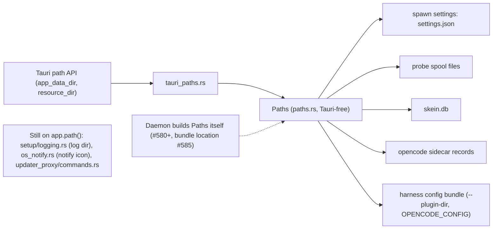

# Paths: where server-side state lives (#579)

A daemon has no `tauri::App` (#575), so the server-side setup code
cannot ask Tauri where the app data or resource directory is. It reads a
`Paths` value instead. The Tauri build fills it from the Tauri path API;
a daemon will build its own. Behaviour is unchanged.

Figure: where each server-side path comes from and who uses it. Renders
`paths.rs`, `tauri_paths.rs`, `shared_state.rs` and `setup/state.rs` in
`app/src-tauri/src`; non-normative, the code is authoritative.

`Paths` carries `data_dir` (fatal if unresolvable) and
`resource_dir: Result<PathBuf, String>` (never fatal: the error text
becomes `HarnessConfig::unavailable`). `shared_state.rs` builds the
state from a `Paths` and an event sink with no Tauri types, so a test
can do it in a temp dir. The login-shell probe is a `Probe` parameter,
so tests pass `Probe::Skip`. The log dir is deliberately not in `Paths`:
logging is a client concern.

## Construction order in `setup()`

1. `Paths` from the Tauri app.
2. Spawn env (creates the data dir, loads settings), then the login-shell
   probe.
3. Updater proxy init (client side, reads `paths.data_dir`).
4. Harness config, from `paths.resource_dir`.
5. Database, then the managers on it and the event sink.
6. Agent API server (`AgentApiState` needs the database; it still holds an
   `AppHandle`, which is #580/#582).
7. Design preview (`PreviewState` needs the database).
8. Manage the database.
9. Window, open request, menu, perf.

Steps 2, 4 and 5 live in `shared_state.rs`; the order is also written in
the module doc of `setup.rs`.
