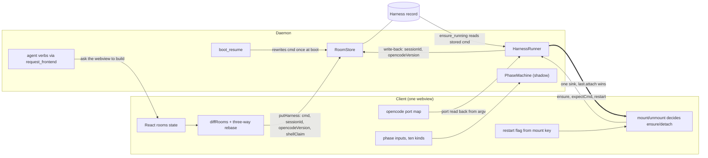
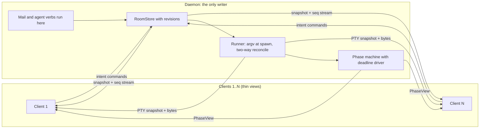
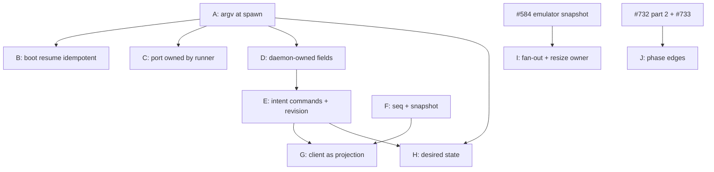

# skeind P2a port review: what to keep, what to rework (#583)

Status: review of slices 1 to 4 part 1 (#729, #730, #731, #732).
Epic: #575. Design: docs/skeind-p2-design.md.

## 1. Purpose and scope

Phase 2a moved TypeScript frontend logic into the Rust daemon close to
1:1. This review asks which parts of that port are the right long-term
design and which are only right while one webview drives one embedded
daemon. It gives a verdict per piece, the fix, and when to do it. It
adds no new design to the epic; section 8 is a draft of the work, not a
filed issue.

Reviewed at: main 068efa9, 2026-11-13. Method: six read-only reviews,
one question each. Code was read; nothing was run. Items marked "not
reproduced" were derived from reading only.

## 2. Summary verdict

The 1:1 port was the right method. Most of what it produced is the right
long-term design: the pure argv builders, the phase machine's rules and
constants, the `RoomStore` core, and the runner's process ownership.
None of these should be rewritten.

What needs rework is not the ported logic. It is the seams where the
client stayed in charge:

- (a) The room sync wire vocabulary: whole records, sent from a
  client-side state diff, with no revision.
- (b) `Harness.cmd` stored as text, with several writers, rewritten once
  at boot.
- (c) View-driven start, one output sink, no resize owner.
- (d) The phase machine's client-fed edges.

| Piece | Verdict | When |
| --- | --- | --- |
| RoomStore core (#729) | keep as is | never |
| Room mutation vocabulary + client diff/merge (#729) | rework | small hardening before #733/#734; full move after phase 2a, with #584 |
| harness_argv pure builders (#730) | keep as is | never |
| Stored Harness.cmd, client write-back, opencode port plumbing (#730) | rework (small) | before #733/#734 |
| HarnessRunner process ownership, gates, refusals (#731) | keep as is | never |
| View-driven start, single sink, resize, restart flag (#731) | rework | with #584 |
| Boot resume one-shot rewrite (#731) | rework (small) | before #733/#734, or removed by spawn-time argv |
| Phase machine rules, constants, tests (#732) | keep as is | never |
| Phase machine edges: tick driver, client-fed inputs, Hermes poller, Reattached (#732) | clean up later | after the flip (part 2) |
| Phase snapshot wire type (#732) | decide now | during #732 part 2 |

### Figure 1: who writes what, today

Figure 1: three separate writers change the same harness record, and
the daemon spawns from whatever text they left in `cmd`. Renders
sections 5.1 to 5.4; the text is authoritative.

### Figure 2: recommended shape

Figure 2: clients send intent and render daemon state; every write to a
record, every spawn decision and every phase fact is made in the daemon.
Renders sections 5 and 7; the text is authoritative.

## 3. Product direction this review assumes

Decided by the user on 2026-11-13 for this review:

1. Several clients may be attached to one daemon at the same time.
2. The desktop client becomes a thin view: the daemon is the only writer
   of room and harness records. The client sends intent commands and
   renders daemon state.

Issue #583 lists the phase/client split as "not decided", and no issue
promises concurrent clients in words. These two answers are what turn
several "clean up" items below into "rework".

## 4. What the later phases require

From the issue bodies, all open:

- #575 / #584: a monotonic per-daemon seq covering every state change;
  reconnect with `since=seq`, or snapshot plus tail ("Today no event has
  a seq or replay"). A headless emulator per PTY sends a snapshot, then
  live bytes; snapshot and subscribe happen under one lock. "The last
  active client sets the size." "The daemon owns which harnesses should
  run and their sessionId, and re-spawns them with resume on start."
- #585: rooms are keyed by (daemon id, room id). Stored cwd, repoRoot
  and argv are daemon-host paths that "clients must not interpret"
  locally.
- #587: "Any client can answer; the first answer wins." A permission
  request with no client attached must still produce a push.
- #733 and #734 assume the daemon knows phase with no client.
- #588: engines run unchanged against a Runtime that is not
  `HostRuntime`.

## 5. Per piece

Six criteria are used throughout. Each finding carries the number of the
criterion it falls under.

1. Single-webview assumptions.
2. Split ownership: two writers.
3. Idiomatic Rust.
4. Testability without a client.
5. Fitness for N clients and remote hosts.
6. Cost and risk of rework now versus later.

### 5.1 Room records (#729)

**Verdict.** Store core: keep as is. Wire vocabulary and client sync:
rework.

**Right as built.**

- In-memory authority; per-row upsert and delete in one transaction.
- Load gate, quarantine, `.bak` rotation, and the load persisting under
  the lock.
- Structural-versus-debounced is decided in the daemon
  (`crates/skein-daemon/src/room_store/structural.rs`).
- Change events carry full room state and are idempotent, which is a
  good resync shape.
- Skip rules never resurrect a removed room.
- 39 Rust store tests with no client
  (`crates/skein-daemon/src/room_store/tests/`).

**Findings.**

- c2, high: mutations are whole-object replace, computed from a diff of
  whole client state, not intent. `app/src/roomMutations.ts:90-91`;
  `crates/skein-daemon/src/room_store/apply.rs:42-49` (`UpdateRoom`
  replaces the slot) and `:71-77`;
  `crates/skein-proto/src/room_mutations.rs:20-48`.
- c2, high (not reproduced): lost update with silent divergence. A
  daemon write (runner sessionId or opencodeVersion, boot-resume cmd)
  can land before an in-flight client `putHarness` for the same
  harness. The stale client copy overwrites it. The client then sets
  `baseline = applyRoomChanges(snap, flightRemote)`
  (`app/src/roomsSync.ts:119`), believing the daemon holds the
  daemon's value. Nothing re-sends.
- c2, med: two writers per field. The client writes sessionId,
  opencodeVersion and shellClaim
  (`app/src/useHarnessWriteBacks.ts:21-62`). The daemon writes sessionId
  and opencodeVersion
  (`crates/skein-daemon/src/harness_runner/record.rs:51-56`). `cmd` is
  written by the client (`app/src/useHarnessActions.ts:235`) and by the
  daemon (`crates/skein-daemon/src/boot_resume.rs:223`).
- c2/c3, med: the daemon's own write-back is a read-modify-write outside
  the store lock. It calls `store.rooms()`, then sends a whole-harness
  `PutHarness` through `store.apply`
  (`crates/skein-daemon/src/harness_runner/record.rs:42-61`). A client
  edit landing in between is overwritten and visibly reverts.
- c5, med: no revision or sequence number. `RoomsChanged` is
  `{origin, changes}`
  (`crates/skein-proto/src/room_mutations.rs:73-78`), deferred to #584
  in the design doc. Two clients editing different fields of one harness
  clobber each other. A reconnecting client replays whole objects from a
  stale baseline.
- c1, med: conflict semantics (the three-way rebase) live only in
  TypeScript (`app/src/roomsRebase.ts:25-40`), so every further client
  must reimplement them. The local-only `spawnGen` drives a React
  remount (`app/src/roomMutations.ts:56`).
- c3, low: the Rust side is idiomatic. Lock order is documented, events
  are emitted under the lock, observers run outside it, and the command
  uses `spawn_blocking` (`app/src-tauri/src/commands/rooms.rs:53`). Skip
  reasons are `&'static str`, errors are `String`, rooms are JSON blobs
  per row.
- c4, low: no test covers a daemon write racing a client put on the same
  harness.

**Risk of leaving it.** #733 and #734 add daemon writers: mail, and the
four agent verbs that still use `request_frontend`
(`crates/skein-daemon/src/agent_api/verbs/room_create.rs:322,360`). Each
widens the lost-update window. #584 reattach would be built on
whole-object last-writer-wins.

**Reworked shape.**

- Intent commands: `RenameRoom`, `SetHarnessAgent`, `ArchiveRoom`,
  `AddHarness`, `RestartHarness`. `RunShell` becomes an ensure-running
  option, not a cmd write.
- Where patches remain, they are field-level with an expected revision
  per room. Daemon-only fields (sessionId, opencodeVersion, resume cmd)
  are rejected from clients.
- `RoomsChanged` gains a monotonic seq, and a reconnecting client gets a
  snapshot.
- The client becomes a projection of daemon state: no baseline, no
  diff, no rebase.

**Cost and safety net.** The store core and `write_room_rows` survive.
The wire enum, `apply.rs`, `record.rs` and `boot_resume` change. On the
client, `roomMutations`, `roomsSync`, `roomsRebase` and `roomChanges` go
away, and about 37 `setRooms` call sites move onto commands. That is the
uncertain part, and what #729 deliberately avoided. The Rust store tests
carry over. The TypeScript sync tests pin behaviour that would be
deleted, so they are no safety net. Write the race test first.

### 5.2 Harness argv (#730)

> Note 2026-11-13: #752 landed spawn-time argv derivation and the
> `launch` mode; see "Spawn-time argv (#752)" in skeind-p2-design.md. The
> review below is the record as written.

**Verdict.** Pure builders: keep as is. Stored cmd, client write-back
and port plumbing: rework (small).

**Right as built.**

- `cmd_for_kind`, `resume_harness`, `remote_argv` and `agent_check` are
  pure and rebuild from the record, not from the old argv
  (`crates/skein-daemon/src/harness_argv/mod.rs:9-15`).
- The port picker and the session-id minter are injected through the
  `*_with` functions (`harness_argv/plan.rs:96-100`).
- 117 tests in `harness_argv/*_tests.rs`, plus 6 in
  `boot_resume/tests.rs`.
- `ensure_running` spawns from the stored record. The client's
  `expectCmd` is only a staleness check
  (`harness_runner/mod.rs:248-252`).
- The leftover TypeScript is thin (`app/src/harnessCmd.ts`).

This is where the 1:1 port is simply the right design.

**Findings.**

- c2, med: `Harness.cmd` is a second source of truth, not a derived
  cache. "The user chose a shell" exists only inside the argv: resume
  decides it by whether `argv[0]` matches the program
  (`crates/skein-daemon/src/harness_argv/resume.rs:138-142`). There are
  three writers: boot resume (`boot_resume.rs:223`), the client's
  restart/unarchive/create path, and Enter-for-shell
  (`app/src/useHarnessActions.ts:225-235`).
- c2/c1, med: the daemon computes argv but does not commit it.
  `harness_resume_cmd` and `rooms_resume_cmds` take a `Harness` or
  `Room` sent by the client (`harness_argv/plan.rs:156-210`) although
  the daemon holds the authoritative store. The Tauri wrappers take the
  input struct straight from the invoke
  (`app/src-tauri/src/commands/harness_argv.rs:31,39`). The client merges the answer
  (`app/src/harnessArgvApply.ts:15-46`) and persists it through
  `setRooms`, `diffRooms` and `rooms_apply`
  (`app/src/useHarnessActions.ts:315-316`,
  `app/src/useRoomsArchive.ts:176-204`).
- c2, med: the opencode port lives in three places. It is parsed from
  argv in Rust (`boot_resume.rs:41`, used at
  `harness_runner/mod.rs:323`) and in TypeScript
  (`app/src/opencodePort.ts:8`, which also accepts `--port=N` where the
  Rust parser does not). A client-side `opencodePorts` map holds it
  too (`app/src/useHarnessActions.ts:312-313`,
  `app/src/useRoomsHydrate.ts:142`).
- c3, med (collision not triggered): `pick_free_port` binds and
  immediately drops (`crates/skein-daemon/src/pty/opencode.rs:41-46`).
  Boot picks ports for every opencode harness, archived rooms included
  (`harness_argv/plan.rs:176-190`), but the spawn is lazy. The gap
  between pick and bind is unbounded, and opencode fails hard on a busy
  `--port`.
- c1, med: agent verbs build a harness through a webview round trip
  (`crates/skein-daemon/src/agent_api/verbs/harness_control.rs:221`,
  `room_create.rs:360`). That is #734's job.
- c3, low: argv is `Vec<String>`. A failed port pick silently becomes a
  bare `opencode`, with no telemetry (`harness_argv/plan.rs:102-105`).
- c5, low: `127.0.0.1` (`harness_argv/mod.rs:173`), the `pwsh.exe`
  fallback (`mod.rs:155`) and `default_shell` are host-local. They are
  correct only while argv building stays on the spawning host, which it
  does.

**Risk of leaving it.** cmd and port races between clients once a second
client exists. Every new spawn flag that encodes state in argv leans
harder on the `argv[0]` heuristic.

**Reworked shape.**

- Store intent on the record: a launch mode (the tool, or a shell with
  its argv), serde-default so old blobs parse. Derive argv inside
  `ensure_running`.
- Allocate the opencode port right before spawn. Keep it in the
  runner's running entry and report it in the spawn result or event.
- Restart, unarchive and create become daemon mutations.
- Delete `app/src/harnessArgvApply.ts` and `app/src/opencodePort.ts`.

**Cost and safety net.** A serde-default field in `skein-proto`, plus a
one-time migration that infers shell mode from `argv[0]`. Touches
`ensure_running`, `boot_resume` and five or six frontend hooks. The
builder table tests carry over unchanged. The restart/unarchive merge
has only TypeScript tests today, so new runner tests are needed.

### 5.3 Harness lifecycle (#731)

**Verdict.** Process ownership: keep as is. Spawn-time argv and boot
resume: rework (small, before #733/#734). Desired state, output fan-out and resize:
rework with #584.

**Right as built.**

- The daemon owns the process. Detach never kills. Stops follow the
  records.
- Argv, folder and session come only from the record.
- A per-harness spawn gate, plus a record re-check after spawn, tested
  with pause points (`harness_runner/tests/stops.rs`).
- Refusals are a typed enum with stable wire codes
  (`harness_runner/gates.rs:11-43`).
- `reconcile` reads the current records, not the batch it was handed.
- No `mountKey`, `spawnGen` or StrictMode handling leaked into the
  daemon API.
- `SinkSlot`, the ConPTY cursor answer and the exit record are a sound
  base for a ring buffer.
- It runs without a client (`harness_runner/tests/acceptance.rs`).

**Findings.**

- c2, high: `ensure_running` spawns `harness.cmd` exactly as stored
  (`harness_runner/gates.rs:127-131`). Resume-versus-fresh is decided
  once per process by rewriting that text at boot. Any path that misses
  the rewrite spawns the fresh-form argv.
- c2, med: boot resume sets its done flag before preparation finishes:
  `if !self.done.swap(true, ..) && !outcome.rooms.is_empty() && let
  Err(e) = prepare(..)` (`crates/skein-daemon/src/boot_resume.rs:188-193`).
  A concurrent second load returns unprepared rows, a failed
  preparation is never retried, and the flag is set even when the first
  load is empty.
- c1/c2, med: the record does not hold desired state. `reconcile` only
  stops, never starts (`harness_runner/mod.rs:435-448`). A daemon with
  no client resumes nothing. The design doc documents this, but #584's
  durability requirement cannot keep it.
- c5, med: one sink per PTY, last attach wins. A second client's ensure
  silently takes the first client's output
  (`crates/skein-daemon/src/pty/sink_slot.rs:141-160`).
- c5, med (N clients only): restart is an imperative flag each webview
  infers from its own mount-key map, and the key includes cmd
  (`app/src/harnessMounts.ts:19`, `app/src/HarnessPaneBody.tsx:68`).
  When one client changes cmd, every client sends restart.
- c5, low now: resize has no owner. Each attach does a one-row resize to
  force a repaint (`app/src/terminalRepaint.ts:29-34,48`,
  `app/src-tauri/src/commands/pty.rs:33`).
- c3, low: a failed attach is reported as `SpawnFailed` carrying a plain
  `String` (`harness_runner/mod.rs:264`).

**Risk of leaving it.** More bugs wherever a spawn misses the rewrite: a
load race, a failed preparation, a client writing an old cmd back. Every
new caller of `ensure_running` inherits it.

**Reworked shape.**

- `ensure_running` derives argv at spawn time from kind, session id, a
  probe of whether the transcript exists, and agent. The logic already
  exists in `harness_argv/resume.rs`.
- The record carries desired state (wanted running or stopped, plus a
  restart generation), and `reconcile` becomes two-way.
- The sink becomes a set of subscribers fed from #584's emulator
  snapshot, with one designated size owner.
- Boot preparation becomes idempotent under the store lock, or
  disappears once spawn-time derivation exists.

**Cost and safety net.** The argv change touches about four files
(`gates.rs`, `boot_resume.rs`, `harness_argv/resume.rs`, the client's
restart path). Desired state and fan-out are bigger and belong with
#584. Runner tests pin stops, races and refusals well. Nothing covers
concurrent loads, two concurrent ensure calls, or the path from boot to
the argv actually spawned for an existing transcript. Write that test
first.

### 5.4 Phase machine (#732 part 1, shadow)

**Verdict.** Rules, constants and tests: keep as is. Edges: clean up
after the flip. Decide the snapshot wire type during part 2.

**Shape.** Paths are under `crates/skein-daemon/src/harness_phase/`.

- `PhaseMachine` is one `&mut self` struct holding every harness. Every
  method takes `now_ms`. No globals, threads or I/O (`machine.rs:57-78`).
- Effects leave through outboxes: `drain_transitions`, `drain_changed`
  and `drain_delegation_armed` (`machine.rs:134-147`).
- `PhaseService` puts the machine, the translators and the comparator
  behind one `std::sync::Mutex` with an injected clock (`service.rs`).
- One std thread, `skein-phase-tick`, sleeps 1 s and calls `tick_once`
  (`service.rs:370-421`). It replaces the TypeScript `setInterval`
  (`app/src/harnessActivityCore.ts:275`).
- Inputs come from the PTY observer
  (`crates/skein-daemon/src/harness_runner/phase_tap.rs`), from adapter
  sinks teed beside the client's sink (`sinks.rs:79-84`), and from ten
  client inputs through `harness_phase_input` (`client_input.rs:21-46`,
  `app/src/phaseInput.ts:8-18`).

**Right as built.**

- The measured constants and rules (8 s idle, 60 s settle, 15 min
  ceilings, the decisive-input rule, permission agent correlation) are
  hard-won. A faithful port is the only provable route to them.
- Injected time and outbox effects.
- 357 tests ported from the vitest tables, no client needed.
- `ActivityPhase` and `TransitionSource` are enums whose `as_str` stays
  byte-identical to the TypeScript strings (`types.rs:19,31,345,352`).
- The Tee sends to the phase sink first and drops its result, so a phase
  bug cannot break the client's stream.

**Findings.**

- c5, med: no snapshot DTO or phase stream. `HarnessActivity` is the
  only serializable record and carries 28 internal fields, including a
  2 KB screen tail (`types.rs:81`). `phase_snapshot` returns the bare
  phase (`machine.rs:104`). Exposing `HarnessActivity` would freeze
  internals into the protocol.
- c1, med: Hermes work events reach the machine only through a
  client-attached poller, and the Hermes screen reading is client-only
  (`crates/skein-daemon/src/harness_runner/events.rs:30-38`,
  `service.rs:317-321`). A detached Hermes harness reads unknown.
- c1/c2, med: `Reattached` is a view-lifecycle fact that moves shared
  phase. A second view attaching while a non-authoritative harness is
  still spawning moves it to idle (`lifecycle.rs:41-54`,
  `service.rs:332`).
- c2, low/med: keystrokes are forwarded with their bytes (the daemon
  does not tap stdin, a recorded deviation from D2). `PromptSubmitted`
  and `RecoverUnheardSilence` come from client-side mail and nudge logic
  until #733 (`io.rs:32-68`, `service.rs:306-336`).
- c3, low: a 1 Hz poll of every harness under one lock, instead of
  deadlines. `PATTERN_WAITING_AFTER_MS` = 500 ms is quantised to the
  tick (`constants.rs:17,27`; `machine.rs:350,410`).
- c3, low: JS-isms survive. `Patch = Box<dyn FnOnce>` mirrors TypeScript
  spread order (`machine.rs:53`). The supervisor logs through `tracing`
  from inside the machine (`supervisor.rs:13-19`). It is an imperative
  store with outboxes, not a pure reducer.
- c3, low: one mutex covers all harnesses and every PTY chunk takes it
  (`service.rs:189-191`). Correct, and never held across I/O.
- c6, low: the comparator pairs on (to, source) within +-5 s,
  order-independent (`shadow.rs:26,106-107,252`). The machine comment
  that iteration order must match (`machine.rs:22-24`) is stronger than
  needed.

**Risk of leaving it.** The flip promotes a machine whose truth for
Hermes and re-attach edge cases depends on a client being attached. The
1 Hz global-lock tick is the wrong primitive for remote hosts with many
harnesses, but harmless today.

**Reworked shape.**

- Keep `PhaseMachine`'s rules. Expose `next_deadline(now)` so a driver
  sleeps until the earliest deadline.
- Add a small `PhaseView` DTO (phase, phase_since, permission tool and
  agent, delegated counts) for snapshot-on-connect and the change
  stream, fed from `drain_changed`.
- The daemon notes prompt submits for its own PTY writes (#733). That
  leaves only human keystrokes and `empty_composer` as client facts.
- Drop `Reattached` once the daemon record outlives views.
- Move the Hermes work poller into the runner.

**Cost and safety net.** Touches the driver (`service.rs`),
`lifecycle.rs` and `client_input.rs`, and the runner's Hermes attach.
The rule files are untouched. The 357 tests drive pure `now_ms` calls,
so a deadline driver can reuse them (not verified by running). Rework
before the flip is not ruled out by the comparator; the argument
against it is changing one variable at a time.

## 6. The three known live bugs

None of the three was reproduced here. Each is a reading of the code.

### Claude spawned with `--session-id` for an existing transcript

After a kill and relaunch, Claude reports the session id is "already in
use". Plausibly a symptom of the port's shape.

- The cmd becomes `--resume` only when boot resume rewrites the stored
  text.
- The done flag is set before preparation finishes
  (`crates/skein-daemon/src/boot_resume.rs:188-193`).
- In dev, StrictMode runs the hydrate effect twice
  (`app/src/main.tsx:18`, `app/src/useRoomsHydrate.ts:118`). A second
  load can then return unprepared rows whose argv still matches the
  record as `expectCmd`.
- Whether the live repro was a dev or release build is unknown.

### The post-exit shell persisting as the harness cmd

> Note 2026-11-13: #752 landed spawn-time argv derivation and the
> `launch` mode: Enter now sets `launch` and leaves `cmd` alone. See
> "Spawn-time argv (#752)" in skeind-p2-design.md.

A symptom of the port's shape, but not a race (not reproduced).

- Enter on the exited pane (`app/src/terminalInteractions.ts:206`, then
  `app/src/useHarnessActions.ts:235`) writes the shell argv into the
  record, because a record patch is the only client-to-daemon channel.
- The design doc states this as policy, and
  `crates/skein-daemon/src/harness_argv/resume.rs:138-142` keeps a
  shell argv at boot by sniffing `argv[0]`.
- `cmd` carries two meanings.

### New Room on a linked worktree resolving to the main checkout

Not a symptom of the port (medium confidence).

- `git_inspect_folder` returns the main checkout for a linked worktree
  (`crates/skein-daemon/src/git.rs:159-163`), and the dialog sets cwd to
  it (`app/src/useNewRoomForm.tsx:169-177`;
  `app/src/worktreeRoom.ts:131,139-145`).
- This is deliberate since #226/#231, and the code last changed in a
  file split (#19) before the ports.
- Not checked: the `create_room` verb, `room_store` and `room_paths`
  for a duplicate-room match on `repoRoot`.

## 7. Recommendation on timing

**Before #733/#734.** Each item is small, closes a bug class, and each
slice adds daemon writers.

1. Derive argv at spawn and add the launch-mode field. Make boot resume
   idempotent, or remove it. Allocate the opencode port at spawn.
2. Make the runner's write-back a field-level change applied under the
   store lock, and reject daemon-owned fields from clients.
3. Two coordination points on the existing issues, not epic work.
   #734 should execute its four verbs inside the daemon by calling the
   store directly, not by adding client round-trips or new
   whole-record writers, so they can become the first intent commands
   when child E defines the vocabulary. #733 should have the daemon
   record prompt submits for its own PTY writes.

Write the three missing tests first, each attached to a child issue of
section 8: the daemon-write-versus-client-put race to D; concurrent
loads to B; boot to the spawned argv for an existing transcript to A.

**During #732 part 2.** Define the `PhaseView` wire type. Do not expose
`HarnessActivity`.

**After phase 2a, with or just before #584.** The thin-client move
proper: intent vocabulary, per-room revision, seq and snapshot, the
client as projection, deleting the TypeScript diff and merge. Also
desired-state reconcile, output fan-out, a resize owner, the phase
deadline driver and the edge clean-ups. Reason: #584 defines seq,
snapshot and subscribe. Building reattach on whole-object
last-writer-wins would have to be redone.

**Never.** Rewriting the argv builders, the phase rules and constants,
the `RoomStore` core, or the runner's process ownership.

**Does the 1:1 method make later rework safer?** Yes for Rust-side
logic: the store, builder, runner and phase tests all run without a
client and carry over, and the shadow comparator is order-free. No for
the client sync: its TypeScript tests pin behaviour the rework deletes.

## 8. Drafted epic

This is a draft in this document. It is NOT filed on GitHub.

**Title:** Thin client: the daemon is the only writer of room and
harness records.

**Goal.** Clients send intent and render daemon state. The daemon alone
writes room and harness records, decides what to spawn, and holds phase.

**Non-goals.** No rewrite of the argv builders, the phase rules or the
`RoomStore` core. No git mutations.

**Child issues, in order.**

- **A. Derive harness argv at spawn; store launch mode instead of
  argv.** `ensure_running` builds argv from kind, session, transcript
  probe and agent. A serde-default launch-mode field replaces the
  argv[0] sniff, with a one-time migration. Test first: boot to the
  argv actually spawned for an existing transcript. Depends on: none.
  When: before #733/#734.
- **B. Boot resume idempotent under the store lock, or removed once A
  lands.** The done flag moves after preparation, and a failed
  preparation retries. Test first: concurrent loads. Depends on: A.
  When: before #733/#734.
- **C. Opencode port allocated at spawn and owned by the runner.**
  Delete the argv port parsers and the client port map. The port is
  reported in the spawn result. Depends on: A. When: before
  #733/#734.
- **D. Daemon-owned fields.** Field-level write-backs under the lock;
  clients cannot write sessionId, opencodeVersion or resume argv. Test
  first: a daemon write racing a client put on the same harness.
  Depends on: A. When: before #733/#734.
- **E. Intent command vocabulary in `skein-proto` with a per-room
  revision.** Rename, archive/unarchive, reorder, add/close/restart
  harness, run shell, set agent. Depends on: D; coordinate with #734.
  When: after phase 2a.
- **F. Sequence number on room changes and snapshot on connect.**
  Overlaps #584 and may be folded into it. Depends on: none. When: with
  #584.
- **G. Client as projection.** Move the about 37 `setRooms` call sites
  onto commands in batches by domain; delete `roomMutations`,
  `roomsSync`, `roomsRebase` and `roomChanges`. Depends on: E, F. When:
  after phase 2a. This is the largest and most uncertain item.
- **H. Desired state on the record.** Two-way reconcile, and a restart
  generation replacing the client restart flag. Depends on: A, E. When:
  with #584.
- **I. Output fan-out to N subscribers and a single resize owner.**
  Depends on: #584's emulator snapshot. When: with #584.
- **J. Phase machine edges.** A `PhaseView` stream, a deadline driver,
  the Hermes poller in the runner, and dropping `Reattached`. Depends
  on: #732 part 2, and #733 having moved prompt submits into the
  daemon. When: after the flip.

**Coordination with existing issues.** Two scope notes for open issues.
They are not children of this epic.

- #734 should execute its four verbs inside the daemon by calling the
  store directly, not by adding client round-trips or new whole-record
  writers. That lets them become the first intent commands when child E
  defines the vocabulary.
- #733 should have the daemon record prompt submits for its own PTY
  writes.

Figure 3: the dependency order of the drafted child issues. A to D are
the small items before #733/#734; the rest follow phase 2a.

## 9. Not verified

- The lost update in 5.1 was not reproduced.
- The relaunch bug was not reproduced, and the build profile of the live
  repro is unknown.
- The opencode port collision was not triggered.
- No test suite was run for this review.
- `create_room`, `room_store` and `room_paths` were not read for the New
  Room bug.
- macOS was not considered.
