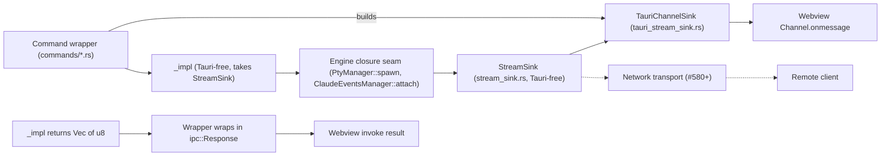

# Stream sink: per-call streams and binary reads (#578)

A daemon cannot import `tauri::ipc` (#575). `EventSink` (#577, see
[skeind-event-sink.md](skeind-event-sink.md)) covers broadcast events;
`StreamSink<T>` covers the stream one call opens: PTY output, harness
events, watcher ticks. Each command is now a thin Tauri wrapper that
wraps its `ipc::Channel` in a `TauriChannelSink` and calls a Tauri-free
`_impl`. A network transport (#580 onward) will implement the same
trait later, with no change to the impls.

Figure: the stream path and the binary-read path. Renders
`stream_sink.rs` and `tauri_stream_sink.rs` in `app/src-tauri/src`;
non-normative, the code is authoritative.

## Streams per command

| Command | Item | Wrapper | Impl | A failed send |
| --- | --- | --- | --- | --- |
| `harness_ensure_running` (was `pty_spawn`, #731) | `PtyEvent` | `commands/harness_runner.rs` | `HarnessRunner::ensure_running` over `pty_spawn_with_sink` | ignored; the sink is replaceable and detach never kills |
| `claude_events_attach` | `ClaudeEvent` | `commands/harness_events.rs` | `claude_events_attach_impl` | one warn per attach, keeps sending |
| `opencode_events_attach` | `OpencodeEvent` | `commands/harness_events.rs` | `opencode_events_attach_impl` | ignored |
| `hermes_work_attach` | `HermesWorkEvent` | `commands/hermes_work.rs` | `hermes_work_attach_impl` | stops the `Poller` |
| `git_watch_start` | `()` | `commands/git.rs` | `git_watch_start_impl` | ignored |
| `git_head_watch_start` | `()` | `commands/git.rs` | `git_head_watch_start_impl` | ignored |
| `design_watch_start` | `()` | `design/commands.rs` | same file, no `_impl` | ignored |

## Binary reads

`read_image_bytes_impl` (`fs.rs`) and `image_bytes_impl`
(`review_surface/image.rs`, behind `review_image_bytes`) return
`Vec<u8>`; only the wrappers build `tauri::ipc::Response`. Decision for
this phase: bytes in, bytes out, in-process only. Deferred: whether the
wire carries binary frames or base64 in JSON (recon open question 9),
to be decided with the transport (#580 onward).

## Deliberate leftovers

- `pty_spawn_impl` takes a `stop_sidecar` closure: managed state is not
  `Arc`-wrapped and the exit callback must be `'static`.
  `OpencodeSidecarManager` is already a cheap shared clone, so a later
  phase can pass it directly. Since #731 the closure is built by
  `HarnessRunner` (from its own manager clone), not by a Tauri wrapper.
- Engines keep their `Fn(T)` closure seams; the `_impl` adapts the sink.
- `review.rs`, `design/commands.rs` and `review_surface/commands.rs`
  still mix wrappers and logic in one file (no `tauri::ipc` in their
  logic).
- `perf_cmds.rs` uses `tauri::ipc::Invoke` to time the invoke handler;
  client-shell only.
