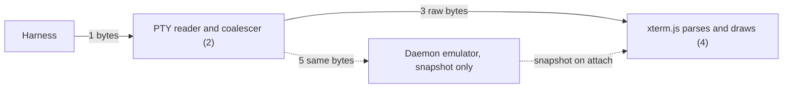
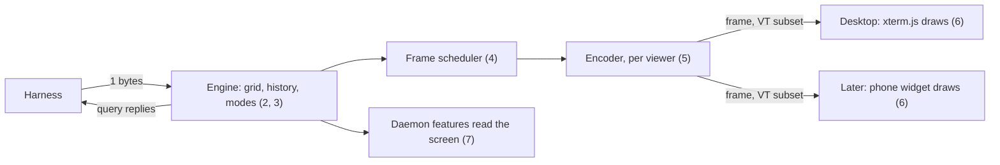
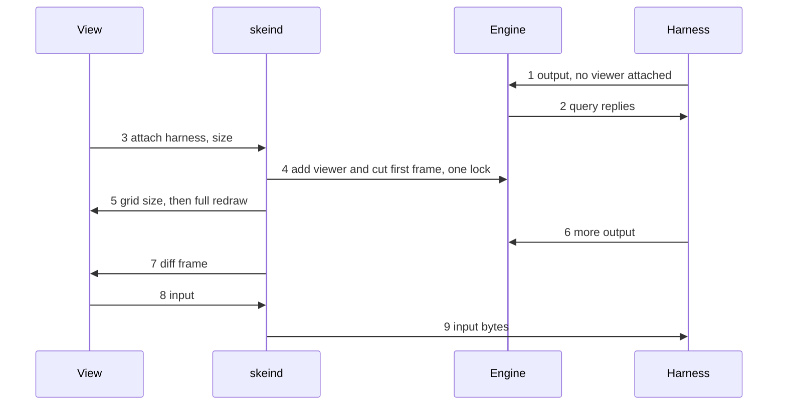
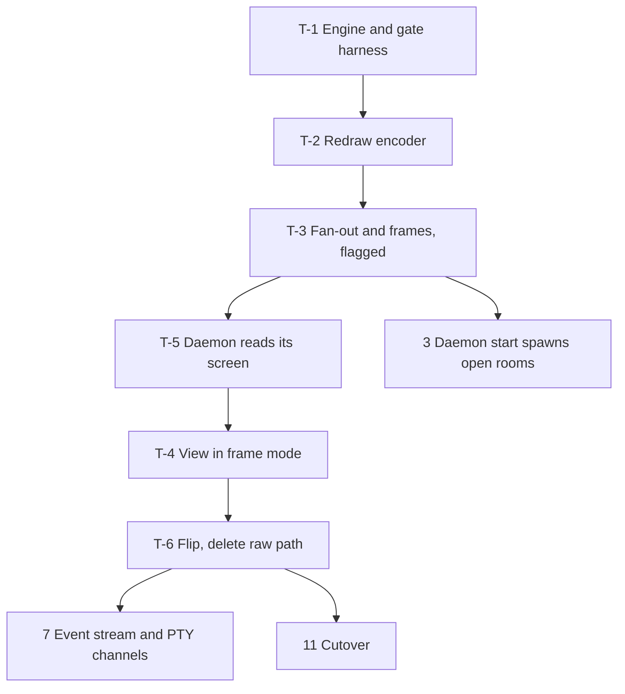

# skeind P2b: the daemon-owned terminal (#584)

This doc replaces the "snapshot, then raw live bytes" terminal flow of
[skeind-p2b-design.md](skeind-p2b-design.md) (its D2 consequences, its
section "The PTY channel and the snapshot", and slices 1 and 2). The
rest of that doc stands. A user-facing picture of the change is in
[explainers/daemon-owned-terminal.html](explainers/daemon-owned-terminal.html).

In one sentence: the daemon's terminal engine is the only thing that
ever parses harness PTY output, and a client only draws what the daemon
sends it. This is the tmux and mosh model.

## Why

The first P2b design kept a headless emulator in the daemon for the
re-attach snapshot and then forwarded the harness's raw bytes, which
the client's own engine (xterm.js) parsed. Two engines parsed the same
stream.

Slice 1 (#793) built a replay gate that compares the `vt100` crate with
`@xterm/headless` on a recorded Claude Code session and on a synthetic
scrollback session, 24 cut points in all. Its findings, received from
that room on 2026-11-18:

| # | Mismatch | Kind | Fixable from outside the engine |
| --- | --- | --- | --- |
| 1 | OSC 8 hyperlinks lost (16 cuts) | `vt100` gap, no per-cell link | No |
| 2 | No reflow on a width change; data past the narrowest width is lost | `vt100` gap | No |
| 3 | Wrap flag cleared on any width change (alternate buffer) | `vt100` gap | No |
| 4 | Stale wrap flag on a row rewritten after CR LF | Engine difference | No |
| 5 | A wide character pushed to the next row sets no wrap flag | `vt100` gap, cosmetic | No |
| 6 | Wide character straddling the last column after a shrink | xterm.js quirk | No |
| 7 | `?1049h` homes the cursor in `vt100`, keeps it in xterm.js | Engine difference | No |
| 8 | Modes 1004, 2026, insert, `?7`, `?45` not tracked | `vt100` gap | Flag only, through a callback |
| 9 | A snapshot inside a synchronized (2026) frame shows it half drawn | Both engines | No |

Items 4, 6 and 7 are not bugs in either engine. They are places where
two correct engines disagree, and more of them appear for as long as
two engines parse the same bytes. The same holds for any later client:
an iOS or Android terminal widget is a third engine.

The same room also found that the xterm.js serialize addon has its own
flaws (it never emits OSC 8, and it misplaces the cursor on an exactly
full last row), so "use xterm.js on both ends" does not close the gap
either.

## Decisions

Each was asked of the user and decided on 2026-11-18.

### T1. One engine, in the daemon

Decided by Stefan, 2026-11-18.

**Decision.** The daemon keeps one terminal engine per PTY. It is the
only parser of harness output. Clients receive what the daemon derives
from its own grid, never the harness's bytes.

**Reason.** The app is a dumb view and the daemon owns everything. Two
engines on one byte stream drift, and the drift cannot be fixed without
patching an emulator.

**Rejected.**
- Snapshot on attach, then raw live bytes (the earlier D2 flow).
- The same engine on both ends (a Node sidecar running
  `@xterm/headless`): it needs a Node runtime beside the daemon, and it
  binds every future client to xterm.js.

**Consequences.**
- D2's requirement stands: a re-attaching view gets full styled
  scrollback. Only its mechanism changes.
- The engine sits in the live path, so its gaps show always, not only
  on re-attach. Engine fidelity matters more than before (T3).

### T2. The client protocol is a VT redraw in a fixed subset

Decided by Stefan, 2026-11-18.

**Decision.** The daemon diffs its grid per viewer and sends each
change as a frame of VT sequences from a small fixed subset. Any
terminal widget can draw it: xterm.js on the desktop today, a native
widget on a phone later.

**Reason.** The desktop keeps xterm.js as its painter, with selection,
copy, links and font rendering as they are. The wire stays a byte
stream, so the socket slice (#796) barely changes. The encoder is
written once, in the daemon, for every client.

**Rejected.**
- Cell diffs drawn by a grid view we write (mosh's model taken all the
  way): zero drift, but a terminal renderer per platform plus our own
  selection, copy, link hit-testing, IME and accessibility, in the area
  where most shipped regressions have lived.
- Cell diffs on the wire with xterm.js as the painter: a new binary
  frame format to version, and the frame-to-VT translator repeated in
  every client.

**Consequences.**
- xterm.js still parses, but only sequences the daemon generates. Its
  state can no longer drift for good: a full redraw always resyncs it.
- Known residual: a client that measures a character's width
  differently from the daemon. The encoder re-positions the cursor
  after every wide or ambiguous-width cluster, so an error stays inside
  one cell run.
- Each frame is self-contained, so a second encoding of the same
  per-viewer diff (structured cells for a native view) can be added
  later without touching the engine.

### T3. The engine is `alacritty_terminal`, behind a trait, gated first

Decided by Stefan, 2026-11-18.

**Decision.** `alacritty_terminal` 0.26.0 is the engine. It sits behind
the engine trait, and the first slice runs the #793 fixtures through it
before anything depends on it.

**Reason.** It is the only candidate with a sourced answer for all
three hard gaps: per-cell hyperlinks, reflow of the main screen, and
synchronized output. It also has damage tracking, mode flags and
replies to device queries. It is pure Rust, on crates.io, and builds on
Windows.

**Rejected.**
- `vt100` (0.18.1), the #793 engine: no OSC 8, no reflow, no 2026, no
  query replies. Upstream closed reflow unmerged and has not reviewed
  the hyperlink change, so a fix means owning a fork.
- `libghostty-vt` (0.2.2): the highest fidelity claims, but a
  third-party binding over a pre-1.0 C API, Zig 0.17 on every build
  machine and in the release pipeline, and no proof found that it
  builds on Windows.
- `wezterm-term`: not on crates.io; git-only or a third-party fork.

**Consequences and what is verified.** Verified means read in the
crate's source, docs or changelog on 2026-11-18. Nothing here has been
compiled or run; that is the gate's job.

- Verified: hyperlinks per cell; `Term::resize` reflows the main grid
  and never the alternate grid; a `Term` plus the `vte` processor runs
  with no PTY; history through the scrolling-history setting; no
  serialiser of any kind, so the redraw encoder is ours.
- Verified: synchronized output is handled in the `vte` processor by
  buffering, up to 150 ms or 2 MiB. A frame is cut only when no
  synchronized update is pending.
- Verified: it pulls PTY and event-loop dependencies with no feature
  gate. They are unused here.
- Claimed, for the gate to confirm: a per-line damage API; device-query
  replies delivered through its event listener; kitty keyboard flags
  readable.
- Known gap: no grapheme-cluster mode. Wide and zero-width characters
  are stored per cell.
- Fallbacks if the gate fails, in order: a spike of `libghostty-vt`
  including a Windows build; then a patched `vt100`.

### T4. The new path lands beside the old one, behind a developer flag

Decided by Stefan, 2026-11-18.

**Decision.** The new terminal path lands on main slice by slice, off
by default. A developer flag turns it on; the flag is not in Settings.
Today's raw-bytes path stays the default and untouched until the new
one passes the gate and a dogfood pass. Then one slice flips the
default and deletes the old path.

**Reason.** Skein must work out of the box at every step on main. D1
rejected an opt-in switch with the default flipped later, for the
daemon mode. This is a deliberate, narrower exception, decided by the
user with D1 in view: the flag is for developers only, it covers the
terminal path only, and the slice that deletes it is planned from the
start.

**Rejected.**
- A long-lived integration branch: one large merge at the end, growing
  conflicts with the other #584 slices in `harness_runner/` and `pty/`,
  and no dogfooding from main.
- A per-harness switch in Settings: the second product path D1
  rejected.

**Consequences.**
- Proposed: the flag is an environment variable read once at daemon
  start, `SKEIN_TERMINAL=frames`. Unset means today's path. The spawn
  result tells the view which mode a harness runs in.
- Two terminal paths exist in the tree for the length of the work. The
  flip slice deletes the old one, and rollback is a revert of the flip.
- Proposed: the flip lands before the cutover (slice 11 of the P2b
  doc), so the socket only ever carries frames and no release ships
  detached mode with the raw path.

## The flow

Old, as built today and as the first P2b design kept it for live
output:

1. The harness writes bytes to its PTY.
2. The daemon's reader and coalescer batch them (16 ms, 64 KB).
3. The daemon forwards the raw bytes to the view.
4. xterm.js in the webview parses them and draws.
5. (First P2b design only.) A second engine in the daemon parses the
   same bytes, for the re-attach snapshot.



Figure 1: the old flow, two parsers on one byte stream. Renders the
numbered steps above; the text is authoritative (non-normative).

New:

1. The harness writes bytes to its PTY.
2. The daemon feeds them to that PTY's engine, the only parser. The
   engine answers device queries itself.
3. The engine marks what changed (damage). History rows that leave the
   screen stay in the engine.
4. The frame scheduler waits for the coalescing window and for any
   synchronized update to finish.
5. For each viewer, the encoder diffs the grid against what that viewer
   was last sent and writes one frame in the VT subset.
6. The client writes the frame into its terminal widget, which draws.
7. Daemon features (Hermes screen phase, prompt delivery, pane notices)
   read the engine, with or without a client.



Figure 2: the new flow, one parser and dumb viewers. Renders the
numbered steps above; the text is authoritative (non-normative).

## The engine

One engine per PTY, created at spawn at the PTY's size, alive until the
harness record is removed. It outlives the child, so an exited pane
keeps its screen.

```text
trait TerminalEngine: Send {
    feed(bytes) -> replies      // bytes to write back to the PTY
    resize(rows, cols)
    frame(view) -> Option<bytes> // diff against that view's last frame
    screen_text() -> rows        // for daemon features
    modes() -> Modes             // bracketed paste, mouse, alt screen
    cursor() -> (row, col)
}
```

- `frame` with a fresh view state is the attach snapshot. There is no
  separate snapshot code path.
- `frame` returns nothing while a synchronized update is pending, so no
  viewer ever sees a half-drawn frame (mismatch 9).
- `feed` returns the engine's replies to device queries (cursor
  position, device attributes). The daemon writes them to the PTY. This
  replaces both the fixed `1;1` answer the daemon gives with no view
  attached, or when a send to the view fails, and the answer xterm.js gives through the input path today.
- History is bounded at 5000 rows, the client's scrollback setting
  today (`HISTORY_ROWS` in the #793 work).
- Nothing but the harness's own output is ever fed to the live parser.
  A PTY chunk often ends in the middle of an escape sequence or a UTF-8
  character, so injected bytes abort the pending sequence and garble
  the next chunk (found by the #793 room, whose snapshot once did
  this). Reads, frames and notices work on the grid, never through
  `feed`.
- Every call is wrapped in `catch_unwind`. A caught panic drops that
  PTY's engine, rebuilds it empty at the current size, and marks every
  viewer for a full redraw. It does not kill the daemon.

## The frame

A frame is a byte string in this subset and nothing else:

- Cursor position, absolute (`CUP`).
- Colours and attributes (`SGR`), always starting from a reset.
- Printable text.
- Erase to end of line (`EL`), erase display and scrollback at a full
  redraw.
- Line feed at the bottom row, only to push rows into the client's
  scrollback.
- OSC 8 open and close around linked runs.
- Cursor visibility and shape.
- Mode mirrors, so the client encodes input correctly: application
  cursor keys and keypad, mouse tracking and its encoding, bracketed
  paste, focus reporting, kitty keyboard flags, alternate screen.
- Title (OSC 0/2) and bell, passed on as they happen.
- Synchronized-update brackets around the whole frame.

Modes and the title are state, not events. Each viewer's last-sent
state includes them, and a frame carries only the difference, so a
viewer that skipped frames still ends in the right modes. The bell is
an event: it is sent with the next frame and several bells in one
frame collapse to one.

Not in the subset: scroll regions, insert and delete line or character,
relative cursor moves, tabs, character sets, origin mode, any query.

Rules the encoder follows:

- Screen rows. For each damaged row that differs from what the viewer
  has: position, reset, write the runs, erase the rest.
- Wrapped rows. Proposed: where the engine marks a row as the
  continuation of the one above, the encoder writes through the right
  margin with autowrap on, so the client's widget sets its own wrap
  flag. Copy then joins the line and the file-path links still match
  across rows. The gate compares wrap flags; if this proves unreliable
  the fallback is no wrap flags in the client. A row that ends early
  because a wide character did not fit is not written through the
  margin: the next row is positioned absolutely and gets no wrap flag
  in the client (mismatch 5, cosmetic).
- History. The client keeps a local scrollback that only the daemon
  fills. The engine wrapper keeps a monotonic count of rows that have
  entered history, and each viewer's state holds the count at its last
  frame. The difference is k, the rows to push. A history-size delta is
  not used, because it stops growing once history is full. Only rows
  that enter history count: a scroll inside a scroll region, or an
  insert or delete line, is plain row damage. To push k rows: repaint
  the viewer's top k rows with their final content, send k line feeds
  at the bottom row, then repaint the damaged screen rows. More than a
  screenful goes in batches. If k is larger than the history bound, or
  cannot be derived, the viewer gets a full redraw. T-1 must show the
  engine can report rows entering history; this is not verified.
- Alternate screen. Each viewer's last-sent state holds both screens.
  On entry the mode mirror switches the client's buffer, and a full
  repaint of the alternate screen with an explicit cursor follows, so
  engine differences on entering it (mismatch 7) are overwritten. On
  exit the mode mirror switches the client back, the main screen is
  diffed against the viewer's stored main screen, and the cursor is set
  explicitly. No history is pushed while the alternate screen is
  active. The alternate screen has no history. Claude Code enters it at
  start and never leaves (#793 fixture), so its common case is plain
  row diffs.
- Width change. The engine reflows. Every viewer then gets a full
  redraw: clear screen and scrollback, the history as flowing lines,
  the screen, modes and cursor. The client's own reflow result is never
  used. A height-only change sends no history again. A width change
  resets the client's scroll position and selection; this is a known
  cost.

Framing and rate:

- The wire is the existing PTY data event, now carrying frames. A
  frame is never split across events.
- The scheduler has a leading edge: the first output after a quiet
  period is cut at once, so a keystroke echo does not wait. After that
  it cuts at most one frame per 16 ms per PTY, the window the coalescer
  uses today, and output inside the window lands in the next frame. A
  synchronized update holds the frame until it ends, at most the
  engine's 150 ms; that delay is the harness's own request.
- Per viewer the daemon keeps the last-sent screen and one pending
  frame at most. A slow viewer skips intermediate states and gets one
  larger diff. Nothing queues without bound.
- A PTY with no output costs nothing.

## Attach, reconnect, several viewers

- Attach adds the viewer and cuts its first frame under one lock. The
  first frame is a full redraw: history, screen, modes, cursor.
- Reconnect is an attach. The PTY stream is state, not a log: the
  event seq and replay of #757 cover events (rooms, phase, mail), and a
  terminal resyncs from the engine. A `gap` on the event stream needs
  no terminal action.
- A view can ask for a full redraw at any time. This replaces the
  one-row resize repaint.
- Several viewers share one PTY and one grid. The PTY has one size
  owner: the last active client, re-asserted when it becomes active
  again (unchanged from the P2b doc). Proposed: a viewer that is not
  the owner sets its widget to the grid's size and letterboxes or
  scrolls it; it becomes the owner on input. Each frame stream starts
  with the grid size and announces a change before the redraw.
  Proposed: the owner's resize is debounced (a short trailing delay)
  before the PTY and the engine are resized, so a window drag causes
  one reflow, not one per pixel. Ownership moves only when a viewer
  becomes active (focus and input) and its size differs. Two viewers of
  different sizes typing in turn will flip the size each time; this is
  accepted, as in tmux, and listed under Risks.
- Input from any viewer is written to the PTY.

1. The harness writes output with no viewer attached, and the engine
   parses it.
2. The engine answers the harness's device queries.
3. A view attaches and sends its size.
4. The daemon adds the viewer and cuts its first frame under one lock.
5. The daemon sends the grid size, then a full redraw.
6. More output arrives.
7. The daemon sends a diff frame.
8. The view sends input.
9. The daemon writes it to the PTY.



Figure 3: attach and live frames. Renders the numbered steps above;
the text is authoritative (non-normative).

## What the client still owns

| Concern | Who | How |
| --- | --- | --- |
| Input encoding (keys, mouse, paste, bracketed paste) | Client widget | It encodes from the mirrored modes and sends bytes, as today (`pty_write`). The daemon is the authority for the modes |
| Selection and copy | Client | Local, over the local screen and scrollback |
| Scrollback browsing | Client | Local scrollback filled by the daemon, 5000 rows. Rejected for now: daemon-paged scrollback (a round trip per scroll and a new UI). Worth revisiting for a remote or phone client |
| Resize | Size owner | The owner fits its pane and sends the size; the daemon resizes PTY and engine |
| Links (OSC 8) | Client | The daemon re-emits OSC 8; the widget's link handler is unchanged |
| URL and file-path links | Client | They read the client's buffer, as today. They need the wrap flags above |
| Bell, title | Daemon passes on | Neither is used by the app today |
| Focus events | Client widget | Sent when the mirrored focus mode is on |
| Device-query replies | Daemon engine | The client never sees a query |
| macOS wheel reports | Client | Read the mirrored mouse mode, as today |

What is lost or different:

- Inline images (sixel, kitty, iTerm): not drawn. The engine has none.
  Nothing is lost against today, because the app loads no image addon.
- Anything the engine does not model is invisible to every client. This
  is the price of one engine, and the reason for T3.
- Character width follows the daemon's engine, not the client's
  Unicode table.
- Local writes into the widget are no longer allowed, because they
  would differ from what the daemon thinks the viewer shows. See
  "Pane notices" below.

## Impact on features that read terminal output

Found by a code survey on 2026-11-18.

| Feature | Today | With the engine |
| --- | --- | --- |
| ConPTY cursor query | With no view attached, or when a send to the view fails, the daemon scans for the query and answers a fixed `1;1` (`pty/sink_slot.rs`); with a view xterm.js answers, and the view buffers that answer during spawn (`ptyInputBuffer.ts`) | The engine answers always, from its real cursor. Both mechanisms are deleted at the flip |
| Hermes screen phase | The webview reads its xterm buffer every second and reports a reading (`screenPhase.ts`, `setScreenReading`); `unknown` with no client | The daemon reads `screen_text` itself. The reader is ported to Rust and the client input is deleted at the flip |
| Prompt delivery, paste mode | A tracker parses the bracketed-paste mode out of raw output (`prompt_delivery/paste_mode.rs`) | Reads the engine's mode flag. The tracker is deleted at the flip. The write path is unchanged. The webview's own read of the same mode off its widget keeps working through the mode mirror. |
| Composer check before a send | The webview reads the visible screen (`harnessInputRegistry.ts`) | Unchanged for now: the client's buffer holds the same screen. Proposed follow-up: the daemon's gate reads the engine |
| Pane notices ("Press Enter for shell", the opencode restart hint, the session notice) | Written by the webview into its own terminal, not the PTY | The daemon authors them, so every viewer sees them and no viewer's state diverges. They never go through the live parser: a notice after exit is appended once the stream has ended, and a notice on a running pane is a daemon-owned overlay row the encoder draws. The exact form is decided in T-5 |
| Post-exit shell | Enter on an exited pane asks the daemon for a shell | Unchanged. The shell is a new child on the same engine or a fresh one; decided in the slice |
| Opencode shell follow (#517) | Output ticks in the view trigger a process scan | Unchanged: a frame is an output tick. It can move to the daemon later |
| Idle heuristic and waiting patterns | The daemon strips escapes from raw output into a tail and matches it (`harness_phase/io.rs`, `patterns.rs`) | Unchanged. It is a second, very small reader of raw bytes inside the daemon. Proposed follow-up: match engine rows instead |
| Re-attach repaint | A one-row resize and back (`terminalRepaint.ts`) | Deleted at the flip. The first frame is the repaint |
| Output gate in the view | Buffers and slices writes to xterm.js | Unchanged |
| Font size and zoom | The view refits its pane and sends a new size | Unchanged for the size owner. A non-owner's zoom changes only how large the shared grid is drawn |

## Delivery

The order keeps main working out of the box (T4):

1. The engine, the encoder and the gate land as library code. Nothing
   calls them in the product.
2. The fan-out and the frame path land behind the flag. With the flag
   unset every byte takes today's path.
3. The daemon learns to read its own screen and to author pane
   notices, then the view learns the frame mode, both only when the
   flag is on.
4. Dogfood with the flag on, on the dev and local-release profiles.
5. The flip: frames become the only path, and the raw path, the flag
   and the helpers listed above are deleted.
6. The socket work (slice 7) and the cutover (slice 11) follow the
   flip.

The flip's conditions: the gate is green with no unexplained cut, a
keystroke-echo measurement shows no regression against the raw path,
and the dogfood pass has run with Claude Code, opencode and a plain
shell on Windows and macOS.

## The gate, second version

The #793 gate stays, with a different second terminal:

- Terminal A: `@xterm/headless` fed the recorded raw stream up to the
  cut. This is what a user saw before the change.
- Terminal B: a fresh `@xterm/headless` fed what the daemon sends: the
  frames up to the cut, and separately a full redraw taken at the cut.
- Compared by category, as #793 does: active buffer, cursor, screen
  cells, history and its wrap flags, screen wrap flags, hyperlinks,
  modes.
- Expected differences are pinned per fixture, cut and category with
  their mechanism. An unexpected difference fails; so does a stale pin.
- Added checks: no frame is cut inside a synchronized update; a diff
  stream and a full redraw at the same cut give the same terminal; a
  skipped-frame viewer converges with one that saw every frame.

The fixtures are the two from #793: one real Claude Code session with
four resizes, and a synthetic scrollback session. The real one is
scrubbed but not yet approved by the user for a public repo.

## Slices

These replace slices 1 and 2 of the P2b doc and add four. The other
slices keep their numbers there.

| Slice | Issue | Content |
| --- | --- | --- |
| T-1 | #793, rescoped | Engine trait, `alacritty_terminal` implementation, `catch_unwind`, the fixtures and gate harness from the #793 room. The `vt100` implementation is not landed |
| T-2 | new | Redraw encoder: grid to VT-subset frames, full and diff, wrap, history push, mode mirrors. Pure and table-tested, plus the gate's second version |
| T-3 | #760, rescoped | PTY subscribers, frame scheduler, per-viewer state, attach as a full redraw, one size owner, engine query replies. Behind the flag |
| T-4 | new | The view in frame mode: no local writes, no repaint hack, grid size from the daemon for a non-owner, redraw request. Only when the spawn result says frames |
| T-5 | new | The daemon reads its own screen: Hermes screen phase in Rust, paste mode from the engine, daemon-authored pane notices. Behind the flag |
| T-6 | new | The flip: frames by default; delete the raw path, the flag, the cursor-query scanner, `terminalRepaint.ts`, `ptyInputBuffer.ts`, the `setScreenReading` input, `screenPhase.ts`, `screenPhaseTick.ts` and `paste_mode.rs` |

Order: T-1, then T-2, then T-3, then T-5, then T-4. T-6 follows T-4
and the dogfood pass. T-5 comes before T-4 because T-4 forbids local
writes into the widget, and the pane notices are written locally until
T-5 makes the daemon author them.



Figure 4: the terminal slices and where they meet the P2b slices.
Renders section "Slices"; the text is authoritative (non-normative).

### Proposed issue changes

Nothing has been edited on GitHub. These are for the user to approve.

| Issue | Change |
| --- | --- |
| #793 (P2b-1) | Rescope and retitle: "engine trait, `alacritty_terminal` implementation and the replay gate". Keeps the trait, fixtures, gate harness and `catch_unwind`; drops the `vt100` implementation and the snapshot-only trait |
| #760 (P2b-2) | Rescope and retitle: "PTY subscribers, per-viewer frames, attach as a full redraw, one size owner". Drops "then live bytes"; adds the scheduler and engine query replies; lands behind the flag |
| #759 (P2b-3) | Scope unchanged. It still follows the fan-out slice (now T-3), and the last known size on the record becomes the engine's first size |
| #796 (P2b-7) | Small change: the PTY channel carries frames, plus the grid size and the redraw request. Adds a dependency on T-6 |
| #800 (P2b-11) | Scope unchanged. Adds a dependency on T-6 |
| #801 (P2b-12) | Adds this doc, CLAUDE.md's PTY and Data flow text, and the stale terminal wording in docs/skeind-port-review.md and docs/skeind-p2-design.md to its list |
| #794, #795, #797, #798, #799 | No change |
| new, T-2 | "skeind P2b: redraw encoder, grid to VT-subset frames" |
| new, T-4 | "skeind P2b: the terminal view in frame mode" |
| new, T-5 | "skeind P2b: the daemon reads its own screen (Hermes phase, paste mode, pane notices)" |
| new, T-6 | "skeind P2b: flip to frames and delete the raw terminal path" |

No issue closes.

## Proposed decisions not put to the user

Each is Proposed and can be reopened.

- Local scrollback filled by the daemon, with a full resend on a width
  change, over daemon-paged scrollback.
- Wrap flags kept in the client by writing through the margin, subject
  to the gate.
- A viewer that is not the size owner shows the grid at the owner's
  size.
- The flag is an environment variable read at daemon start.
- The flip lands before the socket PTY channel and the cutover.
- The idle heuristic and the waiting patterns keep reading raw output
  for now.
- OSC 52 (clipboard writes from a harness) stays ignored, as today.

## Risks

- **The engine has not been run.** Every `alacritty_terminal` fact here
  is read, not measured. Mitigation: T-1 is the gate and nothing
  depends on the engine before it is green; fallbacks are named in T3.
- **Engine gaps are always visible.** There is no client engine to
  cover for the daemon's. Mitigation: the gate compares against what
  xterm.js showed from the raw stream, and the flip waits for it.
- **Character width differs between daemon and client.** Mitigation:
  the cursor is re-positioned after wide and ambiguous clusters; the
  fixtures hold CJK and emoji.
- **Wrap flags through the margin are fragile.** Mitigation: the gate
  compares them; the fallback loses joined copy and cross-row path
  links, nothing else.
- **Keystroke echo latency.** Parsing and encoding are added; the 16 ms
  window already exists. Synchronized updates can hold a frame up to
  150 ms, by the harness's own request. Mitigation: measure before the
  flip.
- **CPU and memory with many harnesses.** One grid and 5000 history
  rows per PTY, plus a last-sent screen per viewer. Mitigation: an idle
  PTY costs nothing; measure at the dogfood pass.
- **Two terminal paths until the flip.** Mitigation: the old path is
  untouched and default; the new one is reached only through the flag;
  T-6 deletes one of them.
- **Size flips with two active viewers.** Two viewers of different
  sizes typing in turn resize the PTY each time, and a width change is
  a full redraw for both. Mitigation: debounce, and ownership moves
  only on focus and input; revisit if it shows in use.
- **An exited pane keeps its engine.** The grid and history stay in
  memory until the harness record is removed. Mitigation: bounded at
  5000 rows per PTY; measure at the dogfood pass.
- **Unused dependencies.** `alacritty_terminal` brings PTY and
  event-loop crates. Mitigation: none needed beyond noting it in
  `docs/skeind-crates.md`.
- **The recorded fixture is not yet approved for a public repo.**
  Mitigation: the user reviews it before T-1 lands, or T-1 lands with
  the synthetic fixture only.

## Sources

- The #793 room's handover, 2026-11-18: mismatch list, engine notes,
  fixtures and gate design.
- Engine research, 2026-11-18: crates.io metadata for `vt100`,
  `alacritty_terminal`, `termwiz` and `libghostty-vt`; the `vt100` and
  Alacritty changelogs; the wezterm `term` manifest; the
  `libghostty-rs` README.
- Not verified: the tmux and mosh mechanics are from general knowledge;
  xterm.js's handling of synchronized-update brackets is to be checked
  in T-2 (a widget that ignores them still draws correctly).
